# vericto-bench report: m2-quick

| Run | Profile | Topology | Proxy image | Harness commit | Started | Finished |
| --- | --- | --- | --- | --- | --- | --- |
| bench-2026-11-m2-quick-1 | quick | two-host | `docker.io/vericto/vericto-proxy:4.14.2@sha256:0446e4357183cf676461c2eac42377d0e331ad19d044d12cde1045608785eb6b` | `d4eef3b` | 2026-10-22T17:42:20.866288+00:00 | 2026-10-22T20:54:56.099512+00:00 |

Cells: 148 recorded, 132 used, 0 invalid (listed at the end, not used).

## Added latency (open loop, from intended send time; target minus direct, paired)

| Curve | Target | Rate/s | % of S | n | added p50 ms [95%] | added p99 ms [95%] | added p99.9 ms [95%] | Note |
| --- | --- | --- | --- | --- | --- | --- | --- | --- |
| bytes-pg-payload-100k | vericto-enforce-4143 | 50 | - | 3 | 0.212 [0.152, 0.272] | 0.237 [0.200, 0.274] | 0.282 [0.271, 0.292] |  |
| bytes-pg-payload-100k | vericto-enforce-4150-observe | 50 | - | 3 | 0.250 [0.127, 0.374] | 0.263 [0.212, 0.314] | 0.503 [-0.266, 1.272] | not distinguishable from the direct path |
| bytes-pg-payload-100k | vericto-enforce-4150-off | 50 | - | 3 | 0.231 [0.167, 0.294] | 0.241 [0.220, 0.263] | 0.502 [-0.251, 1.255] | not distinguishable from the direct path |
| head-my-w3-05 | vericto-enforce-4143 | 109 | 30 | 3 | 1.613 [1.564, 1.661] | 3.806 [3.708, 3.904] | 4.465 [4.256, 4.674] |  |
| head-my-w3-05 | vericto-enforce-4143 | 182 | 50 | 3 | 1.546 [1.503, 1.589] | 4.098 [4.015, 4.181] | 5.706 [4.050, 7.362] |  |
| head-my-w3-05 | vericto-enforce-4143 | 254 | 70 | 3 | 1.532 [1.477, 1.587] | 4.459 [3.942, 4.977] | 10.255 [5.713, 14.796] |  |
| head-my-w3-05 | vericto-enforce-4150-observe | 109 | 30 | 3 | 1.681 [1.569, 1.792] | 4.170 [4.100, 4.240] | 4.875 [4.447, 5.303] |  |
| head-my-w3-05 | vericto-enforce-4150-observe | 182 | 50 | 3 | 1.587 [1.567, 1.608] | 4.587 [4.496, 4.678] | 5.543 [5.026, 6.061] |  |
| head-my-w3-05 | vericto-enforce-4150-observe | 254 | 70 | 3 | 1.509 [1.435, 1.584] | 5.029 [4.927, 5.131] | 13.409 [6.292, 20.527] |  |
| head-my-w3-05 | vericto-enforce-4150-off | 109 | 30 | 3 | 1.633 [1.610, 1.655] | 3.771 [3.493, 4.049] | 4.387 [4.071, 4.703] |  |
| head-my-w3-05 | vericto-enforce-4150-off | 182 | 50 | 3 | 1.658 [1.603, 1.713] | 4.286 [4.183, 4.389] | 5.951 [3.072, 8.831] |  |
| head-my-w3-05 | vericto-enforce-4150-off | 254 | 70 | 3 | 1.528 [1.428, 1.628] | 4.455 [4.352, 4.559] | 9.572 [7.740, 11.404] |  |
| head-pg-w1-05 | vericto-enforce-4143 | 1730 | 30 | 3 | 0.120 [0.117, 0.124] | 1.339 [1.114, 1.564] | 7.451 [0.666, 14.236] |  |
| head-pg-w1-05 | vericto-enforce-4143 | 2883 | 50 | 3 | 0.126 [0.119, 0.132] | 2.658 [2.320, 2.995] | 7.415 [2.320, 12.510] |  |
| head-pg-w1-05 | vericto-enforce-4143 | 4036 | 70 | 3 | 0.133 [0.132, 0.135] | 3.263 [3.184, 3.341] | 13.462 [7.137, 19.787] |  |
| head-pg-w1-05 | vericto-enforce-4150-observe | 1730 | 30 | 3 | 0.124 [0.118, 0.131] | 1.995 [1.824, 2.166] | 7.832 [4.265, 11.399] |  |
| head-pg-w1-05 | vericto-enforce-4150-observe | 2883 | 50 | 3 | 0.132 [0.128, 0.136] | 3.487 [2.809, 4.164] | 7.300 [2.271, 12.329] |  |
| head-pg-w1-05 | vericto-enforce-4150-observe | 4036 | 70 | 3 | 0.143 [0.137, 0.148] | 4.168 [3.917, 4.419] | 17.421 [8.367, 26.474] |  |
| head-pg-w1-05 | vericto-enforce-4150-off | 1730 | 30 | 3 | 0.120 [0.117, 0.124] | 1.361 [1.059, 1.664] | 5.988 [0.904, 11.072] |  |
| head-pg-w1-05 | vericto-enforce-4150-off | 2883 | 50 | 3 | 0.125 [0.112, 0.138] | 2.674 [2.393, 2.954] | 8.573 [7.122, 10.023] |  |
| head-pg-w1-05 | vericto-enforce-4150-off | 4036 | 70 | 3 | 0.139 [0.136, 0.142] | 3.427 [3.112, 3.742] | 15.926 [12.228, 19.624] |  |
| size-pg-batch1000-1 | vericto-enforce-4143 | 10 | - | 3 | 6.323 [6.021, 6.624] | 3.224 [-9.235, 15.683] | 2.795 [-11.827, 17.416] | not distinguishable from the direct path |
| size-pg-batch1000-1 | vericto-enforce-4150-observe | 10 | - | 3 | 6.267 [6.086, 6.447] | 6.003 [5.772, 6.233] | 6.448 [5.857, 7.039] |  |
| size-pg-batch1000-1 | vericto-enforce-4150-off | 10 | - | 3 | 6.261 [6.110, 6.413] | 3.163 [-9.570, 15.896] | 5.616 [2.414, 8.818] | not distinguishable from the direct path |

## Every cell

| Cell | Status | Achieved/s | p50 ms | p99 ms | p99.9 ms | max ms | proxy vCPU | max aggregate Mbps |
| --- | --- | --- | --- | --- | --- | --- | --- | --- |
| sat-pg-w1-05.vericto-enforce-4143.c1.rep1 | ok | 4940.2 | 0.195 | 0.238 | 2.816 | 18.392 | 0.444 | 99.5 |
| sat-pg-w1-05.vericto-enforce-4150-observe.c1.rep1 | ok | 4972.3 | 0.190 | 0.241 | 3.334 | 18.848 | 0.480 | 99.6 |
| sat-pg-w1-05.direct.c1.rep1 | ok | 10342.5 | 0.094 | 0.123 | 0.146 | 0.631 | - | 88.7 |
| sat-pg-w1-05.vericto-enforce-4150-off.c1.rep1 | ok | 5072.5 | 0.188 | 0.230 | 2.808 | 20.193 | 0.463 | 101.2 |
| sat-pg-w1-05.vericto-enforce-4143.c4.rep1 | ok | 5757.2 | 0.336 | 3.181 | 48.002 | 53.477 | 0.500 | 116.1 |
| sat-pg-w1-05.vericto-enforce-4150-observe.c4.rep1 | ok | 5573.1 | 0.342 | 3.706 | 48.368 | 55.870 | 0.500 | 114.5 |
| sat-pg-w1-05.direct.c4.rep1 | ok | 28776.2 | 0.113 | 0.306 | 0.339 | 7.255 | - | 249.3 |
| sat-pg-w1-05.vericto-enforce-4150-off.c4.rep1 | ok | 5746.7 | 0.337 | 3.223 | 47.905 | 52.520 | 0.500 | 116.2 |
| sat-pg-w1-05.vericto-enforce-4143.c16.rep1 | ok | 5766.0 | 1.322 | 51.620 | 54.483 | 63.531 | 0.500 | 151.5 |
| sat-pg-w1-05.vericto-enforce-4150-observe.c16.rep1 | ok | 5573.1 | 1.350 | 51.706 | 55.297 | 69.207 | 0.500 | 114.5 |
| sat-pg-w1-05.direct.c16.rep1 | ok | 28583.9 | 0.529 | 1.183 | 1.643 | 226.477 | - | 245.2 |
| sat-pg-w1-05.vericto-enforce-4150-off.c16.rep1 | ok | 5720.8 | 1.331 | 51.652 | 54.528 | 61.144 | 0.500 | 117.3 |
| sat-my-w3-05.vericto-enforce-4150-observe.c1.rep1 | ok | 282.6 | 3.409 | 6.711 | 6.983 | 16.071 | 0.424 | 498.4 |
| sat-my-w3-05.direct.c1.rep1 | ok | 541.5 | 1.820 | 2.091 | 2.239 | 2.595 | - | 572.7 |
| sat-my-w3-05.vericto-enforce-4150-off.c1.rep1 | ok | 284.4 | 3.405 | 6.295 | 6.815 | 17.567 | 0.420 | 500.7 |
| sat-my-w3-05.vericto-enforce-4143.c1.rep1 | ok | 286.7 | 3.375 | 6.251 | 6.699 | 12.943 | 0.414 | 500.5 |
| sat-my-w3-05.vericto-enforce-4150-observe.c4.rep1 | ok | 354.1 | 5.539 | 56.895 | 60.831 | 68.607 | 0.500 | 639.8 |
| sat-my-w3-05.direct.c4.rep1 | aborted (network cap: network cap: sut-nic above 400 Mbps (3 consecutive samples)) | 0 | 0 | 0 | 0 | 0 | - | 1917.2 |
| sat-my-w3-05.vericto-enforce-4150-off.c4.rep1 | ok | 340.3 | 5.863 | 56.543 | 60.223 | 65.919 | 0.500 | 608.2 |
| sat-my-w3-05.vericto-enforce-4143.c4.rep1 | ok | 363.4 | 5.487 | 56.287 | 59.647 | 62.879 | 0.500 | 669.8 |
| sat-my-w3-05.vericto-enforce-4150-observe.c16.rep1 | ok | 320.6 | 33.439 | 83.519 | 92.223 | 94.847 | 0.500 | 574.8 |
| sat-my-w3-05.vericto-enforce-4150-off.c16.rep1 | ok | 324.0 | 31.743 | 82.111 | 94.207 | 96.831 | 0.500 | 585.2 |
| sat-my-w3-05.vericto-enforce-4143.c16.rep1 | ok | 336.3 | 28.991 | 81.215 | 91.647 | 93.055 | 0.500 | 597.5 |
| head-pg-w1-05.vericto-enforce-4143.r50.rep0.netprobe | ok | 50.6 | 0.556 | 0.707 | 0.777 | 0.777 | 0.008 | 1.5 |
| head-pg-w1-05.vericto-enforce-4150-observe.r1729.8.rep1 | ok | 1716.0 | 0.436 | 2.431 | 7.376 | 84.384 | 0.199 | 36.7 |
| head-pg-w1-05.direct.r1729.8.rep1 | ok | 1720.4 | 0.312 | 0.361 | 0.439 | 70.755 | - | 16.3 |
| head-pg-w1-05.vericto-enforce-4150-off.r1729.8.rep1 | ok | 1718.5 | 0.431 | 1.690 | 4.086 | 88.609 | 0.190 | 37.1 |
| head-pg-w1-05.vericto-enforce-4143.r1729.8.rep1 | ok | 1724.1 | 0.431 | 1.669 | 6.125 | 72.840 | 0.190 | 37.0 |
| head-pg-w1-05.direct.r4036.2.rep1 | ok | 4019.5 | 0.301 | 0.365 | 0.456 | 103.821 | - | 36.1 |
| head-pg-w1-05.vericto-enforce-4143.r4036.2.rep1 | ok | 4012.4 | 0.434 | 3.609 | 12.036 | 174.711 | 0.422 | 82.4 |
| head-pg-w1-05.vericto-enforce-4150-observe.r4036.2.rep1 | ok | 4014.2 | 0.442 | 4.438 | 13.955 | 93.676 | 0.441 | 82.3 |
| head-pg-w1-05.vericto-enforce-4150-off.r4036.2.rep1 | ok | 4023.3 | 0.441 | 3.881 | 17.795 | 56.419 | 0.437 | 82.9 |
| head-pg-w1-05.vericto-enforce-4143.r2883.rep1 | ok | 2869.8 | 0.428 | 2.857 | 6.876 | 152.143 | 0.307 | 59.6 |
| head-pg-w1-05.vericto-enforce-4150-off.r2883.rep1 | ok | 2869.8 | 0.426 | 2.980 | 8.334 | 102.615 | 0.305 | 59.5 |
| head-pg-w1-05.direct.r2883.rep1 | ok | 2879.0 | 0.305 | 0.356 | 0.433 | 106.485 | - | 71.2 |
| head-pg-w1-05.vericto-enforce-4150-observe.r2883.rep1 | ok | 2879.1 | 0.436 | 3.784 | 6.876 | 126.407 | 0.330 | 59.5 |
| head-pg-w1-05.vericto-enforce-4150-off.r5766.rep1 | saturated (achieved rate below 99% of offered) | 4731.5 | 10090.329 | 18308.511 | 18780.682 | 18842.160 | 0.500 | 106.8 |
| head-pg-w1-05.vericto-enforce-4150-observe.r5766.rep1 | saturated (achieved rate below 99% of offered) | 4222.4 | 15705.647 | 26213.923 | 26555.938 | 26605.091 | 0.500 | 100.5 |
| head-pg-w1-05.vericto-enforce-4143.r5766.rep1 | saturated (achieved rate below 99% of offered) | 4761.3 | 10022.443 | 18382.842 | 18818.908 | 18926.259 | 0.500 | 106.5 |
| head-pg-w1-05.direct.r5766.rep1 | ok | 5741.4 | 0.298 | 0.392 | 0.491 | 141.570 | - | 50.4 |
| head-pg-w1-05.vericto-enforce-4150-observe.r4036.2.rep2 | ok | 4013.0 | 0.443 | 4.522 | 18.519 | 169.350 | 0.443 | 82.2 |
| head-pg-w1-05.direct.r4036.2.rep2 | ok | 4019.5 | 0.301 | 0.366 | 0.459 | 133.732 | - | 35.6 |
| head-pg-w1-05.vericto-enforce-4150-off.r4036.2.rep2 | ok | 4011.1 | 0.441 | 3.849 | 14.831 | 111.374 | 0.431 | 82.3 |
| head-pg-w1-05.vericto-enforce-4143.r4036.2.rep2 | ok | 4020.6 | 0.434 | 3.665 | 16.818 | 134.981 | 0.423 | 82.6 |
| head-pg-w1-05.direct.r2883.rep2 | ok | 2863.3 | 0.304 | 0.356 | 0.439 | 105.629 | - | 25.9 |
| head-pg-w1-05.vericto-enforce-4143.r2883.rep2 | ok | 2865.7 | 0.432 | 3.101 | 10.210 | 140.825 | 0.310 | 58.7 |
| head-pg-w1-05.vericto-enforce-4150-observe.r2883.rep2 | ok | 2874.6 | 0.438 | 4.140 | 10.051 | 157.662 | 0.335 | 59.0 |
| head-pg-w1-05.vericto-enforce-4150-off.r2883.rep2 | ok | 2873.3 | 0.427 | 2.950 | 9.399 | 106.568 | 0.304 | 110.2 |
| head-pg-w1-05.vericto-enforce-4143.r1729.8.rep2 | ok | 1724.9 | 0.434 | 1.800 | 11.020 | 72.925 | 0.195 | 37.7 |
| head-pg-w1-05.vericto-enforce-4150-off.r1729.8.rep2 | ok | 1716.7 | 0.432 | 1.855 | 7.302 | 109.337 | 0.191 | 36.8 |
| head-pg-w1-05.direct.r1729.8.rep2 | ok | 1729.7 | 0.312 | 0.359 | 0.423 | 95.001 | - | 16.3 |
| head-pg-w1-05.vericto-enforce-4150-observe.r1729.8.rep2 | ok | 1722.5 | 0.434 | 2.339 | 7.494 | 95.827 | 0.194 | 37.0 |
| head-pg-w1-05.vericto-enforce-4150-off.r5766.rep2 | saturated (achieved rate below 99% of offered) | 4684.1 | 10693.255 | 19708.720 | 20164.691 | 20239.447 | 0.499 | 105.3 |
| head-pg-w1-05.vericto-enforce-4150-observe.r5766.rep2 | saturated (achieved rate below 99% of offered) | 4241.8 | 15544.397 | 26177.083 | 26670.997 | 26742.986 | 0.499 | 100.3 |
| head-pg-w1-05.vericto-enforce-4143.r5766.rep2 | saturated (achieved rate below 99% of offered) | 4617.9 | 11673.611 | 20415.271 | 20886.525 | 20980.249 | 0.500 | 172.7 |
| head-pg-w1-05.direct.r5766.rep2 | ok | 5739.7 | 0.298 | 0.390 | 0.485 | 170.927 | - | 50.6 |
| head-pg-w1-05.vericto-enforce-4150-observe.r4036.2.rep3 | ok | 4028.2 | 0.446 | 4.640 | 21.163 | 102.031 | 0.449 | 82.0 |
| head-pg-w1-05.direct.r4036.2.rep3 | ok | 4016.3 | 0.301 | 0.366 | 0.460 | 114.975 | - | 35.3 |
| head-pg-w1-05.vericto-enforce-4150-off.r4036.2.rep3 | ok | 4019.4 | 0.439 | 3.648 | 16.526 | 114.965 | 0.431 | 82.4 |
| head-pg-w1-05.vericto-enforce-4143.r4036.2.rep3 | ok | 4028.7 | 0.435 | 3.611 | 12.907 | 113.884 | 0.424 | 81.9 |
| head-pg-w1-05.direct.r1729.8.rep3 | ok | 1721.1 | 0.311 | 0.359 | 0.435 | 77.166 | - | 71.9 |
| head-pg-w1-05.vericto-enforce-4143.r1729.8.rep3 | ok | 1723.8 | 0.431 | 1.627 | 6.505 | 91.047 | 0.189 | 36.8 |
| head-pg-w1-05.vericto-enforce-4150-observe.r1729.8.rep3 | ok | 1725.4 | 0.438 | 2.294 | 9.923 | 73.952 | 0.201 | 37.2 |
| head-pg-w1-05.vericto-enforce-4150-off.r1729.8.rep3 | ok | 1733.5 | 0.433 | 1.618 | 7.873 | 72.343 | 0.194 | 37.1 |
| head-pg-w1-05.vericto-enforce-4143.r2883.rep3 | ok | 2881.0 | 0.430 | 3.083 | 6.459 | 99.861 | 0.315 | 59.9 |
| head-pg-w1-05.vericto-enforce-4150-off.r2883.rep3 | ok | 2864.5 | 0.435 | 3.159 | 9.285 | 133.986 | 0.322 | 59.7 |
| head-pg-w1-05.direct.r2883.rep3 | ok | 2871.4 | 0.304 | 0.356 | 0.428 | 107.287 | - | 25.5 |
| head-pg-w1-05.vericto-enforce-4150-observe.r2883.rep3 | ok | 2881.0 | 0.435 | 3.604 | 6.273 | 95.733 | 0.325 | 92.4 |
| head-pg-w1-05.vericto-enforce-4150-off.r5766.rep3 | saturated (achieved rate below 99% of offered) | 4552.1 | 12194.854 | 21500.874 | 21973.915 | 22107.355 | 0.500 | 104.0 |
| head-pg-w1-05.vericto-enforce-4150-observe.r5766.rep3 | saturated (achieved rate below 99% of offered) | 4147.0 | 16370.600 | 27461.230 | 27768.054 | 27859.538 | 0.500 | 99.5 |
| head-pg-w1-05.vericto-enforce-4143.r5766.rep3 | saturated (achieved rate below 99% of offered) | 4769.0 | 9681.986 | 17547.615 | 17947.535 | 18038.152 | 0.500 | 106.2 |
| head-pg-w1-05.direct.r5766.rep3 | ok | 5747.8 | 0.299 | 0.392 | 0.489 | 103.488 | - | 51.0 |
| head-my-w3-05.vericto-enforce-4143.r50.rep0.netprobe | ok | 50 | 4.511 | 5.091 | 7.679 | 7.679 | 0.082 | 86.5 |
| head-my-w3-05.vericto-enforce-4150-observe.r109.rep1 | ok | 109 | 4.327 | 7.419 | 8.407 | 14.263 | 0.181 | 189.5 |
| head-my-w3-05.vericto-enforce-4150-off.r109.rep1 | ok | 109 | 4.307 | 6.991 | 7.687 | 15.351 | 0.178 | 258.5 |
| head-my-w3-05.direct.r109.rep1 | ok | 109 | 2.665 | 3.261 | 3.355 | 3.473 | - | 113.3 |
| head-my-w3-05.vericto-enforce-4143.r109.rep1 | ok | 109 | 4.255 | 7.023 | 7.815 | 14.495 | 0.173 | 189.2 |
| head-my-w3-05.vericto-enforce-4150-off.r254.4.rep1 | ok | 254.4 | 4.111 | 7.639 | 12.335 | 22.735 | 0.383 | 440.0 |
| head-my-w3-05.vericto-enforce-4143.r254.4.rep1 | ok | 254.4 | 4.139 | 7.567 | 13.895 | 20.831 | 0.383 | 439.5 |
| head-my-w3-05.vericto-enforce-4150-observe.r254.4.rep1 | ok | 254.4 | 4.089 | 8.215 | 18.735 | 29.967 | 0.412 | 439.9 |
| head-my-w3-05.direct.r254.4.rep1 | ok | 254.4 | 2.611 | 3.229 | 3.321 | 3.873 | - | 263.8 |
| head-my-w3-05.vericto-enforce-4143.r181.7.rep1 | ok | 181.7 | 4.179 | 7.351 | 9.327 | 20.735 | 0.280 | 313.9 |
| head-my-w3-05.direct.r181.7.rep1 | ok | 181.7 | 2.645 | 3.239 | 3.369 | 3.859 | - | 188.6 |
| head-my-w3-05.vericto-enforce-4150-off.r181.7.rep1 | ok | 181.7 | 4.279 | 7.551 | 8.567 | 18.175 | 0.293 | 313.7 |
| head-my-w3-05.vericto-enforce-4150-observe.r181.7.rep1 | ok | 181.7 | 4.235 | 7.839 | 8.711 | 18.223 | 0.292 | 316.4 |
| head-my-w3-05.direct.r363.4.rep1 | not_run (not run: above the traffic design targets (pre-flight: at most 361/s fits 300 Mbps per component and 600 Mbps aggregate); the curve stops at the cap) | - | - | - | - | - | - | - |
| head-my-w3-05.vericto-enforce-4150-observe.r363.4.rep1 | not_run (not run: above the traffic design targets (pre-flight: at most 361/s fits 300 Mbps per component and 600 Mbps aggregate); the curve stops at the cap) | - | - | - | - | - | - | - |
| head-my-w3-05.vericto-enforce-4143.r363.4.rep1 | not_run (not run: above the traffic design targets (pre-flight: at most 361/s fits 300 Mbps per component and 600 Mbps aggregate); the curve stops at the cap) | - | - | - | - | - | - | - |
| head-my-w3-05.vericto-enforce-4150-off.r363.4.rep1 | not_run (not run: above the traffic design targets (pre-flight: at most 361/s fits 300 Mbps per component and 600 Mbps aggregate); the curve stops at the cap) | - | - | - | - | - | - | - |
| head-my-w3-05.vericto-enforce-4150-observe.r109.rep2 | ok | 109 | 4.315 | 7.415 | 8.115 | 15.119 | 0.183 | 188.5 |
| head-my-w3-05.vericto-enforce-4150-off.r109.rep2 | ok | 109 | 4.291 | 6.951 | 7.703 | 12.935 | 0.175 | 188.6 |
| head-my-w3-05.direct.r109.rep2 | ok | 109 | 2.667 | 3.265 | 3.407 | 3.677 | - | 122.5 |
| head-my-w3-05.vericto-enforce-4143.r109.rep2 | ok | 109 | 4.291 | 7.083 | 7.791 | 14.919 | 0.175 | 188.5 |
| head-my-w3-05.vericto-enforce-4150-off.r181.7.rep2 | ok | 181.7 | 4.303 | 7.455 | 10.599 | 17.407 | 0.304 | 313.7 |
| head-my-w3-05.vericto-enforce-4143.r181.7.rep2 | ok | 181.7 | 4.191 | 7.339 | 8.263 | 17.823 | 0.281 | 313.9 |
| head-my-w3-05.vericto-enforce-4150-observe.r181.7.rep2 | ok | 181.7 | 4.203 | 7.763 | 9.071 | 23.039 | 0.288 | 313.8 |
| head-my-w3-05.direct.r181.7.rep2 | ok | 181.7 | 2.625 | 3.217 | 3.313 | 3.631 | - | 188.6 |
| head-my-w3-05.vericto-enforce-4143.r254.4.rep2 | ok | 254.4 | 4.135 | 7.551 | 11.607 | 18.831 | 0.377 | 439.1 |
| head-my-w3-05.direct.r254.4.rep2 | ok | 254.4 | 2.579 | 3.211 | 3.319 | 3.641 | - | 274.3 |
| head-my-w3-05.vericto-enforce-4150-off.r254.4.rep2 | ok | 254.4 | 4.089 | 7.675 | 13.727 | 19.695 | 0.387 | 439.5 |
| head-my-w3-05.vericto-enforce-4150-observe.r254.4.rep2 | ok | 254.4 | 4.091 | 8.279 | 13.447 | 24.303 | 0.411 | 439.5 |
| head-my-w3-05.direct.r363.4.rep2 | not_run (not run: above the traffic design targets (pre-flight: at most 361/s fits 300 Mbps per component and 600 Mbps aggregate); the curve stops at the cap) | - | - | - | - | - | - | - |
| head-my-w3-05.vericto-enforce-4150-observe.r363.4.rep2 | not_run (not run: above the traffic design targets (pre-flight: at most 361/s fits 300 Mbps per component and 600 Mbps aggregate); the curve stops at the cap) | - | - | - | - | - | - | - |
| head-my-w3-05.vericto-enforce-4143.r363.4.rep2 | not_run (not run: above the traffic design targets (pre-flight: at most 361/s fits 300 Mbps per component and 600 Mbps aggregate); the curve stops at the cap) | - | - | - | - | - | - | - |
| head-my-w3-05.vericto-enforce-4150-off.r363.4.rep2 | not_run (not run: above the traffic design targets (pre-flight: at most 361/s fits 300 Mbps per component and 600 Mbps aggregate); the curve stops at the cap) | - | - | - | - | - | - | - |
| head-my-w3-05.vericto-enforce-4150-observe.r181.7.rep3 | ok | 181.7 | 4.223 | 7.851 | 8.895 | 18.687 | 0.290 | 313.9 |
| head-my-w3-05.vericto-enforce-4150-off.r181.7.rep3 | ok | 181.7 | 4.291 | 7.543 | 8.735 | 24.239 | 0.297 | 314.6 |
| head-my-w3-05.direct.r181.7.rep3 | ok | 181.7 | 2.629 | 3.235 | 3.365 | 3.607 | - | 188.6 |
| head-my-w3-05.vericto-enforce-4143.r181.7.rep3 | ok | 181.7 | 4.167 | 7.295 | 9.575 | 20.863 | 0.279 | 313.8 |
| head-my-w3-05.vericto-enforce-4150-off.r254.4.rep3 | ok | 254.4 | 4.135 | 7.659 | 12.575 | 19.615 | 0.381 | 439.5 |
| head-my-w3-05.vericto-enforce-4143.r254.4.rep3 | ok | 254.4 | 4.073 | 7.867 | 15.183 | 21.919 | 0.408 | 438.9 |
| head-my-w3-05.vericto-enforce-4150-observe.r254.4.rep3 | ok | 254.4 | 4.099 | 8.199 | 17.967 | 26.095 | 0.405 | 439.6 |
| head-my-w3-05.direct.r254.4.rep3 | ok | 254.4 | 2.561 | 3.167 | 3.281 | 3.691 | - | 263.7 |
| head-my-w3-05.vericto-enforce-4143.r109.rep3 | ok | 109 | 4.279 | 7.079 | 7.911 | 13.511 | 0.175 | 188.5 |
| head-my-w3-05.direct.r109.rep3 | ok | 109 | 2.655 | 3.241 | 3.359 | 3.447 | - | 113.2 |
| head-my-w3-05.vericto-enforce-4150-off.r109.rep3 | ok | 109 | 4.287 | 7.139 | 7.891 | 13.031 | 0.176 | 198.0 |
| head-my-w3-05.vericto-enforce-4150-observe.r109.rep3 | ok | 109 | 4.387 | 7.443 | 8.223 | 14.455 | 0.189 | 189.3 |
| head-my-w3-05.direct.r363.4.rep3 | not_run (not run: above the traffic design targets (pre-flight: at most 361/s fits 300 Mbps per component and 600 Mbps aggregate); the curve stops at the cap) | - | - | - | - | - | - | - |
| head-my-w3-05.vericto-enforce-4150-observe.r363.4.rep3 | not_run (not run: above the traffic design targets (pre-flight: at most 361/s fits 300 Mbps per component and 600 Mbps aggregate); the curve stops at the cap) | - | - | - | - | - | - | - |
| head-my-w3-05.vericto-enforce-4143.r363.4.rep3 | not_run (not run: above the traffic design targets (pre-flight: at most 361/s fits 300 Mbps per component and 600 Mbps aggregate); the curve stops at the cap) | - | - | - | - | - | - | - |
| head-my-w3-05.vericto-enforce-4150-off.r363.4.rep3 | not_run (not run: above the traffic design targets (pre-flight: at most 361/s fits 300 Mbps per component and 600 Mbps aggregate); the curve stops at the cap) | - | - | - | - | - | - | - |
| bytes-pg-payload-100k.vericto-enforce-4143.r50.rep0.netprobe | ok | 50 | 1.346 | 1.834 | 2.497 | 2.497 | 0.021 | 212.5 |
| bytes-pg-payload-100k.vericto-enforce-4150-observe.r50.rep1 | ok | 50 | 1.290 | 1.821 | 1.879 | 2.237 | 0.022 | 212.5 |
| bytes-pg-payload-100k.vericto-enforce-4150-off.r50.rep1 | ok | 50 | 1.330 | 1.814 | 2.467 | 5.335 | 0.021 | 212.7 |
| bytes-pg-payload-100k.vericto-enforce-4143.r50.rep1 | ok | 50 | 1.295 | 1.809 | 1.903 | 3.601 | 0.021 | 212.6 |
| bytes-pg-payload-100k.direct.r50.rep1 | ok | 50 | 1.097 | 1.575 | 1.620 | 1.826 | - | 128.1 |
| bytes-pg-payload-100k.vericto-enforce-4150-off.r50.rep2 | ok | 50 | 1.317 | 1.818 | 1.992 | 5.255 | 0.021 | 223.5 |
| bytes-pg-payload-100k.direct.r50.rep2 | ok | 50 | 1.062 | 1.567 | 1.609 | 1.672 | - | 127.6 |
| bytes-pg-payload-100k.vericto-enforce-4150-observe.r50.rep2 | ok | 50 | 1.344 | 1.825 | 2.008 | 2.459 | 0.022 | 214.2 |
| bytes-pg-payload-100k.vericto-enforce-4143.r50.rep2 | ok | 50 | 1.302 | 1.820 | 1.886 | 4.423 | 0.021 | 212.6 |
| bytes-pg-payload-100k.direct.r50.rep3 | ok | 50 | 1.094 | 1.576 | 1.616 | 1.730 | - | 128.2 |
| bytes-pg-payload-100k.vericto-enforce-4143.r50.rep3 | ok | 50 | 1.292 | 1.800 | 1.901 | 5.035 | 0.021 | 212.6 |
| bytes-pg-payload-100k.vericto-enforce-4150-off.r50.rep3 | ok | 50 | 1.298 | 1.810 | 1.893 | 1.956 | 0.021 | 212.6 |
| bytes-pg-payload-100k.vericto-enforce-4150-observe.r50.rep3 | ok | 50 | 1.370 | 1.862 | 2.467 | 8.023 | 0.022 | 225.9 |
| size-pg-batch1000-1.vericto-enforce-4143.r10.rep0.netprobe | ok | 10 | 15.423 | 16.159 | 16.383 | 16.383 | 0.065 | 31.7 |
| size-pg-batch1000-1.direct.r10.rep1 | ok | 10 | 8.943 | 10.431 | 10.807 | 10.863 | - | 18.6 |
| size-pg-batch1000-1.vericto-enforce-4150-observe.r10.rep1 | ok | 10 | 15.199 | 16.447 | 17.423 | 17.695 | 0.065 | 33.1 |
| size-pg-batch1000-1.vericto-enforce-4150-off.r10.rep1 | ok | 10 | 15.151 | 16.375 | 17.151 | 22.943 | 0.064 | 31.7 |
| size-pg-batch1000-1.vericto-enforce-4143.r10.rep1 | ok | 10 | 15.287 | 16.303 | 16.879 | 17.023 | 0.065 | 31.7 |
| size-pg-batch1000-1.vericto-enforce-4150-observe.r10.rep2 | ok | 10 | 15.183 | 16.191 | 17.087 | 25.791 | 0.065 | 31.7 |
| size-pg-batch1000-1.vericto-enforce-4143.r10.rep2 | ok | 10 | 15.175 | 16.463 | 16.847 | 17.231 | 0.065 | 41.8 |
| size-pg-batch1000-1.direct.r10.rep2 | ok | 10 | 8.983 | 10.103 | 10.535 | 10.687 | - | 18.6 |
| size-pg-batch1000-1.vericto-enforce-4150-off.r10.rep2 | ok | 10 | 15.311 | 16.399 | 16.911 | 16.959 | 0.065 | 31.7 |
| size-pg-batch1000-1.vericto-enforce-4143.r10.rep3 | ok | 10 | 15.191 | 16.655 | 17.439 | 18.319 | 0.065 | 31.7 |
| size-pg-batch1000-1.vericto-enforce-4150-off.r10.rep3 | ok | 10 | 15.007 | 16.463 | 25.567 | 25.823 | 0.064 | 31.7 |
| size-pg-batch1000-1.vericto-enforce-4150-observe.r10.rep3 | ok | 10 | 15.103 | 25.119 | 27.615 | 28.015 | 0.065 | 32.3 |
| size-pg-batch1000-1.direct.r10.rep3 | ok | 10 | 8.759 | 19.215 | 21.439 | 23.023 | - | 18.6 |
| validate-generator-pg.direct.r500.rep1 | ok | 500 | 0.806 | 859.647 | 1035.775 | 1061.887 | - | 16.7 |

## Proxy CPU per 1,000 QPS (linear fit, open-loop cells below 80% of S)

| Curve | Target | Size | n | vCPU per 1,000 QPS [95%] | intercept vCPU | USD/month per 1,000 QPS at 70% utilisation |
| --- | --- | --- | --- | --- | --- | --- |
| head-my-w3-05 | vericto-enforce-4143 | 0.5 | 9 | 0.0925 [0.0851, 0.1000] | 0.0120 | 3.13 |
| head-my-w3-05 | vericto-enforce-4150-observe | 0.5 | 9 | 0.0968 [0.0928, 0.1009] | 0.0130 | 3.27 |
| head-my-w3-05 | vericto-enforce-4150-off | 0.5 | 9 | 0.0893 [0.0808, 0.0978] | 0.0268 | 3.01 |
| head-pg-w1-05 | vericto-enforce-4143 | 0.5 | 9 | 0.1009 [0.0982, 0.1035] | 0.0187 | 3.41 |
| head-pg-w1-05 | vericto-enforce-4150-observe | 0.5 | 9 | 0.1073 [0.1024, 0.1122] | 0.0160 | 3.62 |
| head-pg-w1-05 | vericto-enforce-4150-off | 0.5 | 9 | 0.1051 [0.1002, 0.1101] | 0.0097 | 3.55 |

## Network traffic (caps: 400 Mbps per component, 800 Mbps aggregate)

Cells aborted by a cap: 1. Per-cell maxima are in traffic.csv; bytes/s per direction over each measured window in traffic_directions.csv.

## Large results (W8): plain against one masked column, vericto-enforce at 0.5 vCPU

| Engine | Result | Rate/s | Masked | n | added p50 ms [95%] | added p99 ms [95%] | proxy vCPU | result MB/s |
| --- | --- | --- | --- | --- | --- | --- | --- | --- |
| pg | 100k | 50 | no | 3 | 0.212 [0.152, 0.272] | 0.237 [0.200, 0.274] | - | - |
| pg | 100k | 50 | no | 3 | 0.250 [0.127, 0.374] | 0.263 [0.212, 0.314] | - | - |
| pg | 100k | 50 | no | 3 | 0.231 [0.167, 0.294] | 0.241 [0.220, 0.263] | - | - |

## Generator validation

- validate-generator-pg.direct.r500.rep1: 3 pauses of 1.0 s every 20.0 s; max 1061.9 ms, p99.9 1035.8 ms, fraction above 500 ms 0.0283 (expected 0.0250): PASS

## Charts

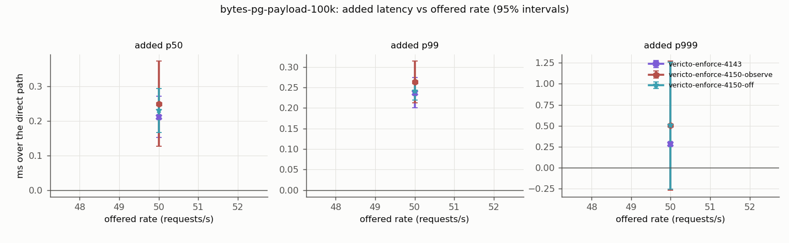
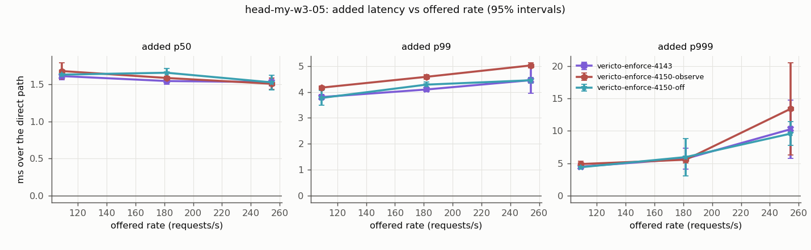
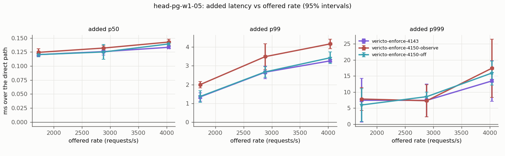
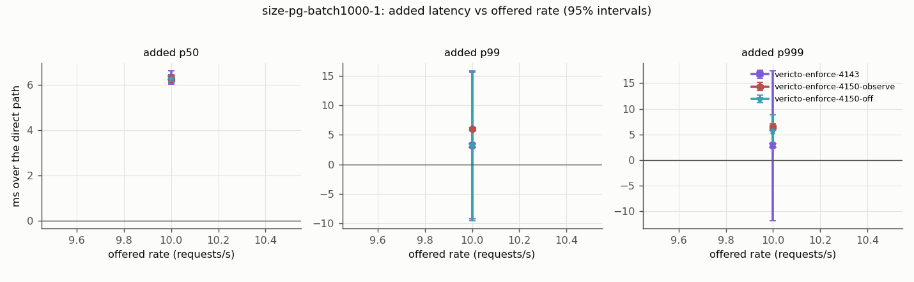
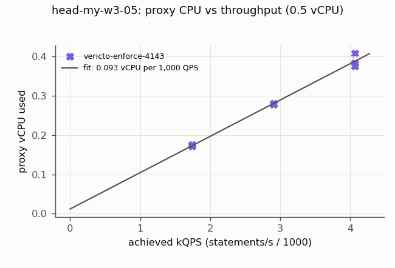
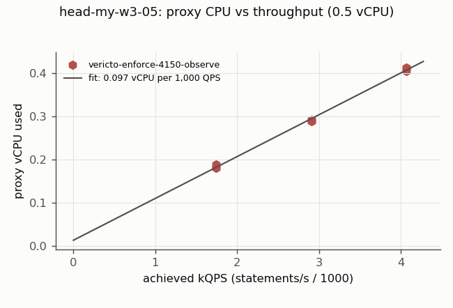
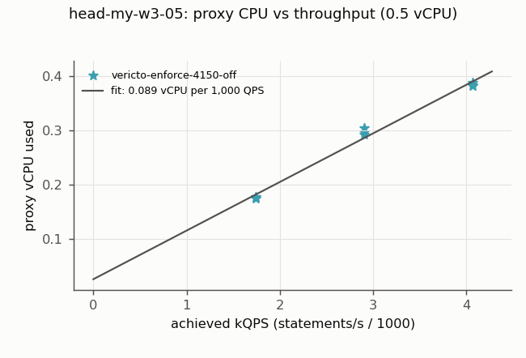
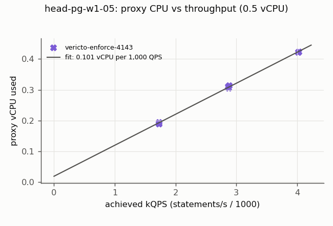
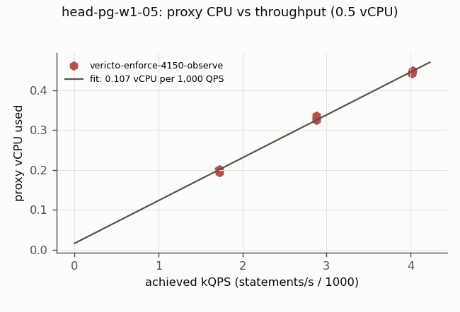
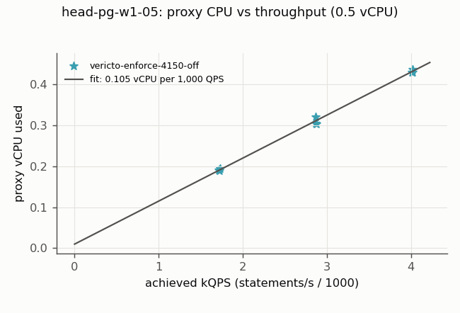
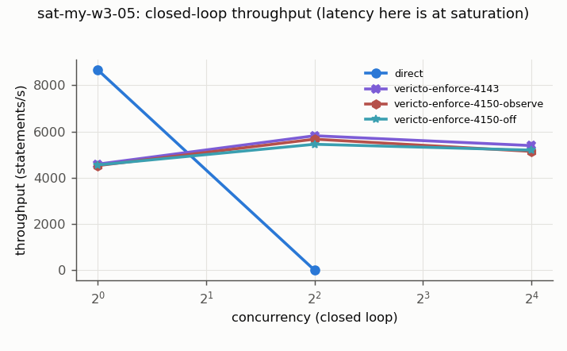
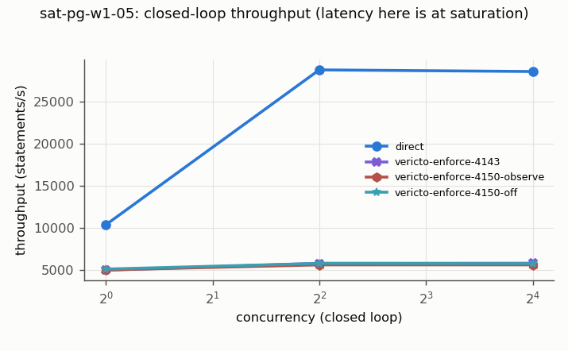
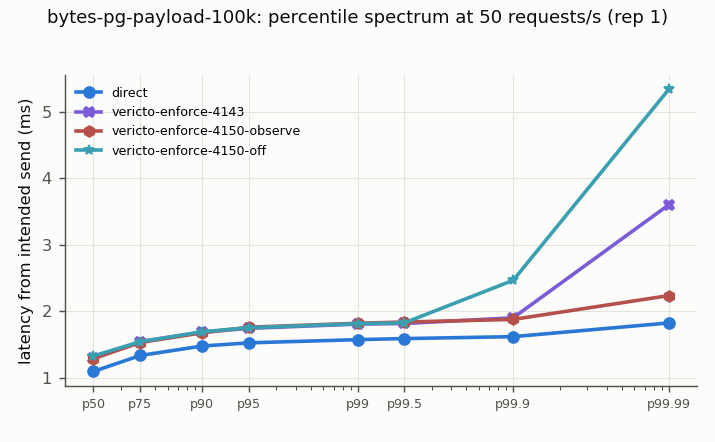
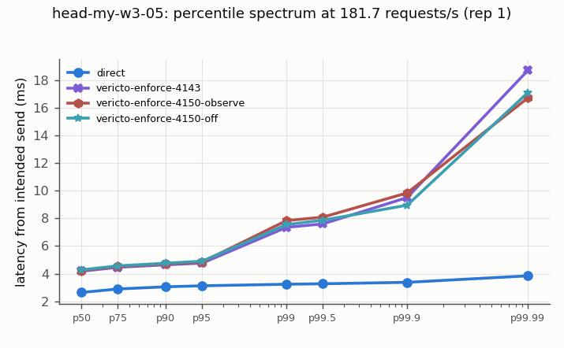
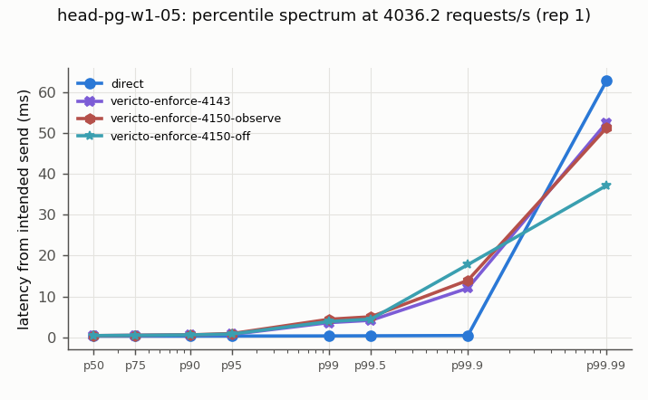
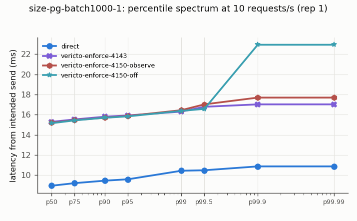
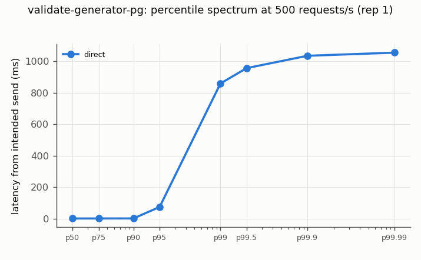
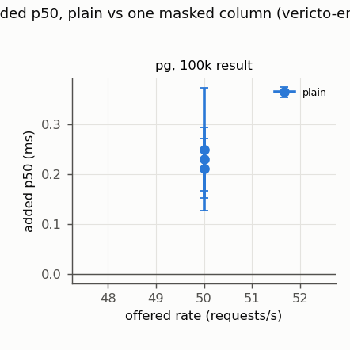
