# vericto-bench report: quick

| Run | Profile | Topology | Proxy image | Harness commit | Started | Finished |
| --- | --- | --- | --- | --- | --- | --- |
| bench-2026-11-p1-quick-2 | quick | two-host | `docker.io/vericto/vericto-proxy:4.14.2@sha256:0446e4357183cf676461c2eac42377d0e331ad19d044d12cde1045608785eb6b` | `c69f68950b76` | 2026-10-20T04:07:11.866119+00:00 | 2026-10-20T04:54:56.935644+00:00 |

Cells: 40 recorded, 31 used, 2 invalid (listed at the end, not used).

## Added latency (open loop, from intended send time; target minus direct, paired)

| Curve | Target | Rate/s | % of S | n | added p50 ms [95%] | added p99 ms [95%] | added p99.9 ms [95%] | Note |
| --- | --- | --- | --- | --- | --- | --- | --- | --- |
| bytes-pg-payload-100k | vericto-enforce | 50 | - | 1 | 0.227 | 0.225 | 0.258 | n=1, no interval |
| head-my-w3-05 | haproxy-tcp | 115 | 30 | 1 | 0.526 | 0.464 | 0.406 | n=1, no interval |
| head-my-w3-05 | haproxy-tcp | 269 | 70 | 1 | 0.486 | 0.490 | 0.620 | n=1, no interval |
| head-my-w3-05 | vericto-enforce | 115 | 30 | 1 | 1.530 | 3.462 | 3.736 | n=1, no interval |
| head-my-w3-05 | vericto-enforce | 269 | 70 | 1 | 1.318 | 4.162 | 6.916 | n=1, no interval |
| head-pg-w1-05 | haproxy-tcp | 1802 | 30 | 1 | 0.032 | 0.043 | 0.083 | n=1, no interval |
| head-pg-w1-05 | haproxy-tcp | 4206 | 70 | 1 | 0.028 | 0.059 | 0.099 | n=1, no interval |
| head-pg-w1-05 | haproxy-tcp | 6008 | 100 | 1 | 0.029 | 0.085 | 0.127 | n=1, no interval |
| head-pg-w1-05 | vericto-enforce | 1802 | 30 | 1 | 0.110 | 1.111 | 5.989 | n=1, no interval |
| head-pg-w1-05 | vericto-enforce | 4206 | 70 | 1 | 0.117 | 2.908 | 9.199 | n=1, no interval |
| size-pg-batch1000-1 | vericto-enforce | 10 | - | 1 | 6.088 | 6.320 | 6.056 | n=1, no interval |

## Every cell

| Cell | Status | Achieved/s | p50 ms | p99 ms | p99.9 ms | max ms | proxy vCPU | max aggregate Mbps |
| --- | --- | --- | --- | --- | --- | --- | --- | --- |
| sat-pg-w1-05.direct.c1.rep1 | ok | 10015.4 | 0.097 | 0.125 | 0.186 | 0.799 | - | 87.2 |
| sat-pg-w1-05.vericto-enforce.c1.rep1 | ok | 5043.1 | 0.190 | 0.230 | 2.636 | 12.256 | 0.444 | 100.8 |
| sat-pg-w1-05.direct.c4.rep1 | ok | 28609.9 | 0.122 | 0.296 | 0.330 | 0.851 | - | 249.1 |
| sat-pg-w1-05.vericto-enforce.c4.rep1 | ok | 6008.5 | 0.328 | 2.941 | 47.433 | 52.878 | 0.500 | 120.3 |
| sat-pg-w1-05.direct.c16.rep1 | ok | 29680.5 | 0.509 | 1.151 | 1.588 | 3.883 | - | 254.3 |
| sat-pg-w1-05.vericto-enforce.c16.rep1 | ok | 5989.8 | 1.272 | 51.586 | 54.607 | 69.233 | 0.500 | 122.5 |
| sat-pg-w1-05.direct.c64.rep1 | ok | 27413.7 | 2.258 | 5.516 | 6.915 | 141.119 | - | 236.6 |
| sat-my-w3-05.direct.c1.rep1 | ok | 532.2 | 1.868 | 2.073 | 2.395 | 2.817 | - | 560.8 |
| sat-my-w3-05.vericto-enforce.c1.rep1 | ok | 290.2 | 3.337 | 6.023 | 6.479 | 13.159 | 0.416 | 792.2 |
| sat-my-w3-05.direct.c4.rep1 | aborted (network cap: network cap: sut-nic above 400 Mbps (3 consecutive samples)) | 0 | 0 | 0 | 0 | 0 | - | 1940.8 |
| sat-my-w3-05.vericto-enforce.c4.rep1 | ok | 378 | 5.339 | 54.847 | 58.687 | 70.015 | 0.500 | 679.6 |
| sat-my-w3-05.vericto-enforce.c16.rep1 | ok | 384.3 | 23.471 | 77.823 | 87.103 | 89.215 | 0.500 | 692.9 |
| head-pg-w1-05.vericto-enforce.r50.rep0.netprobe | ok | 45.4 | 0.549 | 0.698 | 0.762 | 0.762 | 0.007 | 2.2 |
| head-pg-w1-05.direct.r4205.9.rep1 | ok | 4176.9 | 0.294 | 0.353 | 0.443 | 101.783 | - | 36.9 |
| head-pg-w1-05.vericto-enforce.r4205.9.rep1 | ok | 4179.4 | 0.411 | 3.261 | 9.642 | 155.194 | 0.394 | 86.8 |
| head-pg-w1-05.haproxy-tcp.r4205.9.rep1 | ok | 4186.5 | 0.322 | 0.412 | 0.542 | 117.282 | 0.082 | 60.2 |
| head-pg-w1-05.vericto-enforce.r1802.5.rep1 | ok | 1796.6 | 0.412 | 1.456 | 6.436 | 72.713 | 0.181 | 39.1 |
| head-pg-w1-05.haproxy-tcp.r1802.5.rep1 | ok | 1807.5 | 0.334 | 0.388 | 0.530 | 87.959 | 0.038 | 135.6 |
| head-pg-w1-05.direct.r1802.5.rep1 | ok | 1791.2 | 0.302 | 0.345 | 0.447 | 66.107 | - | 16.6 |
| head-pg-w1-05.haproxy-tcp.r6008.5.rep1 | ok | 5997.6 | 0.316 | 0.453 | 0.589 | 111.616 | 0.113 | 85.4 |
| head-pg-w1-05.direct.r6008.5.rep1 | ok | 5988.0 | 0.287 | 0.368 | 0.462 | 120.532 | - | 52.1 |
| head-pg-w1-05.vericto-enforce.r6008.5.rep1 | saturated (achieved rate below 99% of offered) | 5627.0 | 3159.776 | 9005.986 | 9330.160 | 9406.491 | 0.500 | 119.4 |
| head-pg-w1-05.vericto-enforce.r6008.5.rep1.rerun | saturated (achieved rate below 99% of offered) | 5547.9 | 3697.969 | 9521.721 | 9715.000 | 9760.638 | 0.500 | 119.1 |
| head-my-w3-05.vericto-enforce.r50.rep0.netprobe | ok | 50 | 4.135 | 4.967 | 7.471 | 7.471 | 0.073 | 86.5 |
| head-my-w3-05.vericto-enforce.r115.3.rep1 | ok | 115.3 | 4.131 | 6.671 | 7.415 | 14.207 | 0.167 | 412.6 |
| head-my-w3-05.haproxy-tcp.r115.3.rep1 | ok | 115.3 | 3.127 | 3.673 | 4.085 | 5.755 | 0.034 | 199.2 |
| head-my-w3-05.direct.r115.3.rep1 | ok | 115.3 | 2.601 | 3.209 | 3.679 | 5.067 | - | 120.4 |
| head-my-w3-05.haproxy-tcp.r269.rep1 | ok | 269 | 3.007 | 3.607 | 3.943 | 5.683 | 0.080 | 461.9 |
| head-my-w3-05.direct.r269.rep1 | ok | 269 | 2.521 | 3.117 | 3.323 | 4.031 | - | 279.0 |
| head-my-w3-05.vericto-enforce.r269.rep1 | ok | 269 | 3.839 | 7.279 | 10.239 | 22.719 | 0.384 | 464.7 |
| head-my-w3-05.direct.r384.3.rep1 | not_run (not run: above the traffic design targets (pre-flight: at most 361/s fits 300 Mbps per component and 600 Mbps aggregate); the curve stops at the cap) | - | - | - | - | - | - | - |
| head-my-w3-05.vericto-enforce.r384.3.rep1 | not_run (not run: above the traffic design targets (pre-flight: at most 361/s fits 300 Mbps per component and 600 Mbps aggregate); the curve stops at the cap) | - | - | - | - | - | - | - |
| head-my-w3-05.haproxy-tcp.r384.3.rep1 | not_run (not run: above the traffic design targets (pre-flight: at most 361/s fits 300 Mbps per component and 600 Mbps aggregate); the curve stops at the cap) | - | - | - | - | - | - | - |
| bytes-pg-payload-100k.vericto-enforce.r50.rep0.netprobe | ok | 50 | 1.327 | 1.811 | 1.849 | 1.849 | 0.020 | 212.7 |
| bytes-pg-payload-100k.direct.r50.rep1 | ok | 50 | 1.063 | 1.571 | 1.618 | 1.679 | - | 127.5 |
| bytes-pg-payload-100k.vericto-enforce.r50.rep1 | ok | 50 | 1.290 | 1.796 | 1.876 | 6.151 | 0.020 | 222.0 |
| size-pg-batch1000-1.vericto-enforce.r10.rep0.netprobe | ok | 10 | 15.359 | 16.311 | 16.527 | 16.527 | 0.063 | 31.7 |
| size-pg-batch1000-1.direct.r10.rep1 | ok | 10 | 8.959 | 9.943 | 10.839 | 10.855 | - | 18.6 |
| size-pg-batch1000-1.vericto-enforce.r10.rep1 | ok | 10 | 15.047 | 16.263 | 16.895 | 24.079 | 0.063 | 31.7 |
| validate-generator-pg.direct.r500.rep1 | ok | 500 | 0.785 | 851.967 | 1028.095 | 1049.599 | - | 6.1 |

## Proxy CPU per 1,000 QPS (linear fit, open-loop cells below 80% of S)

| Curve | Target | Size | n | vCPU per 1,000 QPS [95%] | intercept vCPU | USD/month per 1,000 QPS at 70% utilisation |
| --- | --- | --- | --- | --- | --- | --- |

## Network traffic (owner caps: 400 Mbps per component, 800 Mbps aggregate)

Cells aborted by a cap: 1. Per-cell maxima are in traffic.csv; bytes/s per direction over each measured window in traffic_directions.csv.

Bytes per direction at vericto-enforce, highest valid rate of each open-loop curve (Mbps, window mean):

| Curve | Rate/s | client to proxy | proxy to client | proxy to DB | DB to proxy | telemetry out | proxy total | result bytes per request |
| --- | --- | --- | --- | --- | --- | --- | --- | --- |
| bytes-pg-payload-100k | 50 | 0.2 | 42.1 | 0.4 | 42.1 | 0.01 | 84.9 | 105156 |
| head-my-w3-05 | 269 | 4.4 | 87.4 | 4.1 | 87.4 | 1.80 | 185.2 | 40624 |
| head-pg-w1-05 | 4206 | 6.2 | 5.0 | 16.1 | 6.8 | 1.35 | 35.4 | 150 |
| size-pg-batch1000-1 | 10 | 6.1 | 0.0 | 6.1 | 0.0 | 0.19 | 12.4 | 263 |

## Statement size (W5): added latency per KB of SQL

| Engine | Statement | Proxy size | points | added p50 ms/KB [95%] | added p99 ms/KB [95%] | KB where the p50 fit passes 1 ms | first measured KB with added p50 > 1 ms |
| --- | --- | --- | --- | --- | --- | --- | --- |
| pg | multi-row INSERT | 1 | 1 | - [-, -] | - [-, -] | - | 21.4 |

## Large results (W8): plain against one masked column, vericto-enforce at 0.5 vCPU

| Engine | Result | Rate/s | Masked | n | added p50 ms [95%] | added p99 ms [95%] | proxy vCPU | result MB/s |
| --- | --- | --- | --- | --- | --- | --- | --- | --- |
| pg | 100k | 50 | no | 1 | 0.227 | 0.225 | 0.020 | 5.26 |

## Generator validation

- validate-generator-pg.direct.r500.rep1: 3 pauses of 1.0 s every 20.0 s; max 1049.6 ms, p99.9 1028.1 ms, fraction above 500 ms 0.0279 (expected 0.0250): PASS

## Invalid repetitions (pre-registered rules; kept in the raw data)

- head-pg-w1-05.vericto-enforce.r6008.5.rep1: not steady: rate varies 29.4% across parts
- head-pg-w1-05.vericto-enforce.r6008.5.rep1.rerun: not steady: rate varies 32.1% across parts

## Charts

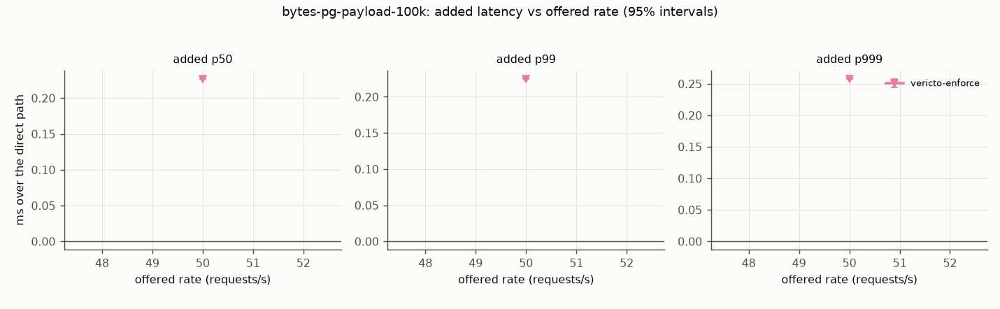
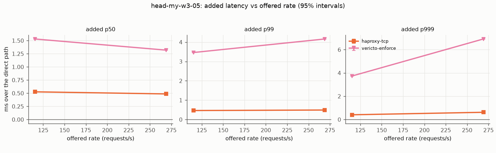
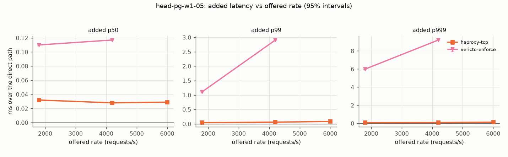
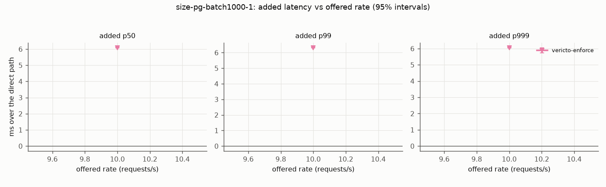
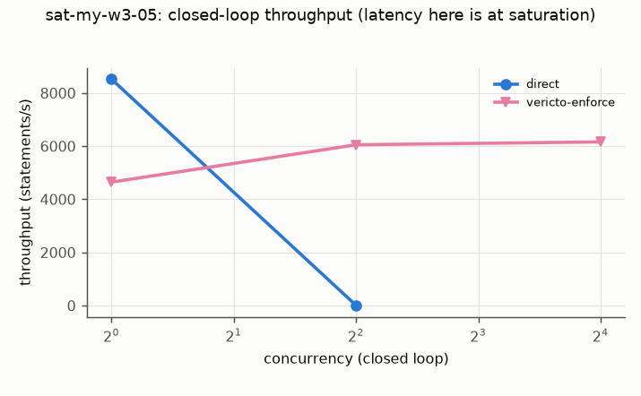
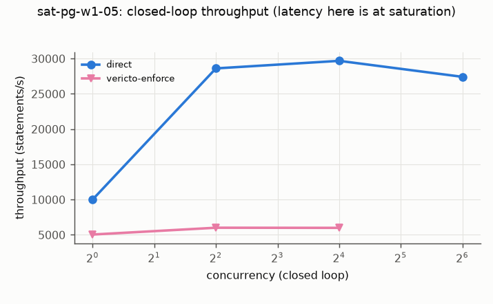
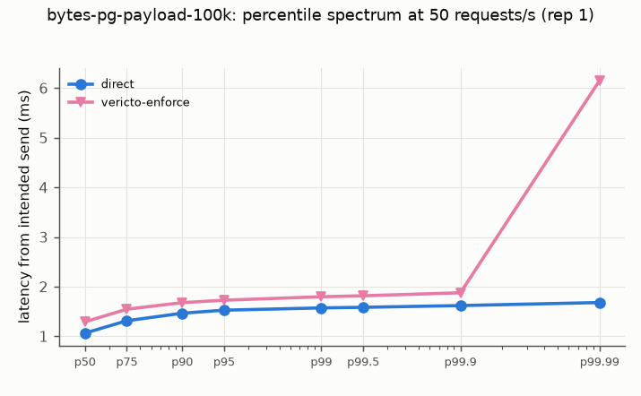
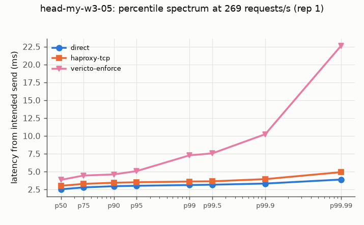
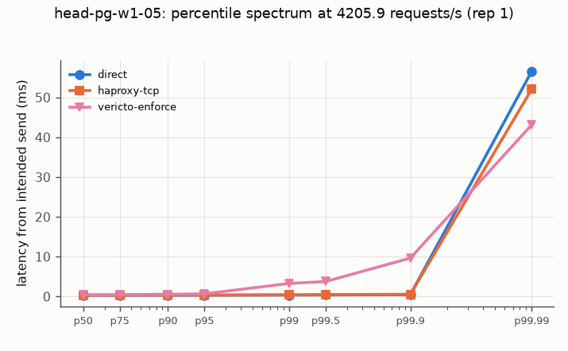
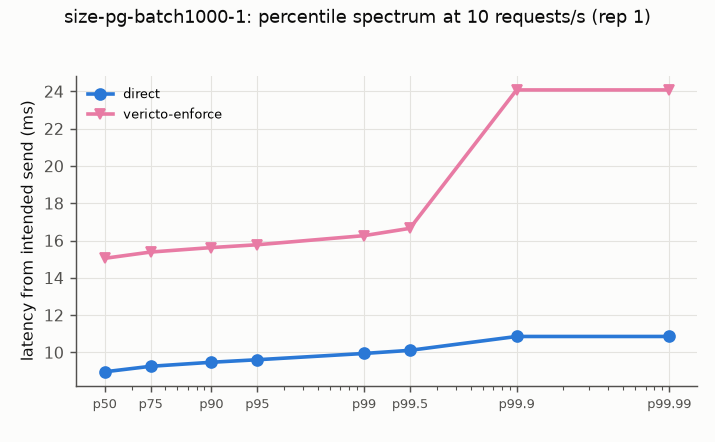
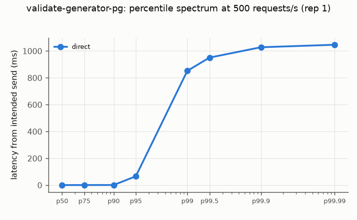
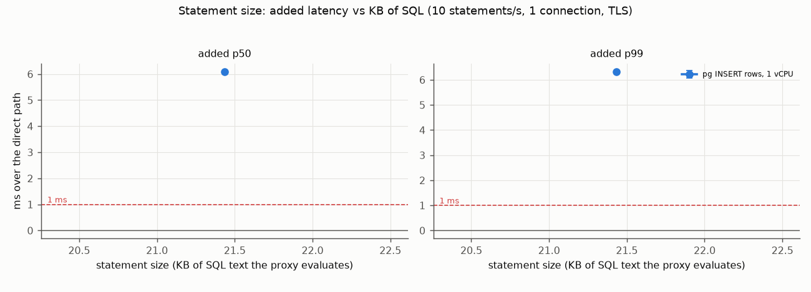
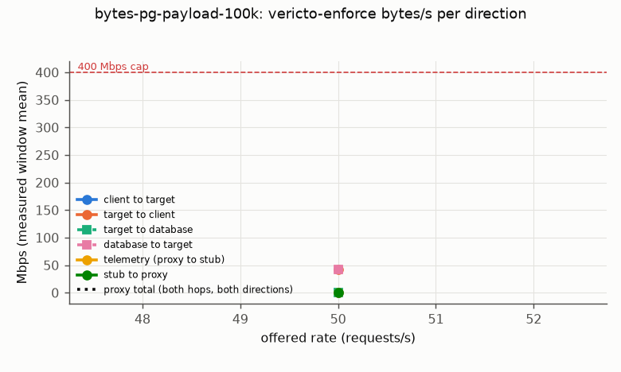
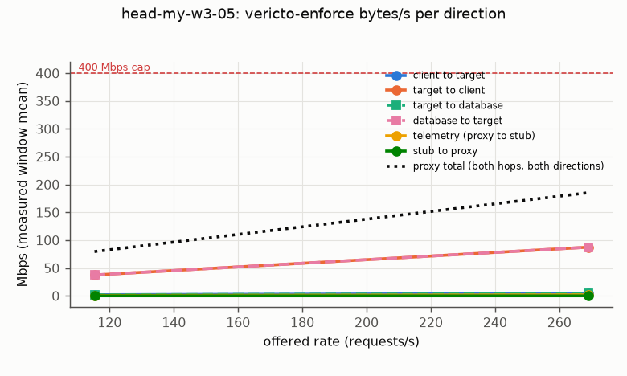
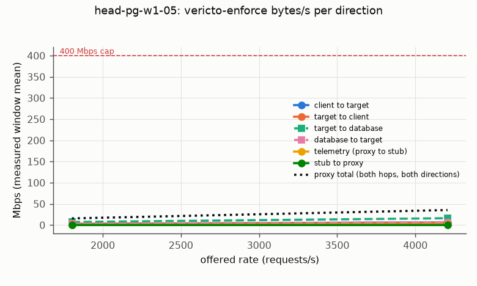
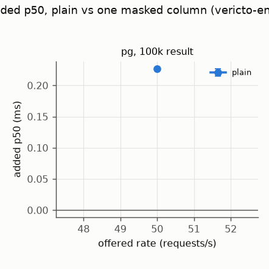
