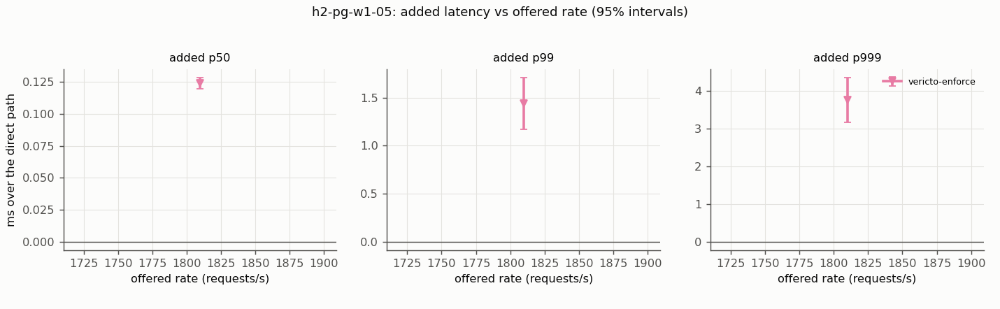
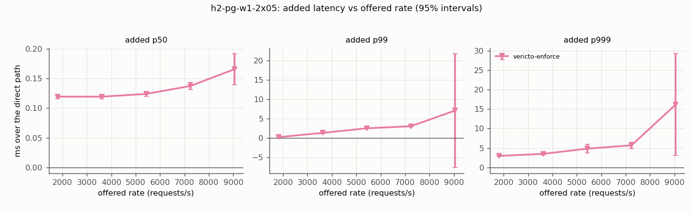
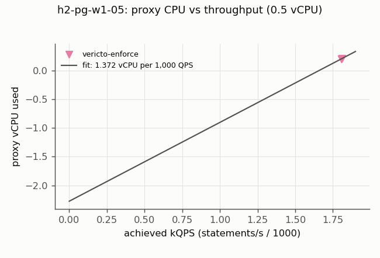
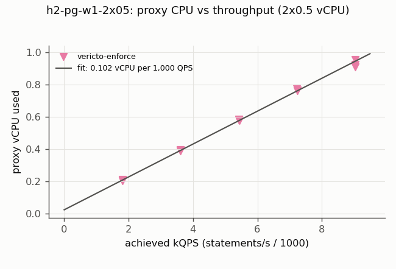
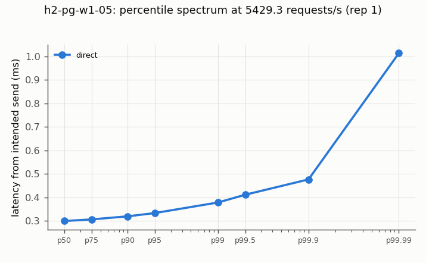
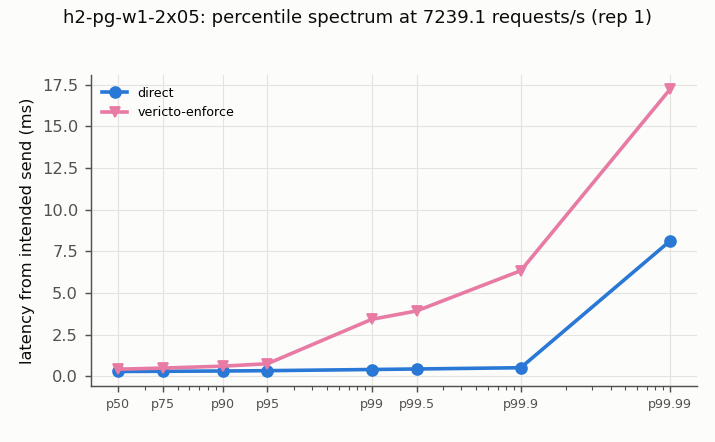

# vericto-bench report: core-h2

| Run | Profile | Topology | Proxy image | Harness commit | Started | Finished |
| --- | --- | --- | --- | --- | --- | --- |
| bench-2026-11-p2-core-h2-2 | published | two-host | `docker.io/vericto/vericto-proxy:4.14.2@sha256:0446e4357183cf676461c2eac42377d0e331ad19d044d12cde1045608785eb6b` | `a7acf9df4623` | 2026-10-21T02:10:49.816742+00:00 | 2026-10-21T09:14:47.026421+00:00 |

Cells: 64 recorded, 60 used, 2 invalid (listed at the end, not used).

## Added latency (open loop, from intended send time; target minus direct, paired)

| Curve | Target | Rate/s | % of S | n | added p50 ms [95%] | added p99 ms [95%] | added p99.9 ms [95%] | Note |
| --- | --- | --- | --- | --- | --- | --- | --- | --- |
| h2-pg-w1-05 | vericto-enforce | 1810 | 30 | 3 | 0.124 [0.120, 0.128] | 1.438 [1.169, 1.708] | 3.764 [3.167, 4.361] |  |
| h2-pg-w1-2x05 | vericto-enforce | 1810 | 30 | 3 | 0.119 [0.116, 0.123] | 0.248 [0.232, 0.264] | 2.945 [2.791, 3.100] |  |
| h2-pg-w1-2x05 | vericto-enforce | 3620 | 60 | 3 | 0.119 [0.116, 0.123] | 1.344 [1.217, 1.472] | 3.493 [3.163, 3.822] |  |
| h2-pg-w1-2x05 | vericto-enforce | 5429 | 90 | 3 | 0.124 [0.120, 0.128] | 2.524 [2.343, 2.706] | 4.819 [3.690, 5.949] |  |
| h2-pg-w1-2x05 | vericto-enforce | 7239 | 120 | 3 | 0.137 [0.131, 0.144] | 3.066 [2.909, 3.222] | 5.679 [4.856, 6.502] |  |
| h2-pg-w1-2x05 | vericto-enforce | 9049 | 150 | 3 | 0.166 [0.140, 0.192] | 7.095 [-7.552, 21.743] | 16.139 [3.074, 29.204] | not distinguishable from the direct path |

## Every cell

| Cell | Status | Achieved/s | p50 ms | p99 ms | p99.9 ms | max ms | proxy vCPU | max aggregate Mbps |
| --- | --- | --- | --- | --- | --- | --- | --- | --- |
| h2-pg-w1-2x05.vericto-enforce.r50.rep0.netprobe | ok | 49.8 | 0.578 | 1.266 | 1.382 | 1.382 | 0.009 | 1.6 |
| h2-pg-w1-2x05.direct.r1809.8.rep1 | ok | 1805.5 | 0.309 | 0.359 | 0.433 | 297.855 | - | 19.1 |
| h2-pg-w1-2x05.vericto-enforce.r1809.8.rep1 | ok | 1806.7 | 0.430 | 0.614 | 3.373 | 265.053 | 0.211 | 102.1 |
| h2-pg-w1-2x05.vericto-enforce.r5429.3.rep1 | ok | 5433.4 | 0.420 | 2.830 | 5.409 | 236.508 | 0.575 | 176.6 |
| h2-pg-w1-2x05.direct.r5429.3.rep1 | ok | 5413.8 | 0.297 | 0.376 | 0.477 | 226.627 | - | 47.7 |
| h2-pg-w1-2x05.direct.r3619.5.rep1 | ok | 3607.0 | 0.301 | 0.357 | 0.449 | 269.819 | - | 104.7 |
| h2-pg-w1-2x05.vericto-enforce.r3619.5.rep1 | ok | 3609.6 | 0.420 | 1.717 | 4.074 | 262.144 | 0.393 | 149.7 |
| h2-pg-w1-2x05.vericto-enforce.r7239.1.rep1 | ok | 7234.4 | 0.431 | 3.423 | 6.345 | 214.010 | 0.762 | 147.3 |
| h2-pg-w1-2x05.direct.r7239.1.rep1 | ok | 7239.8 | 0.296 | 0.413 | 0.520 | 311.421 | - | 135.8 |
| h2-pg-w1-2x05.direct.r9048.9.rep1 | ok | 9042.5 | 0.294 | 0.440 | 0.555 | 261.837 | - | 146.4 |
| h2-pg-w1-2x05.vericto-enforce.r9048.9.rep1 | ok | 9040.1 | 0.470 | 14.342 | 21.936 | 241.753 | 0.909 | 184.3 |
| h2-pg-w1-2x05.vericto-enforce.r10858.6.rep1 | ok | 10821.2 | 113.347 | 2265.211 | 2445.885 | 2658.074 | 1.000 | 292.9 |
| h2-pg-w1-2x05.direct.r10858.6.rep1 | ok | 10853.1 | 0.292 | 0.470 | 0.609 | 185.465 | - | 167.2 |
| h2-pg-w1-2x05.direct.r13271.6.rep1 | ok | 13263.4 | 0.291 | 0.529 | 0.729 | 306.226 | - | 115.4 |
| h2-pg-w1-2x05.vericto-enforce.r13271.6.rep1 | saturated (achieved rate below 99% of offered) | 9656.3 | 80033.541 | 135822.200 | 138739.893 | 139156.314 | 1.000 | 299.4 |
| h2-pg-w1-2x05.vericto-enforce.r1809.8.rep2 | ok | 1808.7 | 0.426 | 0.598 | 3.414 | 285.320 | 0.203 | 111.4 |
| h2-pg-w1-2x05.direct.r1809.8.rep2 | ok | 1805.6 | 0.307 | 0.352 | 0.404 | 290.456 | - | 19.1 |
| h2-pg-w1-2x05.direct.r3619.5.rep2 | ok | 3613.0 | 0.300 | 0.355 | 0.441 | 261.206 | - | 101.6 |
| h2-pg-w1-2x05.vericto-enforce.r3619.5.rep2 | ok | 3609.3 | 0.418 | 1.741 | 3.934 | 260.819 | 0.388 | 75.4 |
| h2-pg-w1-2x05.vericto-enforce.r5429.3.rep2 | ok | 5421.1 | 0.421 | 2.976 | 5.686 | 435.977 | 0.582 | 111.5 |
| h2-pg-w1-2x05.direct.r5429.3.rep2 | ok | 5429.9 | 0.298 | 0.376 | 0.479 | 249.704 | - | 117.8 |
| h2-pg-w1-2x05.direct.r7239.1.rep2 | ok | 7224.0 | 0.296 | 0.412 | 0.514 | 416.934 | - | 63.1 |
| h2-pg-w1-2x05.vericto-enforce.r7239.1.rep2 | ok | 7230.4 | 0.433 | 3.465 | 6.426 | 434.451 | 0.765 | 147.8 |
| h2-pg-w1-2x05.vericto-enforce.r9048.9.rep2 | ok | 9035.7 | 0.447 | 4.009 | 11.414 | 210.906 | 0.925 | 251.7 |
| h2-pg-w1-2x05.direct.r9048.9.rep2 | ok | 9032.4 | 0.292 | 0.437 | 0.551 | 228.034 | - | 79.5 |
| h2-pg-w1-2x05.direct.r10858.6.rep2 | ok | 10842.0 | 0.291 | 0.465 | 0.604 | 263.321 | - | 95.1 |
| h2-pg-w1-2x05.vericto-enforce.r10858.6.rep2 | ok | 10752.2 | 1509.300 | 9484.418 | 9637.666 | 9702.505 | 1.000 | 294.6 |
| h2-pg-w1-2x05.vericto-enforce.r13271.6.rep2 | saturated (achieved rate below 99% of offered) | 9023.2 | 94331.502 | 152545.921 | 154533.262 | 155136.096 | 1.000 | 286.1 |
| h2-pg-w1-2x05.direct.r13271.6.rep2 | ok | 13261.7 | 0.291 | 0.520 | 0.713 | 249.342 | - | 115.0 |
| h2-pg-w1-2x05.direct.r1809.8.rep3 | ok | 1800.7 | 0.308 | 0.354 | 0.429 | 274.819 | - | 97.0 |
| h2-pg-w1-2x05.vericto-enforce.r1809.8.rep3 | ok | 1807.1 | 0.426 | 0.597 | 3.315 | 325.947 | 0.205 | 42.6 |
| h2-pg-w1-2x05.vericto-enforce.r3619.5.rep3 | ok | 3614.2 | 0.421 | 1.641 | 3.797 | 295.814 | 0.391 | 75.1 |
| h2-pg-w1-2x05.direct.r3619.5.rep3 | ok | 3613.0 | 0.300 | 0.354 | 0.437 | 267.193 | - | 99.0 |
| h2-pg-w1-2x05.direct.r5429.3.rep3 | ok | 5424.0 | 0.296 | 0.373 | 0.467 | 283.399 | - | 47.9 |
| h2-pg-w1-2x05.vericto-enforce.r5429.3.rep3 | ok | 5418.8 | 0.422 | 2.892 | 4.786 | 224.989 | 0.582 | 289.7 |
| h2-pg-w1-2x05.vericto-enforce.r7239.1.rep3 | ok | 7228.4 | 0.436 | 3.546 | 5.807 | 231.027 | 0.777 | 215.4 |
| h2-pg-w1-2x05.direct.r7239.1.rep3 | ok | 7224.4 | 0.296 | 0.412 | 0.507 | 220.585 | - | 63.6 |
| h2-pg-w1-2x05.direct.r9048.9.rep3 | ok | 9036.7 | 0.296 | 0.448 | 0.556 | 229.630 | - | 78.9 |
| h2-pg-w1-2x05.vericto-enforce.r9048.9.rep3 | ok | 9043.8 | 0.462 | 4.260 | 16.729 | 191.689 | 0.953 | 251.2 |
| h2-pg-w1-2x05.vericto-enforce.r10858.6.rep3 | saturated (achieved rate below 99% of offered) | 10119.7 | 18732.479 | 43379.521 | 44439.504 | 44734.407 | 1.000 | 221.2 |
| h2-pg-w1-2x05.direct.r10858.6.rep3 | ok | 10837.9 | 0.297 | 0.482 | 0.611 | 224.332 | - | 94.1 |
| h2-pg-w1-2x05.direct.r13271.6.rep3 | ok | 13256.1 | 0.296 | 0.541 | 0.720 | 167.211 | - | 188.8 |
| h2-pg-w1-2x05.vericto-enforce.r13271.6.rep3 | saturated (achieved rate below 99% of offered) | 9342.7 | 88501.817 | 143565.055 | 146444.335 | 147003.277 | 1.000 | 222.0 |
| h2-pg-w1-2x05.vericto-enforce.r10858.6.rep1.rerun | saturated (achieved rate below 99% of offered) | 10587.8 | 4954.060 | 21132.426 | 21940.899 | 22159.109 | 1.000 | 220.8 |
| h2-pg-w1-2x05.vericto-enforce.r10858.6.rep2.rerun | saturated (achieved rate below 99% of offered) | 10622.1 | 4335.919 | 16907.557 | 17053.881 | 17266.320 | 0.999 | 292.3 |
| h2-pg-w1-05.vericto-enforce.r50.rep0.netprobe | ok | 50.2 | 0.578 | 1.244 | 1.355 | 1.355 | 0.009 | 2.2 |
| h2-pg-w1-05.direct.r5429.3.rep1 | ok | 5419.0 | 0.299 | 0.378 | 0.476 | 292.640 | - | 118.4 |
| h2-pg-w1-05.vericto-enforce.r5429.3.rep1 | saturated (achieved rate below 99% of offered) | 4725.0 | 37748.052 | 74053.474 | 75664.154 | 75876.819 | 0.500 | 107.3 |
| h2-pg-w1-05.vericto-enforce.r1809.8.rep1 | ok | 1806.1 | 0.434 | 1.711 | 4.233 | 275.279 | 0.202 | 108.8 |
| h2-pg-w1-05.direct.r1809.8.rep1 | ok | 1809.0 | 0.312 | 0.362 | 0.426 | 372.042 | - | 86.9 |
| h2-pg-w1-05.direct.r7239.1.rep1 | ok | 7225.7 | 0.301 | 0.423 | 0.519 | 221.878 | - | 63.8 |
| h2-pg-w1-05.vericto-enforce.r7239.1.rep1 | saturated (achieved rate below 99% of offered) | 2994.0 | 176860.514 | 240360.735 | 243795.604 | 244207.193 | 0.500 | 174.9 |
| h2-pg-w1-05.vericto-enforce.r1809.8.rep2 | ok | 1807.1 | 0.437 | 1.767 | 3.926 | 254.450 | 0.206 | 108.0 |
| h2-pg-w1-05.direct.r1809.8.rep2 | ok | 1803.5 | 0.312 | 0.360 | 0.421 | 282.959 | - | 19.4 |
| h2-pg-w1-05.direct.r5429.3.rep2 | ok | 5421.8 | 0.301 | 0.382 | 0.480 | 369.704 | - | 114.1 |
| h2-pg-w1-05.vericto-enforce.r5429.3.rep2 | saturated (achieved rate below 99% of offered) | 4687.1 | 40359.961 | 77149.661 | 79330.487 | 79615.500 | 0.500 | 179.4 |
| h2-pg-w1-05.vericto-enforce.r7239.1.rep2 | saturated (achieved rate below 99% of offered) | 2603.2 | 191636.526 | 252675.351 | 255918.148 | 256309.195 | 0.500 | 102.3 |
| h2-pg-w1-05.direct.r7239.1.rep2 | ok | 7223.7 | 0.300 | 0.420 | 0.515 | 268.882 | - | 129.5 |
| h2-pg-w1-05.direct.r5429.3.rep3 | ok | 5430.8 | 0.303 | 0.387 | 0.485 | 605.912 | - | 114.9 |
| h2-pg-w1-05.vericto-enforce.r5429.3.rep3 | saturated (achieved rate below 99% of offered) | 4783.3 | 35114.422 | 69619.576 | 70861.562 | 71093.783 | 0.500 | 108.0 |
| h2-pg-w1-05.vericto-enforce.r1809.8.rep3 | ok | 1809.1 | 0.436 | 1.918 | 4.404 | 268.478 | 0.206 | 114.9 |
| h2-pg-w1-05.direct.r1809.8.rep3 | ok | 1807.2 | 0.311 | 0.359 | 0.424 | 248.520 | - | 90.4 |
| h2-pg-w1-05.direct.r7239.1.rep3 | ok | 7224.3 | 0.298 | 0.418 | 0.518 | 237.961 | - | 63.5 |
| h2-pg-w1-05.vericto-enforce.r7239.1.rep3 | saturated (achieved rate below 99% of offered) | 3112.0 | 170894.829 | 235618.756 | 239007.205 | 239445.833 | 0.500 | 177.1 |

## Proxy CPU per 1,000 QPS (linear fit, open-loop cells below 80% of S)

| Curve | Target | Size | n | vCPU per 1,000 QPS [95%] | intercept vCPU | USD/month per 1,000 QPS at 70% utilisation |
| --- | --- | --- | --- | --- | --- | --- |
| h2-pg-w1-05 | vericto-enforce | 0.5 | 3 | 1.3725 [-11.8204, 14.5654] | -2.2760 | 46.35 |
| h2-pg-w1-2x05 | vericto-enforce | 2x0.5 | 6 | 0.1021 [0.0976, 0.1066] | 0.0221 | 3.45 |

## Network traffic (owner caps: 400 Mbps per component, 800 Mbps aggregate)

Cells aborted by a cap: 0. Per-cell maxima are in traffic.csv; bytes/s per direction over each measured window in traffic_directions.csv.

Bytes per direction at vericto-enforce, highest valid rate of each open-loop curve (Mbps, window mean):

| Curve | Rate/s | client to proxy | proxy to client | proxy to DB | DB to proxy | telemetry out | proxy total | result bytes per request |
| --- | --- | --- | --- | --- | --- | --- | --- | --- |
| h2-pg-w1-05 | 7239 | 7.1 | 6.9 | 19.6 | 7.8 | 1.56 | 42.9 | 297 |
| h2-pg-w1-2x05 | 13272 | 15.7 | 13.8 | 42.0 | 17.3 | 3.46 | 92.2 | 184 |

## Horizontal scaling (P-2tasks): 1 x 0.5, 1 x 1 and 2 x 0.5 vCPU at the same absolute rates

Saturated cells end a curve (never latency). With two tasks the client spreads its connections over both ports; task 1 / task 2 vCPU show whether the load split evenly.

| Engine | Proxy | Rate/s | cells (saturated) | achieved/s | added p50 ms | added p99 ms | task 1 vCPU | task 2 vCPU | task 1 throttled ms |
| --- | --- | --- | --- | --- | --- | --- | --- | --- | --- |
| pg | 1x0.5 | 50 | 1 (0) | 50 | - | - | 0.009 | - | 0 |
| pg | 2x0.5 | 50 | 1 (0) | 50 | - | - | 0.005 | 0.005 | 0 |
| pg | 1x0.5 | 1810 | 3 (0) | 1807 | 0.124 | 1.438 | 0.205 | - | 0 |
| pg | 2x0.5 | 1810 | 3 (0) | 1807 | 0.119 | 0.248 | 0.105 | 0.102 | 0 |
| pg | 2x0.5 | 3620 | 3 (0) | 3611 | 0.119 | 1.344 | 0.188 | 0.203 | 0 |
| pg | 1x0.5 | 5429 | 3 (3) | 4732 | - | - | 0.500 | - | 149277 |
| pg | 2x0.5 | 5429 | 3 (0) | 5424 | 0.124 | 2.524 | 0.310 | 0.270 | 0 |
| pg | 1x0.5 | 7239 | 3 (3) | 2903 | - | - | 0.500 | - | 149459 |
| pg | 2x0.5 | 7239 | 3 (0) | 7231 | 0.137 | 3.066 | 0.383 | 0.385 | 39 |
| pg | 2x0.5 | 9049 | 3 (0) | 9040 | 0.166 | 7.095 | 0.445 | 0.484 | 498 |
| pg | 2x0.5 | 10859 | 3 (3) | 10443 | - | - | 0.500 | 0.500 | 144576 |
| pg | 2x0.5 | 13272 | 3 (3) | 9341 | - | - | 0.500 | 0.500 | 145157 |

## Invalid repetitions (pre-registered rules; kept in the raw data)

- h2-pg-w1-2x05.vericto-enforce.r10858.6.rep1: not steady: rate varies 2.4% across parts
- h2-pg-w1-2x05.vericto-enforce.r10858.6.rep2: not steady: rate varies 10.2% across parts

## Charts

