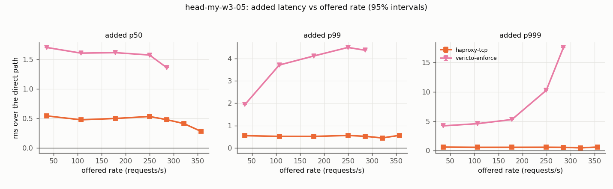
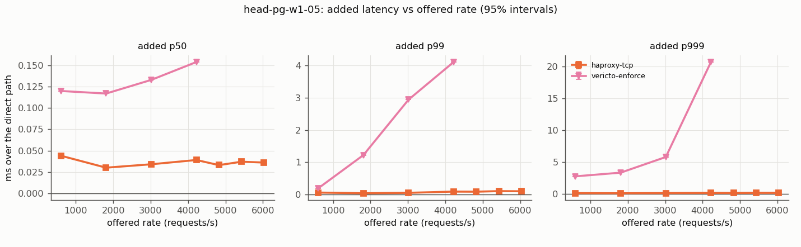
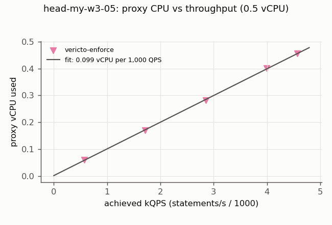
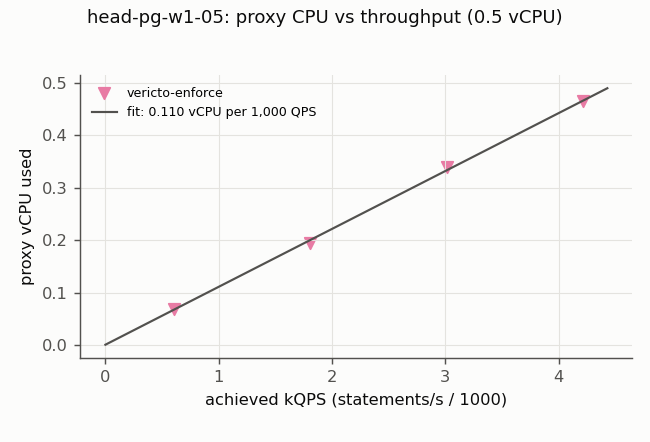
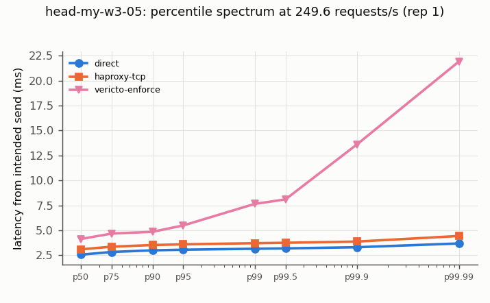
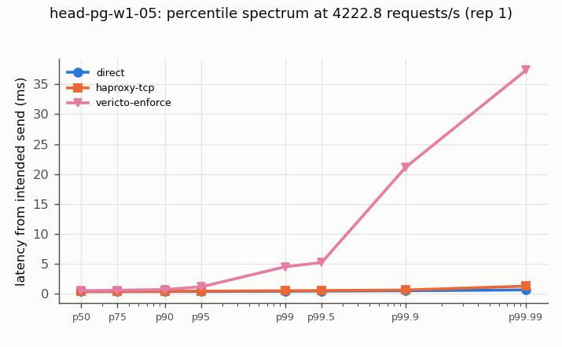
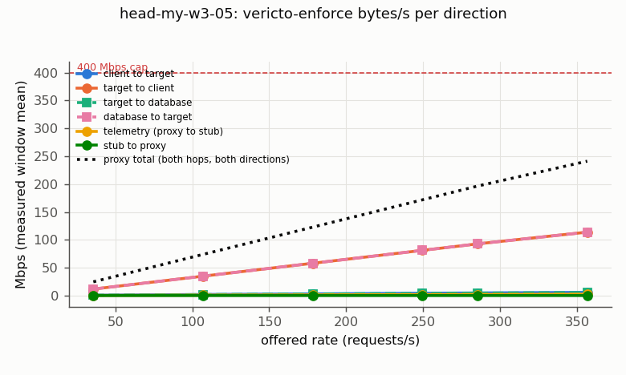
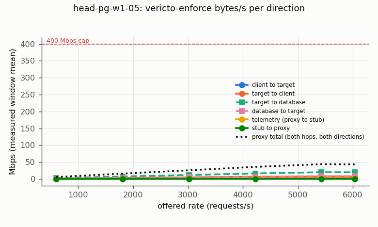

# vericto-bench report: published-day2

| Run | Profile | Topology | Proxy image | Harness commit | Started | Finished |
| --- | --- | --- | --- | --- | --- | --- |
| bench-2026-11-p2-day2 | published | two-host | `docker.io/vericto/vericto-proxy:4.14.2@sha256:0446e4357183cf676461c2eac42377d0e331ad19d044d12cde1045608785eb6b` | `1adaff4be7f4` | 2026-10-21T11:52:16.164769+00:00 | 2026-10-21T16:47:37.611365+00:00 |

Cells: 46 recorded, 40 used, 4 invalid (listed at the end, not used).

## Added latency (open loop, from intended send time; target minus direct, paired)

| Curve | Target | Rate/s | % of S | n | added p50 ms [95%] | added p99 ms [95%] | added p99.9 ms [95%] | Note |
| --- | --- | --- | --- | --- | --- | --- | --- | --- |
| head-my-w3-05 | haproxy-tcp | 36 | 10 | 1 | 0.542 | 0.546 | 0.590 | n=1, no interval |
| head-my-w3-05 | haproxy-tcp | 107 | 30 | 1 | 0.476 | 0.514 | 0.552 | n=1, no interval |
| head-my-w3-05 | haproxy-tcp | 178 | 50 | 1 | 0.498 | 0.512 | 0.556 | n=1, no interval |
| head-my-w3-05 | haproxy-tcp | 250 | 70 | 1 | 0.532 | 0.556 | 0.564 | n=1, no interval |
| head-my-w3-05 | haproxy-tcp | 285 | 80 | 1 | 0.478 | 0.518 | 0.548 | n=1, no interval |
| head-my-w3-05 | haproxy-tcp | 321 | 90 | 1 | 0.412 | 0.444 | 0.456 | n=1, no interval |
| head-my-w3-05 | haproxy-tcp | 357 | 100 | 1 | 0.280 | 0.560 | 0.598 | n=1, no interval |
| head-my-w3-05 | vericto-enforce | 36 | 10 | 1 | 1.702 | 1.942 | 4.214 | n=1, no interval |
| head-my-w3-05 | vericto-enforce | 107 | 30 | 1 | 1.606 | 3.708 | 4.586 | n=1, no interval |
| head-my-w3-05 | vericto-enforce | 178 | 50 | 1 | 1.614 | 4.110 | 5.298 | n=1, no interval |
| head-my-w3-05 | vericto-enforce | 250 | 70 | 1 | 1.574 | 4.494 | 10.274 | n=1, no interval |
| head-my-w3-05 | vericto-enforce | 285 | 80 | 1 | 1.360 | 4.370 | 17.590 | n=1, no interval |
| head-pg-w1-05 | haproxy-tcp | 603 | 10 | 1 | 0.044 | 0.056 | 0.093 | n=1, no interval |
| head-pg-w1-05 | haproxy-tcp | 1810 | 30 | 1 | 0.030 | 0.035 | 0.077 | n=1, no interval |
| head-pg-w1-05 | haproxy-tcp | 3016 | 50 | 1 | 0.034 | 0.048 | 0.102 | n=1, no interval |
| head-pg-w1-05 | haproxy-tcp | 4223 | 70 | 1 | 0.039 | 0.086 | 0.126 | n=1, no interval |
| head-pg-w1-05 | haproxy-tcp | 4826 | 80 | 1 | 0.033 | 0.083 | 0.116 | n=1, no interval |
| head-pg-w1-05 | haproxy-tcp | 5429 | 90 | 1 | 0.037 | 0.101 | 0.138 | n=1, no interval |
| head-pg-w1-05 | haproxy-tcp | 6033 | 100 | 1 | 0.036 | 0.096 | 0.134 | n=1, no interval |
| head-pg-w1-05 | vericto-enforce | 603 | 10 | 1 | 0.120 | 0.189 | 2.733 | n=1, no interval |
| head-pg-w1-05 | vericto-enforce | 1810 | 30 | 1 | 0.117 | 1.220 | 3.309 | n=1, no interval |
| head-pg-w1-05 | vericto-enforce | 3016 | 50 | 1 | 0.133 | 2.943 | 5.766 | n=1, no interval |
| head-pg-w1-05 | vericto-enforce | 4223 | 70 | 1 | 0.154 | 4.113 | 20.687 | n=1, no interval |

## Every cell

| Cell | Status | Achieved/s | p50 ms | p99 ms | p99.9 ms | max ms | proxy vCPU | max aggregate Mbps |
| --- | --- | --- | --- | --- | --- | --- | --- | --- |
| head-pg-w1-05-day2.vericto-enforce.r50.rep0.netprobe | ok | 45.7 | 0.578 | 0.753 | 0.810 | 0.810 | 0.008 | 1.7 |
| head-pg-w1-05-day2.haproxy-tcp.r4826.1.rep1 | ok | 4826.0 | 0.329 | 0.448 | 0.570 | 147.074 | 0.100 | 69.5 |
| head-pg-w1-05-day2.vericto-enforce.r4826.1.rep1 | ok | 4826.8 | 10.214 | 104.357 | 155.041 | 204.722 | 0.500 | 160.7 |
| head-pg-w1-05-day2.direct.r4826.1.rep1 | ok | 4817.6 | 0.296 | 0.365 | 0.454 | 228.109 | - | 113.9 |
| head-pg-w1-05-day2.vericto-enforce.r603.3.rep1 | ok | 600.9 | 0.442 | 0.563 | 3.157 | 106.366 | 0.069 | 15.3 |
| head-pg-w1-05-day2.direct.r603.3.rep1 | ok | 602.0 | 0.322 | 0.374 | 0.424 | 39.292 | - | 76.7 |
| head-pg-w1-05-day2.haproxy-tcp.r603.3.rep1 | ok | 603.8 | 0.366 | 0.430 | 0.517 | 74.082 | 0.016 | 69.2 |
| head-pg-w1-05-day2.direct.r1809.8.rep1 | ok | 1808.7 | 0.309 | 0.354 | 0.399 | 127.570 | - | 17.4 |
| head-pg-w1-05-day2.haproxy-tcp.r1809.8.rep1 | ok | 1807.1 | 0.339 | 0.389 | 0.476 | 119.810 | 0.041 | 86.3 |
| head-pg-w1-05-day2.vericto-enforce.r1809.8.rep1 | ok | 1808.1 | 0.426 | 1.574 | 3.708 | 135.218 | 0.195 | 113.0 |
| head-pg-w1-05-day2.direct.r4222.8.rep1 | ok | 4213.8 | 0.297 | 0.358 | 0.441 | 107.233 | - | 37.4 |
| head-pg-w1-05-day2.vericto-enforce.r4222.8.rep1 | ok | 4218.5 | 0.451 | 4.471 | 21.128 | 141.641 | 0.464 | 156.0 |
| head-pg-w1-05-day2.haproxy-tcp.r4222.8.rep1 | ok | 4226.0 | 0.336 | 0.444 | 0.567 | 122.187 | 0.091 | 130.6 |
| head-pg-w1-05-day2.haproxy-tcp.r3016.3.rep1 | ok | 3016.5 | 0.340 | 0.404 | 0.525 | 139.813 | 0.067 | 43.7 |
| head-pg-w1-05-day2.direct.r3016.3.rep1 | ok | 3015.2 | 0.306 | 0.356 | 0.423 | 136.958 | - | 97.3 |
| head-pg-w1-05-day2.vericto-enforce.r3016.3.rep1 | ok | 3016.0 | 0.439 | 3.299 | 6.189 | 171.675 | 0.339 | 126.9 |
| head-pg-w1-05-day2.vericto-enforce.r5429.3.rep1 | saturated (achieved rate below 99% of offered) | 4875.1 | 26810.477 | 61252.601 | 61888.905 | 62086.718 | 0.500 | 104.8 |
| head-pg-w1-05-day2.haproxy-tcp.r5429.3.rep1 | ok | 5429.9 | 0.333 | 0.477 | 0.602 | 129.419 | 0.116 | 146.8 |
| head-pg-w1-05-day2.direct.r5429.3.rep1 | ok | 5426.1 | 0.296 | 0.376 | 0.464 | 127.975 | - | 116.6 |
| head-pg-w1-05-day2.haproxy-tcp.r6032.6.rep1 | ok | 6036.9 | 0.333 | 0.489 | 0.617 | 121.568 | 0.127 | 87.2 |
| head-pg-w1-05-day2.vericto-enforce.r6032.6.rep1 | saturated (achieved rate below 99% of offered) | 4462.7 | 76162.685 | 132573.024 | 134058.569 | 134370.503 | 0.500 | 169.3 |
| head-pg-w1-05-day2.direct.r6032.6.rep1 | ok | 6027.6 | 0.297 | 0.393 | 0.483 | 119.154 | - | 124.5 |
| head-pg-w1-05-day2.vericto-enforce.r4826.1.rep1.rerun | ok | 4828.7 | 4.633 | 74.549 | 109.390 | 170.089 | 0.500 | 99.9 |
| head-my-w3-05-day2.vericto-enforce.r35.7.rep0.netprobe | ok | 35.7 | 4.519 | 5.187 | 7.655 | 7.655 | 0.060 | 62.5 |
| head-my-w3-05-day2.vericto-enforce.r178.3.rep1 | ok | 178.3 | 4.255 | 7.327 | 8.679 | 23.039 | 0.281 | 381.6 |
| head-my-w3-05-day2.haproxy-tcp.r178.3.rep1 | ok | 178.3 | 3.139 | 3.729 | 3.937 | 9.119 | 0.056 | 314.1 |
| head-my-w3-05-day2.direct.r178.3.rep1 | ok | 178.3 | 2.641 | 3.217 | 3.381 | 4.479 | - | 185.4 |
| head-my-w3-05-day2.haproxy-tcp.r285.3.rep1 | ok | 285.3 | 3.053 | 3.695 | 3.837 | 5.431 | 0.089 | 504.4 |
| head-my-w3-05-day2.direct.r285.3.rep1 | ok | 285.3 | 2.575 | 3.177 | 3.289 | 4.487 | - | 309.7 |
| head-my-w3-05-day2.vericto-enforce.r285.3.rep1 | ok | 285.3 | 3.935 | 7.547 | 20.879 | 41.055 | 0.457 | 493.7 |
| head-my-w3-05-day2.direct.r320.9.rep1 | ok | 320.9 | 2.639 | 3.277 | 3.401 | 5.767 | - | 346.4 |
| head-my-w3-05-day2.vericto-enforce.r320.9.rep1 | ok | 320.9 | 9.151 | 51.263 | 67.583 | 102.975 | 0.500 | 575.5 |
| head-my-w3-05-day2.haproxy-tcp.r320.9.rep1 | ok | 320.9 | 3.051 | 3.721 | 3.857 | 13.047 | 0.101 | 551.2 |
| head-my-w3-05-day2.direct.r107.rep1 | ok | 107 | 2.705 | 3.263 | 3.385 | 3.749 | - | 132.2 |
| head-my-w3-05-day2.haproxy-tcp.r107.rep1 | ok | 107 | 3.181 | 3.777 | 3.937 | 7.359 | 0.034 | 194.9 |
| head-my-w3-05-day2.vericto-enforce.r107.rep1 | ok | 107.0 | 4.311 | 6.971 | 7.971 | 17.343 | 0.170 | 185.2 |
| head-my-w3-05-day2.vericto-enforce.r249.6.rep1 | ok | 249.6 | 4.139 | 7.651 | 13.583 | 23.391 | 0.401 | 444.5 |
| head-my-w3-05-day2.direct.r249.6.rep1 | ok | 249.6 | 2.565 | 3.157 | 3.309 | 3.935 | - | 259.0 |
| head-my-w3-05-day2.haproxy-tcp.r249.6.rep1 | ok | 249.6 | 3.097 | 3.713 | 3.873 | 12.943 | 0.078 | 428.9 |
| head-my-w3-05-day2.haproxy-tcp.r35.7.rep1 | ok | 35.7 | 3.347 | 3.935 | 4.111 | 4.559 | 0.012 | 76.2 |
| head-my-w3-05-day2.vericto-enforce.r35.7.rep1 | ok | 35.7 | 4.507 | 5.331 | 7.735 | 14.231 | 0.060 | 62.6 |
| head-my-w3-05-day2.direct.r35.7.rep1 | ok | 35.7 | 2.805 | 3.389 | 3.521 | 3.849 | - | 37.7 |
| head-my-w3-05-day2.vericto-enforce.r356.6.rep1 | saturated (achieved rate below 99% of offered) | 346.7 | 6893.567 | 8454.143 | 8470.527 | 8486.911 | 0.500 | 627.7 |
| head-my-w3-05-day2.haproxy-tcp.r356.6.rep1 | ok | 356.6 | 2.845 | 3.803 | 3.975 | 6.335 | 0.112 | 612.7 |
| head-my-w3-05-day2.direct.r356.6.rep1 | ok | 356.6 | 2.565 | 3.243 | 3.377 | 4.027 | - | 388.1 |
| head-my-w3-05-day2.vericto-enforce.r320.9.rep1.rerun | ok | 320.9 | 8.287 | 52.159 | 65.919 | 92.671 | 0.500 | 572.8 |

## Proxy CPU per 1,000 QPS (linear fit, open-loop cells below 80% of S)

| Curve | Target | Size | n | vCPU per 1,000 QPS [95%] | intercept vCPU | USD/month per 1,000 QPS at 70% utilisation |
| --- | --- | --- | --- | --- | --- | --- |
| head-my-w3-05 | vericto-enforce | 0.5 | 4 | 0.0994 [0.0927, 0.1060] | 0.0013 | 3.36 |
| head-pg-w1-05 | vericto-enforce | 0.5 | 4 | 0.1104 [0.1013, 0.1194] | 0.0008 | 3.73 |

## Network traffic (owner caps: 400 Mbps per component, 800 Mbps aggregate)

Cells aborted by a cap: 0. Per-cell maxima are in traffic.csv; bytes/s per direction over each measured window in traffic_directions.csv.

Bytes per direction at vericto-enforce, highest offered rate of each open-loop curve (saturated cells included; Mbps, window mean):

| Curve | Rate/s | client to proxy | proxy to client | proxy to DB | DB to proxy | telemetry out | proxy total | result bytes per request |
| --- | --- | --- | --- | --- | --- | --- | --- | --- |
| head-my-w3-05 | 357 | 5.8 | 113.8 | 5.4 | 113.7 | 2.41 | 241.1 | 41027 |
| head-pg-w1-05 | 6033 | 7.3 | 6.5 | 19.6 | 8.0 | 1.61 | 43.1 | 181 |

## Invalid repetitions (pre-registered rules; kept in the raw data)

- head-pg-w1-05-day2.vericto-enforce.r4826.1.rep1: not steady: p50 drifts 2649% from the first to the last third
- head-pg-w1-05-day2.vericto-enforce.r4826.1.rep1.rerun: not steady: p50 drifts 144% from the first to the last third
- head-my-w3-05-day2.vericto-enforce.r320.9.rep1: not steady: p50 drifts 18% from the first to the last third
- head-my-w3-05-day2.vericto-enforce.r320.9.rep1.rerun: not steady: p50 drifts 172% from the first to the last third

## Charts

