**day 1 + day 2.**

# vericto-bench report: published-day1, core-h2, published-day2

| Run | Profile | Topology | Proxy image | Harness commit | Started | Finished |
| --- | --- | --- | --- | --- | --- | --- |
| bench-2026-11-p2-day1 | published | two-host | `docker.io/vericto/vericto-proxy:4.14.2@sha256:0446e4357183cf676461c2eac42377d0e331ad19d044d12cde1045608785eb6b` | `40d69b8bbb01` | 2026-10-20T05:08:37.740579+00:00 | None |
| bench-2026-11-p2-core-h2-2 | published | two-host | `docker.io/vericto/vericto-proxy:4.14.2@sha256:0446e4357183cf676461c2eac42377d0e331ad19d044d12cde1045608785eb6b` | `a7acf9df4623` | 2026-10-21T02:10:49.816742+00:00 | 2026-10-21T09:14:47.026421+00:00 |
| bench-2026-11-p2-day2 | published | two-host | `docker.io/vericto/vericto-proxy:4.14.2@sha256:0446e4357183cf676461c2eac42377d0e331ad19d044d12cde1045608785eb6b` | `1adaff4be7f4` | 2026-10-21T11:52:16.164769+00:00 | 2026-10-21T16:47:37.611365+00:00 |

Cells: 374 recorded, 359 used, 8 invalid (listed at the end, not used).

## Added latency (open loop, from intended send time; target minus direct, paired)

| Curve | Target | Rate/s | % of S | n | added p50 ms [95%] | added p99 ms [95%] | added p99.9 ms [95%] | Note |
| --- | --- | --- | --- | --- | --- | --- | --- | --- |
| h2-pg-w1-05 | vericto-enforce | 1810 | 30 | 3 | 0.124 [0.120, 0.128] | 1.438 [1.169, 1.708] | 3.764 [3.167, 4.361] |  |
| h2-pg-w1-2x05 | vericto-enforce | 1810 | 30 | 3 | 0.119 [0.116, 0.123] | 0.248 [0.232, 0.264] | 2.945 [2.791, 3.100] |  |
| h2-pg-w1-2x05 | vericto-enforce | 3620 | 60 | 3 | 0.119 [0.116, 0.123] | 1.344 [1.217, 1.472] | 3.493 [3.163, 3.822] |  |
| h2-pg-w1-2x05 | vericto-enforce | 5429 | 90 | 3 | 0.124 [0.120, 0.128] | 2.524 [2.343, 2.706] | 4.819 [3.690, 5.949] |  |
| h2-pg-w1-2x05 | vericto-enforce | 7239 | 120 | 3 | 0.137 [0.131, 0.144] | 3.066 [2.909, 3.222] | 5.679 [4.856, 6.502] |  |
| h2-pg-w1-2x05 | vericto-enforce | 9049 | 150 | 3 | 0.166 [0.140, 0.192] | 7.095 [-7.552, 21.743] | 16.139 [3.074, 29.204] | not distinguishable from the direct path |
| head-my-w3-05 | haproxy-tcp | 36 | 10 | 4 | 0.494 [0.441, 0.547] | 0.488 [0.424, 0.551] | 0.578 [0.471, 0.686] |  |
| head-my-w3-05 | haproxy-tcp | 107 | 30 | 4 | 0.488 [0.466, 0.511] | 0.500 [0.477, 0.523] | 0.529 [0.281, 0.778] |  |
| head-my-w3-05 | haproxy-tcp | 178 | 50 | 4 | 0.508 [0.486, 0.530] | 0.479 [0.430, 0.528] | 0.550 [0.464, 0.636] |  |
| head-my-w3-05 | haproxy-tcp | 250 | 70 | 4 | 0.465 [0.390, 0.540] | 0.440 [0.313, 0.566] | 0.494 [0.398, 0.589] |  |
| head-my-w3-05 | haproxy-tcp | 285 | 80 | 4 | 0.492 [0.455, 0.529] | 0.484 [0.411, 0.556] | 0.541 [0.494, 0.588] |  |
| head-my-w3-05 | haproxy-tcp | 321 | 90 | 4 | 0.416 [0.385, 0.446] | 0.475 [0.441, 0.508] | 0.498 [0.451, 0.545] |  |
| head-my-w3-05 | haproxy-tcp | 357 | 100 | 4 | 0.350 [0.274, 0.425] | 0.458 [0.325, 0.591] | 0.521 [0.426, 0.615] |  |
| head-my-w3-05 | vericto-enforce | 36 | 10 | 4 | 1.724 [1.660, 1.789] | 1.958 [1.865, 2.051] | 4.192 [4.043, 4.342] |  |
| head-my-w3-05 | vericto-enforce | 107 | 30 | 4 | 1.583 [1.546, 1.621] | 3.636 [3.557, 3.715] | 4.330 [4.015, 4.645] |  |
| head-my-w3-05 | vericto-enforce | 178 | 50 | 4 | 1.598 [1.557, 1.639] | 4.028 [3.896, 4.160] | 5.645 [4.707, 6.583] |  |
| head-my-w3-05 | vericto-enforce | 250 | 70 | 4 | 1.570 [1.554, 1.585] | 4.357 [4.197, 4.517] | 11.024 [9.418, 12.630] |  |
| head-my-w3-05 | vericto-enforce | 285 | 80 | 4 | 1.228 [1.077, 1.378] | 4.277 [4.124, 4.431] | 16.988 [12.635, 21.342] |  |
| head-my-w3-05 | vericto-enforce | 321 | 90 | 3 | 1.603 [1.211, 1.996] | 32.875 [17.883, 47.868] | 48.318 [35.040, 61.596] |  |
| head-pg-w1-05 | haproxy-tcp | 603 | 10 | 4 | 0.038 [0.031, 0.045] | 0.047 [0.036, 0.058] | 0.075 [0.055, 0.095] |  |
| head-pg-w1-05 | haproxy-tcp | 1810 | 30 | 4 | 0.032 [0.030, 0.034] | 0.038 [0.035, 0.040] | 0.078 [0.071, 0.086] |  |
| head-pg-w1-05 | haproxy-tcp | 3016 | 50 | 4 | 0.033 [0.032, 0.034] | 0.044 [0.040, 0.048] | 0.089 [0.075, 0.103] |  |
| head-pg-w1-05 | haproxy-tcp | 4223 | 70 | 4 | 0.034 [0.029, 0.039] | 0.071 [0.055, 0.087] | 0.108 [0.087, 0.128] |  |
| head-pg-w1-05 | haproxy-tcp | 4826 | 80 | 4 | 0.034 [0.033, 0.034] | 0.083 [0.082, 0.084] | 0.117 [0.114, 0.119] |  |
| head-pg-w1-05 | haproxy-tcp | 5429 | 90 | 4 | 0.033 [0.028, 0.038] | 0.090 [0.079, 0.102] | 0.124 [0.108, 0.139] |  |
| head-pg-w1-05 | haproxy-tcp | 6033 | 100 | 4 | 0.035 [0.033, 0.038] | 0.095 [0.089, 0.100] | 0.132 [0.126, 0.138] |  |
| head-pg-w1-05 | vericto-enforce | 603 | 10 | 4 | 0.119 [0.117, 0.121] | 0.187 [0.182, 0.191] | 2.709 [2.665, 2.753] |  |
| head-pg-w1-05 | vericto-enforce | 1810 | 30 | 4 | 0.119 [0.116, 0.122] | 1.312 [1.209, 1.415] | 3.413 [3.219, 3.608] |  |
| head-pg-w1-05 | vericto-enforce | 3016 | 50 | 4 | 0.129 [0.122, 0.136] | 2.769 [2.535, 3.004] | 5.604 [3.880, 7.329] |  |
| head-pg-w1-05 | vericto-enforce | 4223 | 70 | 4 | 0.145 [0.135, 0.156] | 3.634 [2.941, 4.327] | 17.021 [11.847, 22.194] |  |
| head-pg-w1-05 | vericto-enforce | 4826 | 80 | 3 | 0.223 [0.153, 0.293] | 43.097 [32.779, 53.415] | 71.953 [51.265, 92.641] |  |

## Between days (days 1, 2; the pooled rows above use every day)

Day 1 intervals are Student t 95% over its repetitions; a later day's value outside them is flagged.

| Curve | Target | Rate/s | day 1 added p50 / p99 ms (n) | day 2 added p50 / p99 ms (n) | day 1 p50 [95%] | day 1 p99 [95%] | difference p50 / p99 ms | flag |
| --- | --- | --- | --- | --- | --- | --- | --- | --- |
| head-my-w3-05 | haproxy-tcp | 36 | 0.478 / 0.468 (3) | 0.542 / 0.546 (1) | [0.450, 0.506] | [0.443, 0.493] | 0.064 / 0.078 | day 2 p50 outside day 1's 95% interval; day 2 p99 outside day 1's 95% interval |
| head-my-w3-05 | haproxy-tcp | 107 | 0.493 / 0.495 (3) | 0.476 / 0.514 (1) | [0.457, 0.528] | [0.462, 0.529] | -0.017 / 0.019 | within |
| head-my-w3-05 | haproxy-tcp | 178 | 0.511 / 0.468 (3) | 0.498 / 0.512 (1) | [0.474, 0.549] | [0.401, 0.535] | -0.013 / 0.044 | within |
| head-my-w3-05 | haproxy-tcp | 250 | 0.443 / 0.401 (3) | 0.532 / 0.556 (1) | [0.398, 0.487] | [0.346, 0.455] | 0.089 / 0.155 | day 2 p50 outside day 1's 95% interval; day 2 p99 outside day 1's 95% interval |
| head-my-w3-05 | haproxy-tcp | 285 | 0.497 / 0.472 (3) | 0.478 / 0.518 (1) | [0.433, 0.561] | [0.353, 0.591] | -0.019 / 0.046 | within |
| head-my-w3-05 | haproxy-tcp | 321 | 0.417 / 0.485 (3) | 0.412 / 0.444 (1) | [0.359, 0.474] | [0.466, 0.503] | -0.005 / -0.041 | day 2 p99 outside day 1's 95% interval |
| head-my-w3-05 | haproxy-tcp | 357 | 0.373 / 0.424 (3) | 0.280 / 0.560 (1) | [0.344, 0.402] | [0.276, 0.572] | -0.093 / 0.136 | day 2 p50 outside day 1's 95% interval |
| head-my-w3-05 | vericto-enforce | 36 | 1.732 / 1.963 (3) | 1.702 / 1.942 (1) | [1.617, 1.847] | [1.788, 2.138] | -0.030 / -0.021 | within |
| head-my-w3-05 | vericto-enforce | 107 | 1.576 / 3.612 (3) | 1.606 / 3.708 (1) | [1.521, 1.631] | [3.571, 3.653] | 0.030 / 0.096 | day 2 p99 outside day 1's 95% interval |
| head-my-w3-05 | vericto-enforce | 178 | 1.593 / 4.001 (3) | 1.614 / 4.110 (1) | [1.520, 1.665] | [3.812, 4.190] | 0.021 / 0.109 | within |
| head-my-w3-05 | vericto-enforce | 250 | 1.568 / 4.311 (3) | 1.574 / 4.494 (1) | [1.540, 1.596] | [4.182, 4.441] | 0.006 / 0.183 | day 2 p99 outside day 1's 95% interval |
| head-my-w3-05 | vericto-enforce | 285 | 1.183 / 4.247 (3) | 1.360 / 4.370 (1) | [1.081, 1.285] | [4.021, 4.472] | 0.177 / 0.123 | day 2 p50 outside day 1's 95% interval |
| head-pg-w1-05 | haproxy-tcp | 603 | 0.036 / 0.044 (3) | 0.044 / 0.056 (1) | [0.030, 0.041] | [0.034, 0.053] | 0.008 / 0.012 | day 2 p50 outside day 1's 95% interval; day 2 p99 outside day 1's 95% interval |
| head-pg-w1-05 | haproxy-tcp | 1810 | 0.032 / 0.038 (3) | 0.030 / 0.035 (1) | [0.031, 0.034] | [0.037, 0.040] | -0.002 / -0.003 | day 2 p50 outside day 1's 95% interval; day 2 p99 outside day 1's 95% interval |
| head-pg-w1-05 | haproxy-tcp | 3016 | 0.033 / 0.043 (3) | 0.034 / 0.048 (1) | [0.033, 0.033] | [0.041, 0.044] | 0.001 / 0.005 | day 2 p50 outside day 1's 95% interval; day 2 p99 outside day 1's 95% interval |
| head-pg-w1-05 | haproxy-tcp | 4223 | 0.033 / 0.066 (3) | 0.039 / 0.086 (1) | [0.031, 0.034] | [0.064, 0.067] | 0.006 / 0.020 | day 2 p50 outside day 1's 95% interval; day 2 p99 outside day 1's 95% interval |
| head-pg-w1-05 | haproxy-tcp | 4826 | 0.034 / 0.083 (3) | 0.033 / 0.083 (1) | [0.032, 0.035] | [0.081, 0.085] | -0.001 / 0.000 | within |
| head-pg-w1-05 | haproxy-tcp | 5429 | 0.031 / 0.087 (3) | 0.037 / 0.101 (1) | [0.028, 0.035] | [0.081, 0.092] | 0.006 / 0.014 | day 2 p50 outside day 1's 95% interval; day 2 p99 outside day 1's 95% interval |
| head-pg-w1-05 | haproxy-tcp | 6033 | 0.035 / 0.094 (3) | 0.036 / 0.096 (1) | [0.030, 0.040] | [0.084, 0.104] | 0.001 / 0.002 | within |
| head-pg-w1-05 | vericto-enforce | 603 | 0.119 / 0.186 (3) | 0.120 / 0.189 (1) | [0.115, 0.122] | [0.178, 0.193] | 0.001 / 0.003 | within |
| head-pg-w1-05 | vericto-enforce | 1810 | 0.120 / 1.343 (3) | 0.117 / 1.220 (1) | [0.114, 0.125] | [1.281, 1.405] | -0.003 / -0.123 | day 2 p99 outside day 1's 95% interval |
| head-pg-w1-05 | vericto-enforce | 3016 | 0.128 / 2.711 (3) | 0.133 / 2.943 (1) | [0.117, 0.139] | [2.434, 2.989] | 0.005 / 0.232 | within |
| head-pg-w1-05 | vericto-enforce | 4223 | 0.142 / 3.475 (3) | 0.154 / 4.113 (1) | [0.132, 0.153] | [2.573, 4.377] | 0.012 / 0.638 | day 2 p50 outside day 1's 95% interval |

## Every cell

| Cell | Status | Achieved/s | p50 ms | p99 ms | p99.9 ms | max ms | proxy vCPU | max aggregate Mbps |
| --- | --- | --- | --- | --- | --- | --- | --- | --- |
| sat-pg-w1-05.direct.c1.rep1 | ok | 11140.0 | 0.087 | 0.112 | 0.135 | 1.032 | - | 96.2 |
| sat-pg-w1-05.pgbouncer-session.c1.rep1 | ok | 7705.2 | 0.128 | 0.150 | 0.180 | 2.707 | 0.191 | 108.4 |
| sat-pg-w1-05.vericto-offline.c1.rep1 | ok | 5851.3 | 0.167 | 0.195 | 0.259 | 12.484 | 0.409 | 436.6 |
| sat-pg-w1-05.vericto-enforce.c1.rep1 | ok | 5259.4 | 0.182 | 0.217 | 2.663 | 24.362 | 0.490 | 106.2 |
| sat-pg-w1-05.vericto-observe.c1.rep1 | ok | 5136.8 | 0.186 | 0.226 | 2.685 | 16.600 | 0.466 | 105.1 |
| sat-pg-w1-05.haproxy-tcp.c1.rep1 | ok | 8426.9 | 0.117 | 0.136 | 0.166 | 1.499 | 0.159 | 573.5 |
| sat-pg-w1-05.direct.c2.rep1 | ok | 22887.2 | 0.085 | 0.109 | 0.140 | 0.808 | - | 197.5 |
| sat-pg-w1-05.pgbouncer-session.c2.rep1 | ok | 15679.8 | 0.125 | 0.151 | 0.188 | 0.782 | 0.368 | 220.3 |
| sat-pg-w1-05.vericto-offline.c2.rep1 | ok | 6933.4 | 0.209 | 0.259 | 28.970 | 38.588 | 0.500 | 137.0 |
| sat-pg-w1-05.vericto-enforce.c2.rep1 | ok | 5503.5 | 0.216 | 0.472 | 35.516 | 45.883 | 0.500 | 110.9 |
| sat-pg-w1-05.vericto-observe.c2.rep1 | ok | 5590.0 | 0.229 | 0.471 | 34.707 | 44.447 | 0.500 | 114.0 |
| sat-pg-w1-05.haproxy-tcp.c2.rep1 | ok | 16586.5 | 0.118 | 0.144 | 0.172 | 0.758 | 0.293 | 232.1 |
| sat-pg-w1-05.direct.c4.rep1 | ok | 29606.1 | 0.107 | 0.296 | 0.324 | 2.975 | - | 626.0 |
| sat-pg-w1-05.pgbouncer-session.c4.rep1 | ok | 21815.9 | 0.166 | 0.347 | 0.417 | 5.605 | 0.497 | 304.8 |
| sat-pg-w1-05.vericto-offline.c4.rep1 | ok | 7206.6 | 0.302 | 0.481 | 46.325 | 56.478 | 0.500 | 496.6 |
| sat-pg-w1-05.vericto-enforce.c4.rep1 | ok | 5922.4 | 0.327 | 3.007 | 48.290 | 58.638 | 0.500 | 714.7 |
| sat-pg-w1-05.vericto-observe.c4.rep1 | ok | 5793.1 | 0.333 | 2.995 | 48.484 | 53.934 | 0.500 | 116.6 |
| sat-pg-w1-05.haproxy-tcp.c4.rep1 | ok | 23330.2 | 0.153 | 0.344 | 0.376 | 2.992 | 0.398 | 333.2 |
| sat-pg-w1-05.direct.c8.rep1 | ok | 31219.9 | 0.280 | 0.477 | 0.560 | 2.846 | - | 765.4 |
| sat-pg-w1-05.pgbouncer-session.c8.rep1 | ok | 23344.0 | 0.318 | 0.556 | 13.839 | 15.027 | 0.500 | 324.8 |
| sat-pg-w1-05.vericto-offline.c8.rep1 | ok | 7617.4 | 0.532 | 50.328 | 50.757 | 64.625 | 0.500 | 149.8 |
| sat-pg-w1-05.vericto-enforce.c8.rep1 | ok | 6032.6 | 0.617 | 50.600 | 52.516 | 66.566 | 0.500 | 887.7 |
| sat-pg-w1-05.vericto-observe.c8.rep1 | ok | 6004.7 | 0.619 | 50.617 | 52.518 | 62.466 | 0.500 | 121.1 |
| sat-pg-w1-05.haproxy-tcp.c8.rep1 | ok | 27230.8 | 0.316 | 0.543 | 0.642 | 7.762 | 0.422 | 379.1 |
| sat-pg-w1-05.direct.c16.rep1 | ok | 29947.9 | 0.507 | 1.132 | 1.577 | 18.199 | - | 1260.3 |
| sat-pg-w1-05.pgbouncer-session.c16.rep1 | ok | 23773.9 | 0.566 | 1.674 | 12.312 | 14.872 | 0.500 | 330.7 |
| sat-pg-w1-05.vericto-offline.c16.rep1 | ok | 7414.5 | 1.117 | 51.279 | 51.541 | 65.751 | 0.500 | 147.4 |
| sat-pg-w1-05.vericto-observe.c16.rep1 | ok | 5716.2 | 1.335 | 51.668 | 54.511 | 66.387 | 0.500 | 116.7 |
| sat-pg-w1-05.haproxy-tcp.c16.rep1 | ok | 26503.0 | 0.574 | 1.276 | 1.775 | 53.245 | 0.396 | 368.7 |
| sat-my-w3-05.haproxy-tcp.c1.rep1 | ok | 444.6 | 2.241 | 2.433 | 2.797 | 4.795 | 0.136 | 780.7 |
| sat-my-w3-05.proxysql.c1.rep1 | ok | 345.8 | 2.883 | 3.095 | 3.407 | 5.575 | 0.336 | 603.9 |
| sat-my-w3-05.vericto-offline.c1.rep1 | ok | 353.6 | 2.817 | 3.029 | 3.493 | 12.903 | 0.320 | 930.2 |
| sat-my-w3-05.vericto-enforce.c1.rep1 | ok | 290.8 | 3.333 | 5.987 | 6.435 | 22.367 | 0.446 | 516.6 |
| sat-my-w3-05.vericto-observe.c1.rep1 | ok | 295.9 | 3.273 | 5.959 | 6.391 | 18.575 | 0.440 | 524.5 |
| sat-my-w3-05.direct.c1.rep1 | ok | 570.7 | 1.740 | 1.930 | 2.299 | 3.295 | - | 604.0 |
| sat-my-w3-05.haproxy-tcp.c2.rep1 | aborted (network cap: network cap: intermediary above 400 Mbps (3 consecutive samples)) | 0 | 0 | 0 | 0 | 0 | - | 1520.1 |
| sat-my-w3-05.proxysql.c2.rep1 | aborted (network cap: network cap: aggregate of 4 components above 800 Mbps (3 consecutive samples)) | 0 | 0 | 0 | 0 | 0 | - | 903.9 |
| sat-my-w3-05.vericto-offline.c2.rep1 | aborted (network cap: network cap: aggregate of 4 components above 800 Mbps (3 consecutive samples)) | 0 | 0 | 0 | 0 | 0 | - | 973.2 |
| sat-my-w3-05.vericto-enforce.c2.rep1 | ok | 350.2 | 3.749 | 36.223 | 40.287 | 55.263 | 0.500 | 627.5 |
| sat-my-w3-05.vericto-observe.c2.rep1 | ok | 342.4 | 3.829 | 36.543 | 39.935 | 55.647 | 0.500 | 609.9 |
| sat-my-w3-05.direct.c2.rep1 | aborted (network cap: network cap: aggregate of 3 components above 800 Mbps (3 consecutive samples)) | 0 | 0 | 0 | 0 | 0 | - | 1182.9 |
| sat-my-w3-05.vericto-enforce.c4.rep1 | ok | 356.6 | 5.587 | 56.447 | 59.743 | 70.015 | 0.500 | 632.4 |
| sat-my-w3-05.vericto-observe.c4.rep1 | ok | 357.9 | 5.563 | 56.127 | 59.615 | 74.815 | 0.500 | 633.5 |
| sat-my-w3-05.vericto-observe.c8.rep1 | ok | 375.6 | 10.095 | 67.007 | 69.119 | 82.623 | 0.500 | 672.5 |
| sat-my-w3-05.vericto-observe.c16.rep1 | ok | 358.2 | 25.951 | 79.487 | 88.959 | 95.295 | 0.500 | 651.3 |
| sat-pg-w1-1.direct.c1.rep1 | ok | 11542.5 | 0.085 | 0.105 | 0.124 | 1.393 | - | 99.1 |
| sat-pg-w1-1.vericto-observe.c1.rep1 | ok | 5323.9 | 0.180 | 0.215 | 2.663 | 6.877 | 0.486 | 106.6 |
| sat-pg-w1-1.vericto-enforce.c1.rep1 | ok | 5350.2 | 0.179 | 0.215 | 2.654 | 6.111 | 0.484 | 287.1 |
| sat-pg-w1-1.haproxy-tcp.c1.rep1 | ok | 8415.8 | 0.117 | 0.135 | 0.162 | 0.988 | 0.157 | 119.7 |
| sat-pg-w1-1.vericto-offline.c1.rep1 | ok | 5893.2 | 0.168 | 0.190 | 0.237 | 5.830 | 0.428 | 116.6 |
| sat-pg-w1-1.pgbouncer-session.c1.rep1 | ok | 7972.0 | 0.124 | 0.143 | 0.172 | 3.537 | 0.199 | 432.1 |
| sat-pg-w1-1.direct.c2.rep1 | ok | 22733.3 | 0.086 | 0.108 | 0.141 | 0.638 | - | 193.8 |
| sat-pg-w1-1.vericto-observe.c2.rep1 | ok | 8562.3 | 0.216 | 0.330 | 5.049 | 10.974 | 0.757 | 171.2 |
| sat-pg-w1-1.vericto-enforce.c2.rep1 | ok | 8479.0 | 0.232 | 0.337 | 5.072 | 9.809 | 0.755 | 743.7 |
| sat-pg-w1-1.haproxy-tcp.c2.rep1 | ok | 16476.0 | 0.119 | 0.143 | 0.176 | 2.758 | 0.293 | 232.4 |
| sat-pg-w1-1.vericto-offline.c2.rep1 | ok | 10054.2 | 0.207 | 0.240 | 0.271 | 6.793 | 0.686 | 197.6 |
| sat-pg-w1-1.pgbouncer-session.c2.rep1 | ok | 15405.0 | 0.128 | 0.152 | 0.186 | 9.001 | 0.362 | 1072.5 |
| sat-pg-w1-1.direct.c4.rep1 | ok | 28956.3 | 0.119 | 0.297 | 0.332 | 2.648 | - | 254.0 |
| sat-pg-w1-1.vericto-observe.c4.rep1 | ok | 11242.2 | 0.327 | 0.628 | 7.611 | 211.235 | 0.950 | 225.1 |
| sat-pg-w1-1.vericto-enforce.c4.rep1 | ok | 11355.1 | 0.325 | 0.621 | 7.563 | 21.607 | 0.947 | 226.8 |
| sat-pg-w1-1.haproxy-tcp.c4.rep1 | ok | 23941.1 | 0.148 | 0.341 | 0.366 | 2.927 | 0.404 | 341.4 |
| sat-pg-w1-1.vericto-offline.c4.rep1 | ok | 13504.9 | 0.296 | 0.445 | 0.512 | 10.652 | 0.915 | 265.2 |
| sat-pg-w1-1.pgbouncer-session.c4.rep1 | ok | 22974.4 | 0.160 | 0.339 | 0.368 | 2.959 | 0.519 | 320.3 |
| sat-pg-w1-1.direct.c8.rep1 | ok | 31224.0 | 0.279 | 0.476 | 0.562 | 3.009 | - | 267.5 |
| sat-pg-w1-1.vericto-observe.c8.rep1 | ok | 11757.6 | 0.635 | 1.277 | 8.488 | 22.655 | 0.999 | 237.2 |
| sat-pg-w1-1.vericto-enforce.c8.rep1 | ok | 11874.2 | 0.630 | 1.258 | 8.430 | 21.229 | 0.999 | 238.3 |
| sat-pg-w1-1.haproxy-tcp.c8.rep1 | ok | 27138.8 | 0.318 | 0.545 | 0.647 | 3.091 | 0.420 | 1001.5 |
| sat-pg-w1-1.vericto-offline.c8.rep1 | ok | 14789.0 | 0.546 | 0.830 | 0.947 | 12.485 | 0.999 | 292.3 |
| sat-pg-w1-1.pgbouncer-session.c8.rep1 | ok | 26907.8 | 0.319 | 0.544 | 0.651 | 3.844 | 0.578 | 373.2 |
| sat-pg-w1-1.direct.c16.rep1 | ok | 29938.7 | 0.504 | 1.116 | 1.589 | 3.869 | - | 1225.5 |
| sat-pg-w1-1.vericto-observe.c16.rep1 | ok | 11951.5 | 1.280 | 5.753 | 9.500 | 24.766 | 1.000 | 240.6 |
| sat-pg-w1-1.vericto-enforce.c16.rep1 | ok | 11784.7 | 1.300 | 5.807 | 9.532 | 21.106 | 1.000 | 237.0 |
| sat-pg-w1-1.haproxy-tcp.c16.rep1 | ok | 26392.1 | 0.575 | 1.287 | 1.785 | 11.942 | 0.397 | 1287.2 |
| sat-pg-w1-1.vericto-offline.c16.rep1 | ok | 14848.4 | 1.117 | 1.499 | 1.700 | 15.674 | 1.000 | 293.0 |
| sat-pg-w1-1.pgbouncer-session.c16.rep1 | ok | 26592.1 | 0.571 | 1.271 | 1.771 | 3.927 | 0.556 | 369.6 |
| sat-my-w3-1.vericto-enforce.c1.rep1 | ok | 285.8 | 3.421 | 6.091 | 6.447 | 216.319 | 0.428 | 1004.6 |
| sat-my-w3-1.haproxy-tcp.c1.rep1 | ok | 441.8 | 2.257 | 2.455 | 2.731 | 3.469 | 0.134 | 771.1 |
| sat-my-w3-1.direct.c1.rep1 | ok | 558.2 | 1.747 | 2.069 | 2.265 | 3.259 | - | 602.2 |
| sat-my-w3-1.proxysql.c1.rep1 | ok | 345.5 | 2.885 | 3.107 | 3.431 | 4.307 | 0.330 | 602.4 |
| sat-my-w3-1.vericto-offline.c1.rep1 | ok | 354.1 | 2.813 | 3.029 | 3.459 | 11.175 | 0.317 | 620.8 |
| sat-my-w3-1.vericto-observe.c1.rep1 | ok | 292.3 | 3.319 | 5.967 | 6.311 | 13.287 | 0.442 | 512.7 |
| sat-my-w3-1.vericto-enforce.c2.rep1 | aborted (network cap: network cap: aggregate of 4 components above 800 Mbps (3 consecutive samples)) | 0 | 0 | 0 | 0 | 0 | - | 880.2 |
| sat-my-w3-1.haproxy-tcp.c2.rep1 | aborted (network cap: network cap: intermediary above 400 Mbps (3 consecutive samples)) | 0 | 0 | 0 | 0 | 0 | - | 1522.2 |
| sat-my-w3-1.direct.c2.rep1 | aborted (network cap: network cap: aggregate of 3 components above 800 Mbps (3 consecutive samples)) | 0 | 0 | 0 | 0 | 0 | - | 1179.4 |
| sat-my-w3-1.proxysql.c2.rep1 | aborted (network cap: network cap: intermediary above 400 Mbps (3 consecutive samples)) | 0 | 0 | 0 | 0 | 0 | - | 1042.9 |
| sat-my-w3-1.vericto-offline.c2.rep1 | aborted (network cap: network cap: intermediary above 400 Mbps (3 consecutive samples)) | 0 | 0 | 0 | 0 | 0 | - | 1167.2 |
| sat-my-w3-1.vericto-observe.c2.rep1 | aborted (network cap: network cap: aggregate of 4 components above 800 Mbps (3 consecutive samples)) | 0 | 0 | 0 | 0 | 0 | - | 880.2 |
| sat-my-sysbench-ro.proxysql.c1.rep1 | aborted (network cap: network cap: aggregate of 4 components above 800 Mbps (3 consecutive samples)) | 0.0 | - | - | - | - | - | 944.5 |
| sat-my-sysbench-ro.vericto-offline.c1.rep1 | aborted (network cap: network cap: aggregate of 4 components above 800 Mbps (3 consecutive samples)) | 0.0 | - | - | - | - | - | 1014.9 |
| sat-my-sysbench-ro.vericto-enforce.c1.rep1 | aborted (network cap: network cap: aggregate of 4 components above 800 Mbps (3 consecutive samples)) | 0.0 | - | - | - | - | - | 1004.1 |
| sat-my-sysbench-ro.vericto-observe.c1.rep1 | aborted (network cap: network cap: aggregate of 4 components above 800 Mbps (3 consecutive samples)) | 0.0 | - | - | - | - | - | 1025.5 |
| sat-my-sysbench-ro.haproxy-tcp.c1.rep1 | aborted (network cap: network cap: aggregate of 4 components above 800 Mbps (3 consecutive samples)) | 0.0 | - | - | - | - | - | 920.9 |
| sat-my-sysbench-ro.direct.c1.rep1 | ok | 673.6 | - | 1.610 | - | 4.140 | - | 713.2 |
| sat-my-sysbench-ro.direct.c2.rep1 | aborted (network cap: network cap: sut-nic above 400 Mbps (3 consecutive samples)) | 0.0 | - | - | - | - | - | 1408.7 |
| sat-my-sysbench-rw.haproxy-tcp.c1.rep1 | ok | 167.8 | - | 9.390 | - | 61.200 | 0.064 | 413.0 |
| sat-my-sysbench-rw.direct.c1.rep1 | ok | 206.7 | - | 7.560 | - | 51.350 | - | 295.4 |
| sat-my-sysbench-rw.vericto-enforce.c1.rep1 | ok | 182.7 | - | 7.300 | - | 55.100 | 0.075 | 437.5 |
| sat-my-sysbench-rw.haproxy-tcp.c2.rep1 | ok | 335.9 | - | 12.520 | - | 191.260 | 0.127 | 751.5 |
| sat-my-sysbench-rw.direct.c2.rep1 | ok | 359.9 | - | 8.580 | - | 166.800 | - | 491.2 |
| sat-my-sysbench-rw.vericto-enforce.c2.rep1 | ok | 358.4 | - | 8.740 | - | 98.970 | 0.143 | 797.6 |
| sat-my-sysbench-rw.haproxy-tcp.c4.rep1 | aborted (network cap: network cap: aggregate of 4 components above 800 Mbps (3 consecutive samples)) | 0.0 | - | - | - | - | - | 1031.1 |
| sat-my-sysbench-rw.direct.c4.rep1 | ok | 409.6 | - | 90.780 | - | 250.690 | - | 829.3 |
| sat-my-sysbench-rw.vericto-enforce.c4.rep1 | aborted (network cap: network cap: aggregate of 4 components above 800 Mbps (3 consecutive samples)) | 0.0 | - | - | - | - | - | 1029.2 |
| sat-my-sysbench-rw.direct.c8.rep1 | aborted (network cap: network cap: aggregate of 3 components above 800 Mbps (3 consecutive samples)) | 0.0 | - | - | - | - | - | 1098.6 |
| sat-pg-w2.vericto-enforce.c1.rep1 | ok | 433.4 | 2.282 | 3.785 | 4.044 | 9.576 | 0.268 | 57.1 |
| sat-pg-w2.direct.c1.rep1 | ok | 621.1 | 1.607 | 1.831 | 2.585 | 17.500 | - | 37.5 |
| sat-pg-w2.vericto-enforce.c2.rep1 | ok | 821.7 | 2.332 | 4.752 | 13.682 | 26.273 | 0.499 | 108.0 |
| sat-pg-w2.direct.c2.rep1 | ok | 1067.6 | 1.871 | 2.160 | 2.857 | 24.239 | - | 61.9 |
| sat-pg-w2.vericto-enforce.c4.rep1 | ok | 862.1 | 2.885 | 37.920 | 40.977 | 55.534 | 0.500 | 113.0 |
| sat-pg-w2.direct.c4.rep1 | ok | 2082.1 | 1.878 | 2.976 | 3.953 | 16.341 | - | 114.0 |
| sat-pg-w2.vericto-enforce.c8.rep1 | ok | 877.8 | 4.478 | 54.448 | 57.342 | 70.070 | 0.500 | 164.8 |
| sat-pg-w2.direct.c8.rep1 | ok | 2898.3 | 2.908 | 5.014 | 6.357 | 27.387 | - | 163.3 |
| sat-pg-w2.direct.c16.rep1 | ok | 4260.9 | 3.606 | 6.353 | 8.487 | 77.275 | - | 231.5 |
| sat-pg-w2.direct.c32.rep1 | ok | 4339.7 | 7.158 | 13.593 | 19.077 | 158.938 | - | 442.6 |
| sat-pg-w4.direct.c1.rep1 | ok | 1302.7 | 0.160 | 25.391 | 28.879 | 30.191 | - | 30.6 |
| sat-pg-w4.vericto-enforce.c1.rep1 | ok | 1003.7 | 0.305 | 30.047 | 32.799 | 34.591 | 0.149 | 45.1 |
| sat-pg-w4.direct.c2.rep1 | ok | 1985.4 | 0.173 | 34.111 | 39.487 | 59.295 | - | 118.4 |
| sat-pg-w4.vericto-enforce.c2.rep1 | ok | 1393.5 | 0.329 | 58.783 | 63.135 | 65.087 | 0.199 | 64.5 |
| sat-pg-w4.direct.c4.rep1 | ok | 2115.1 | 0.215 | 65.791 | 102.079 | 153.727 | - | 52.3 |
| sat-pg-w4.vericto-enforce.c4.rep1 | ok | 1686.8 | 0.412 | 75.135 | 117.439 | 160.767 | 0.241 | 88.2 |
| sat-pg-w4.direct.c8.rep1 | ok | 1682.6 | 0.249 | 162.431 | 282.879 | 362.495 | - | 44.6 |
| sat-pg-w4.vericto-enforce.c8.rep1 | ok | 1533.6 | 0.491 | 166.399 | 305.151 | 408.575 | 0.220 | 79.3 |
| sat-my-w4.vericto-enforce.c1.rep1 | ok | 508.6 | 0.327 | 50.303 | 52.639 | 53.599 | 0.082 | 18.5 |
| sat-my-w4.direct.c1.rep1 | ok | 519.8 | 0.175 | 53.439 | 55.743 | 56.671 | - | 39.6 |
| sat-my-w4.vericto-enforce.c2.rep1 | ok | 806.4 | 0.346 | 59.519 | 75.775 | 80.127 | 0.127 | 29.0 |
| sat-my-w4.direct.c2.rep1 | ok | 835.4 | 0.187 | 64.927 | 81.791 | 85.823 | - | 17.4 |
| sat-my-w4.vericto-enforce.c4.rep1 | ok | 1130.1 | 0.384 | 100.991 | 138.751 | 183.167 | 0.183 | 49.8 |
| sat-my-w4.direct.c4.rep1 | ok | 1109.0 | 0.199 | 113.535 | 151.807 | 203.775 | - | 27.8 |
| sat-my-w4.vericto-enforce.c8.rep1 | ok | 1097.8 | 0.495 | 264.703 | 334.335 | 394.495 | 0.169 | 48.5 |
| sat-my-w4.direct.c8.rep1 | ok | 1031.9 | 0.271 | 294.399 | 365.567 | 454.911 | - | 66.9 |
| validate-generator-pg.direct.r1000.rep1 | ok | 1000 | 0.713 | 482.303 | 1000.959 | 1063.935 | - | 13.6 |
| validate-generator-pg.direct.r1000.rep2 | ok | 1000 | 0.705 | 473.343 | 992.767 | 1053.695 | - | 25.4 |
| head-pg-w1-05.vericto-enforce.r50.rep0.netprobe | ok | 49.9 | 0.558 | 0.730 | 0.781 | 0.781 | 0.008 | 2.0 |
| head-pg-w1-05.haproxy-tcp.r603.3.rep1 | ok | 602.4 | 0.350 | 0.414 | 0.498 | 89.176 | 0.016 | 61.4 |
| head-pg-w1-05.vericto-enforce.r603.3.rep1 | ok | 605.1 | 0.431 | 0.550 | 3.136 | 55.384 | 0.069 | 14.6 |
| head-pg-w1-05.direct.r603.3.rep1 | ok | 603.3 | 0.312 | 0.366 | 0.425 | 58.515 | - | 87.0 |
| head-pg-w1-05.vericto-enforce.r4826.1.rep1 | ok | 4828.0 | 0.489 | 39.139 | 63.844 | 132.683 | 0.500 | 627.2 |
| head-pg-w1-05.direct.r4826.1.rep1 | ok | 4822.3 | 0.287 | 0.353 | 0.437 | 126.380 | - | 42.7 |
| head-pg-w1-05.haproxy-tcp.r4826.1.rep1 | ok | 4825.7 | 0.321 | 0.436 | 0.552 | 123.458 | 0.103 | 441.4 |
| head-pg-w1-05.direct.r4222.8.rep1 | ok | 4227.9 | 0.286 | 0.345 | 0.427 | 117.296 | - | 607.9 |
| head-pg-w1-05.haproxy-tcp.r4222.8.rep1 | ok | 4217.9 | 0.319 | 0.411 | 0.523 | 89.770 | 0.089 | 61.0 |
| head-pg-w1-05.vericto-enforce.r4222.8.rep1 | ok | 4227.6 | 0.433 | 4.237 | 19.220 | 54.295 | 0.461 | 341.9 |
| head-pg-w1-05.direct.r5429.3.rep1 | ok | 5420.5 | 0.285 | 0.360 | 0.447 | 127.227 | - | 747.3 |
| head-pg-w1-05.vericto-enforce.r5429.3.rep1 | saturated (achieved rate below 99% of offered) | 5134.9 | 14004.670 | 37099.335 | 37718.566 | 37875.612 | 0.500 | 108.6 |
| head-pg-w1-05.haproxy-tcp.r5429.3.rep1 | ok | 5424.5 | 0.316 | 0.445 | 0.565 | 176.441 | 0.112 | 464.9 |
| head-pg-w1-05.haproxy-tcp.r1809.8.rep1 | ok | 1809.8 | 0.329 | 0.380 | 0.472 | 94.335 | 0.041 | 370.0 |
| head-pg-w1-05.direct.r1809.8.rep1 | ok | 1807.5 | 0.297 | 0.342 | 0.389 | 129.257 | - | 16.8 |
| head-pg-w1-05.vericto-enforce.r1809.8.rep1 | ok | 1813.4 | 0.419 | 1.711 | 3.978 | 128.455 | 0.201 | 233.9 |
| head-pg-w1-05.vericto-enforce.r3016.3.rep1 | ok | 3015.3 | 0.415 | 2.967 | 4.505 | 233.807 | 0.321 | 444.9 |
| head-pg-w1-05.haproxy-tcp.r3016.3.rep1 | ok | 3011.9 | 0.323 | 0.383 | 0.492 | 124.220 | 0.065 | 44.7 |
| head-pg-w1-05.direct.r3016.3.rep1 | ok | 3012.9 | 0.290 | 0.340 | 0.410 | 117.502 | - | 351.9 |
| head-pg-w1-05.haproxy-tcp.r6032.6.rep1 | ok | 6034.2 | 0.317 | 0.459 | 0.582 | 109.820 | 0.125 | 87.2 |
| head-pg-w1-05.vericto-enforce.r6032.6.rep1 | saturated (achieved rate below 99% of offered) | 4689.1 | 65034.410 | 115646.950 | 117023.898 | 117307.504 | 0.500 | 106.9 |
| head-pg-w1-05.direct.r6032.6.rep1 | ok | 6022.9 | 0.282 | 0.365 | 0.452 | 122.226 | - | 880.3 |
| head-pg-w1-05.vericto-enforce.r4826.1.rep2 | ok | 4813.9 | 0.499 | 43.786 | 80.480 | 149.417 | 0.499 | 772.0 |
| head-pg-w1-05.direct.r4826.1.rep2 | ok | 4826.7 | 0.287 | 0.353 | 0.437 | 156.223 | - | 42.8 |
| head-pg-w1-05.haproxy-tcp.r4826.1.rep2 | ok | 4829.8 | 0.320 | 0.435 | 0.553 | 160.944 | 0.102 | 607.2 |
| head-pg-w1-05.direct.r1809.8.rep2 | ok | 1806.7 | 0.297 | 0.342 | 0.398 | 123.480 | - | 349.0 |
| head-pg-w1-05.haproxy-tcp.r1809.8.rep2 | ok | 1811.9 | 0.330 | 0.381 | 0.470 | 115.822 | 0.041 | 27.4 |
| head-pg-w1-05.vericto-enforce.r1809.8.rep2 | ok | 1807.2 | 0.415 | 1.661 | 3.760 | 110.669 | 0.194 | 251.5 |
| head-pg-w1-05.direct.r603.3.rep2 | ok | 601.7 | 0.315 | 0.372 | 0.437 | 68.561 | - | 6.9 |
| head-pg-w1-05.vericto-enforce.r603.3.rep2 | ok | 604.0 | 0.432 | 0.556 | 3.107 | 83.421 | 0.069 | 15.0 |
| head-pg-w1-05.haproxy-tcp.r603.3.rep2 | ok | 602.4 | 0.349 | 0.413 | 0.504 | 61.777 | 0.016 | 80.5 |
| head-pg-w1-05.haproxy-tcp.r3016.3.rep2 | ok | 3015.9 | 0.324 | 0.384 | 0.493 | 138.761 | 0.065 | 44.7 |
| head-pg-w1-05.direct.r3016.3.rep2 | ok | 3009.6 | 0.291 | 0.341 | 0.406 | 133.454 | - | 27.3 |
| head-pg-w1-05.vericto-enforce.r3016.3.rep2 | ok | 3016.3 | 0.424 | 3.179 | 7.079 | 145.469 | 0.336 | 329.6 |
| head-pg-w1-05.vericto-enforce.r4222.8.rep2 | ok | 4222.6 | 0.427 | 3.579 | 14.312 | 228.707 | 0.446 | 88.0 |
| head-pg-w1-05.haproxy-tcp.r4222.8.rep2 | ok | 4219.7 | 0.321 | 0.414 | 0.534 | 97.398 | 0.090 | 61.0 |
| head-pg-w1-05.direct.r4222.8.rep2 | ok | 4219.7 | 0.288 | 0.348 | 0.430 | 133.594 | - | 404.9 |
| head-pg-w1-05.haproxy-tcp.r5429.3.rep2 | ok | 5433.1 | 0.320 | 0.452 | 0.574 | 142.533 | 0.114 | 78.6 |
| head-pg-w1-05.vericto-enforce.r5429.3.rep2 | saturated (achieved rate below 99% of offered) | 5001.7 | 19155.271 | 50270.591 | 51195.228 | 51310.300 | 0.500 | 392.1 |
| head-pg-w1-05.direct.r5429.3.rep2 | ok | 5432.5 | 0.287 | 0.363 | 0.452 | 133.497 | - | 758.8 |
| head-pg-w1-05.vericto-enforce.r6032.6.rep2 | saturated (achieved rate below 99% of offered) | 4608.9 | 69084.698 | 121680.811 | 123161.157 | 123506.610 | 0.500 | 106.2 |
| head-pg-w1-05.direct.r6032.6.rep2 | ok | 6026.6 | 0.284 | 0.369 | 0.457 | 115.308 | - | 52.8 |
| head-pg-w1-05.haproxy-tcp.r6032.6.rep2 | ok | 6028.5 | 0.321 | 0.467 | 0.593 | 129.053 | 0.126 | 575.3 |
| head-pg-w1-05.direct.r603.3.rep3 | ok | 602.9 | 0.315 | 0.371 | 0.446 | 59.807 | - | 6.8 |
| head-pg-w1-05.haproxy-tcp.r603.3.rep3 | ok | 604.4 | 0.350 | 0.413 | 0.512 | 69.751 | 0.016 | 11.1 |
| head-pg-w1-05.vericto-enforce.r603.3.rep3 | ok | 603.9 | 0.435 | 0.560 | 3.169 | 80.628 | 0.072 | 89.7 |
| head-pg-w1-05.direct.r5429.3.rep3 | ok | 5425.9 | 0.287 | 0.362 | 0.449 | 112.725 | - | 48.1 |
| head-pg-w1-05.vericto-enforce.r5429.3.rep3 | saturated (achieved rate below 99% of offered) | 5015.5 | 19293.714 | 48705.784 | 49261.099 | 49406.930 | 0.500 | 238.0 |
| head-pg-w1-05.haproxy-tcp.r5429.3.rep3 | ok | 5424.1 | 0.317 | 0.448 | 0.566 | 162.056 | 0.114 | 643.9 |
| head-pg-w1-05.haproxy-tcp.r4222.8.rep3 | ok | 4219.6 | 0.320 | 0.413 | 0.535 | 141.948 | 0.090 | 61.0 |
| head-pg-w1-05.direct.r4222.8.rep3 | ok | 4218.7 | 0.288 | 0.348 | 0.430 | 140.961 | - | 37.8 |
| head-pg-w1-05.vericto-enforce.r4222.8.rep3 | ok | 4225.1 | 0.429 | 3.649 | 15.151 | 138.785 | 0.445 | 458.3 |
| head-pg-w1-05.vericto-enforce.r3016.3.rep3 | ok | 3013.2 | 0.417 | 3.010 | 6.292 | 233.671 | 0.322 | 62.6 |
| head-pg-w1-05.haproxy-tcp.r3016.3.rep3 | ok | 3014.3 | 0.324 | 0.383 | 0.495 | 128.166 | 0.066 | 43.9 |
| head-pg-w1-05.direct.r3016.3.rep3 | ok | 3011.4 | 0.291 | 0.341 | 0.409 | 105.696 | - | 303.4 |
| head-pg-w1-05.haproxy-tcp.r1809.8.rep3 | ok | 1806.4 | 0.330 | 0.382 | 0.474 | 114.733 | 0.041 | 27.5 |
| head-pg-w1-05.vericto-enforce.r1809.8.rep3 | ok | 1809.5 | 0.417 | 1.685 | 3.787 | 179.782 | 0.200 | 199.3 |
| head-pg-w1-05.direct.r1809.8.rep3 | ok | 1804.5 | 0.298 | 0.344 | 0.393 | 127.532 | - | 199.8 |
| head-pg-w1-05.vericto-enforce.r4826.1.rep3 | ok | 4821.5 | 0.542 | 47.426 | 72.847 | 142.982 | 0.500 | 99.0 |
| head-pg-w1-05.direct.r4826.1.rep3 | ok | 4820.1 | 0.287 | 0.354 | 0.438 | 136.517 | - | 329.1 |
| head-pg-w1-05.haproxy-tcp.r4826.1.rep3 | ok | 4825.0 | 0.321 | 0.438 | 0.557 | 122.484 | 0.103 | 528.0 |
| head-pg-w1-05.direct.r6032.6.rep3 | ok | 6026.1 | 0.284 | 0.369 | 0.454 | 134.355 | - | 53.2 |
| head-pg-w1-05.haproxy-tcp.r6032.6.rep3 | ok | 6029.2 | 0.317 | 0.459 | 0.582 | 138.738 | 0.125 | 430.9 |
| head-pg-w1-05.vericto-enforce.r6032.6.rep3 | saturated (achieved rate below 99% of offered) | 4754.7 | 61376.294 | 110744.033 | 112499.389 | 112772.893 | 0.500 | 726.3 |
| head-my-w3-05.vericto-enforce.r35.7.rep0.netprobe | ok | 35.7 | 4.263 | 4.943 | 6.895 | 6.895 | 0.057 | 62.5 |
| head-my-w3-05.direct.r178.3.rep1 | ok | 178.3 | 2.567 | 3.183 | 3.325 | 4.111 | - | 185.4 |
| head-my-w3-05.haproxy-tcp.r178.3.rep1 | ok | 178.3 | 3.079 | 3.673 | 3.917 | 4.751 | 0.056 | 307.0 |
| head-my-w3-05.vericto-enforce.r178.3.rep1 | ok | 178.3 | 4.127 | 7.159 | 9.647 | 22.239 | 0.277 | 332.2 |
| head-my-w3-05.haproxy-tcp.r249.6.rep1 | ok | 249.6 | 2.961 | 3.583 | 3.769 | 8.647 | 0.077 | 429.0 |
| head-my-w3-05.vericto-enforce.r249.6.rep1 | ok | 249.6 | 4.103 | 7.519 | 14.927 | 29.871 | 0.392 | 451.3 |
| head-my-w3-05.direct.r249.6.rep1 | ok | 249.6 | 2.537 | 3.195 | 3.331 | 4.455 | - | 281.7 |
| head-my-w3-05.vericto-enforce.r35.7.rep1 | ok | 35.7 | 4.439 | 5.287 | 7.699 | 17.855 | 0.062 | 62.5 |
| head-my-w3-05.direct.r35.7.rep1 | ok | 35.7 | 2.663 | 3.263 | 3.385 | 4.067 | - | 67.1 |
| head-my-w3-05.haproxy-tcp.r35.7.rep1 | ok | 35.7 | 3.131 | 3.731 | 3.953 | 5.527 | 0.011 | 87.5 |
| head-my-w3-05.vericto-enforce.r285.3.rep1 | ok | 285.3 | 3.705 | 7.443 | 23.711 | 41.631 | 0.452 | 504.3 |
| head-my-w3-05.haproxy-tcp.r285.3.rep1 | ok | 285.3 | 2.999 | 3.611 | 3.801 | 4.651 | 0.089 | 519.1 |
| head-my-w3-05.direct.r285.3.rep1 | ok | 285.3 | 2.481 | 3.097 | 3.231 | 5.299 | - | 320.9 |
| head-my-w3-05.direct.r320.9.rep1 | ok | 320.9 | 2.501 | 3.125 | 3.301 | 5.047 | - | 332.9 |
| head-my-w3-05.vericto-enforce.r320.9.rep1 | ok | 320.9 | 5.455 | 45.759 | 59.871 | 79.935 | 0.500 | 576.1 |
| head-my-w3-05.haproxy-tcp.r320.9.rep1 | ok | 320.9 | 2.939 | 3.613 | 3.799 | 4.999 | 0.100 | 578.7 |
| head-my-w3-05.haproxy-tcp.r107.rep1 | ok | 107 | 3.061 | 3.673 | 3.839 | 9.367 | 0.034 | 184.8 |
| head-my-w3-05.direct.r107.rep1 | ok | 107 | 2.581 | 3.173 | 3.531 | 4.471 | - | 140.7 |
| head-my-w3-05.vericto-enforce.r107.rep1 | ok | 107 | 4.135 | 6.799 | 7.667 | 15.703 | 0.166 | 212.6 |
| head-my-w3-05.direct.r356.6.rep1 | ok | 356.6 | 2.461 | 3.135 | 3.295 | 4.081 | - | 369.9 |
| head-my-w3-05.haproxy-tcp.r356.6.rep1 | ok | 356.6 | 2.829 | 3.625 | 3.827 | 14.231 | 0.110 | 646.7 |
| head-my-w3-05.vericto-enforce.r356.6.rep1 | saturated (queue above max-queue) | 249.1 | 6336.511 | 10387.455 | 10469.375 | 10502.143 | 0.500 | 623.5 |
| head-my-w3-05.haproxy-tcp.r320.9.rep2 | ok | 320.9 | 2.925 | 3.615 | 3.803 | 5.655 | 0.100 | 580.3 |
| head-my-w3-05.vericto-enforce.r320.9.rep2 | ok | 320.9 | 4.143 | 38.591 | 52.767 | 68.543 | 0.500 | 574.9 |
| head-my-w3-05.direct.r320.9.rep2 | ok | 320.9 | 2.533 | 3.139 | 3.287 | 4.299 | - | 332.9 |
| head-my-w3-05.vericto-enforce.r249.6.rep2 | ok | 249.6 | 4.099 | 7.527 | 15.447 | 36.447 | 0.395 | 453.5 |
| head-my-w3-05.direct.r249.6.rep2 | ok | 249.6 | 2.519 | 3.171 | 3.297 | 5.975 | - | 284.2 |
| head-my-w3-05.haproxy-tcp.r249.6.rep2 | ok | 249.6 | 2.963 | 3.559 | 3.747 | 6.875 | 0.078 | 429.0 |
| head-my-w3-05.vericto-enforce.r285.3.rep2 | ok | 285.3 | 3.665 | 7.347 | 19.071 | 36.159 | 0.447 | 520.7 |
| head-my-w3-05.haproxy-tcp.r285.3.rep2 | ok | 285.3 | 2.985 | 3.603 | 3.799 | 9.575 | 0.089 | 518.5 |
| head-my-w3-05.direct.r285.3.rep2 | ok | 285.3 | 2.481 | 3.121 | 3.253 | 4.067 | - | 295.9 |
| head-my-w3-05.direct.r35.7.rep2 | ok | 35.7 | 2.659 | 3.259 | 3.395 | 3.971 | - | 70.3 |
| head-my-w3-05.vericto-enforce.r35.7.rep2 | ok | 35.7 | 4.395 | 5.239 | 7.539 | 13.839 | 0.062 | 93.2 |
| head-my-w3-05.haproxy-tcp.r35.7.rep2 | ok | 35.7 | 3.149 | 3.737 | 4.055 | 7.151 | 0.011 | 62.3 |
| head-my-w3-05.haproxy-tcp.r178.3.rep2 | ok | 178.3 | 3.023 | 3.563 | 3.763 | 5.131 | 0.056 | 326.0 |
| head-my-w3-05.direct.r178.3.rep2 | ok | 178.3 | 2.527 | 3.125 | 3.291 | 4.271 | - | 211.6 |
| head-my-w3-05.vericto-enforce.r178.3.rep2 | ok | 178.3 | 4.143 | 7.211 | 9.223 | 19.919 | 0.286 | 309.8 |
| head-my-w3-05.direct.r107.rep2 | ok | 107 | 2.571 | 3.189 | 3.313 | 5.335 | - | 145.1 |
| head-my-w3-05.haproxy-tcp.r107.rep2 | ok | 107 | 3.061 | 3.669 | 3.985 | 5.883 | 0.034 | 214.2 |
| head-my-w3-05.vericto-enforce.r107.rep2 | ok | 107 | 4.147 | 6.783 | 7.691 | 219.391 | 0.169 | 185.9 |
| head-my-w3-05.haproxy-tcp.r356.6.rep2 | ok | 356.6 | 2.821 | 3.531 | 3.777 | 5.915 | 0.111 | 646.0 |
| head-my-w3-05.vericto-enforce.r356.6.rep2 | saturated (achieved rate below 99% of offered) | 349.1 | 3489.791 | 6455.295 | 6533.119 | 6557.695 | 0.500 | 630.2 |
| head-my-w3-05.direct.r356.6.rep2 | ok | 356.6 | 2.457 | 3.157 | 3.287 | 4.347 | - | 369.9 |
| head-my-w3-05.vericto-enforce.r320.9.rep3 | ok | 320.9 | 4.435 | 43.775 | 57.343 | 72.639 | 0.500 | 581.3 |
| head-my-w3-05.direct.r320.9.rep3 | ok | 320.9 | 2.481 | 3.091 | 3.239 | 4.071 | - | 332.8 |
| head-my-w3-05.haproxy-tcp.r320.9.rep3 | ok | 320.9 | 2.901 | 3.581 | 3.761 | 6.943 | 0.100 | 551.5 |
| head-my-w3-05.vericto-enforce.r249.6.rep3 | ok | 249.6 | 4.045 | 7.375 | 13.335 | 24.127 | 0.392 | 460.0 |
| head-my-w3-05.haproxy-tcp.r249.6.rep3 | ok | 249.6 | 2.947 | 3.547 | 3.781 | 12.223 | 0.077 | 429.2 |
| head-my-w3-05.direct.r249.6.rep3 | ok | 249.6 | 2.487 | 3.121 | 3.259 | 4.119 | - | 292.4 |
| head-my-w3-05.direct.r107.rep3 | ok | 107 | 2.565 | 3.163 | 3.287 | 10.583 | - | 139.8 |
| head-my-w3-05.vericto-enforce.r107.rep3 | ok | 107 | 4.163 | 6.779 | 7.507 | 20.591 | 0.169 | 185.3 |
| head-my-w3-05.haproxy-tcp.r107.rep3 | ok | 107 | 3.073 | 3.669 | 3.873 | 10.399 | 0.034 | 217.3 |
| head-my-w3-05.haproxy-tcp.r35.7.rep3 | ok | 35.7 | 3.143 | 3.735 | 3.969 | 5.031 | 0.012 | 95.0 |
| head-my-w3-05.direct.r35.7.rep3 | ok | 35.7 | 2.667 | 3.277 | 3.473 | 4.191 | - | 37.6 |
| head-my-w3-05.vericto-enforce.r35.7.rep3 | ok | 35.7 | 4.351 | 5.163 | 7.571 | 14.023 | 0.061 | 83.2 |
| head-my-w3-05.direct.r178.3.rep3 | ok | 178.3 | 2.545 | 3.167 | 3.299 | 4.191 | - | 211.2 |
| head-my-w3-05.haproxy-tcp.r178.3.rep3 | ok | 178.3 | 3.071 | 3.643 | 3.879 | 9.543 | 0.056 | 306.9 |
| head-my-w3-05.vericto-enforce.r178.3.rep3 | ok | 178.3 | 4.147 | 7.107 | 8.327 | 20.543 | 0.274 | 339.4 |
| head-my-w3-05.haproxy-tcp.r285.3.rep3 | ok | 285.3 | 2.969 | 3.587 | 3.777 | 5.887 | 0.089 | 520.6 |
| head-my-w3-05.vericto-enforce.r285.3.rep3 | ok | 285.3 | 3.643 | 7.335 | 17.343 | 35.775 | 0.433 | 493.8 |
| head-my-w3-05.direct.r285.3.rep3 | ok | 285.3 | 2.501 | 3.167 | 3.277 | 4.315 | - | 332.5 |
| head-my-w3-05.vericto-enforce.r356.6.rep3 | saturated (queue above max-queue) | 303.5 | 5001.215 | 10371.071 | 10502.143 | 10534.911 | 0.500 | 633.2 |
| head-my-w3-05.direct.r356.6.rep3 | ok | 356.6 | 2.437 | 3.139 | 3.295 | 4.327 | - | 369.7 |
| head-my-w3-05.haproxy-tcp.r356.6.rep3 | ok | 356.6 | 2.823 | 3.547 | 3.757 | 5.067 | 0.111 | 641.6 |
| head-my-w3-05.vericto-enforce.r320.9.rep1.rerun | ok | 320.9 | 4.259 | 40.319 | 56.287 | 74.431 | 0.500 | 563.2 |
| head-my-w3-05.vericto-enforce.r320.9.rep3.rerun | ok | 320.9 | 3.923 | 29.071 | 45.727 | 62.047 | 0.500 | 557.9 |
| decomp-pg-w1.vericto-enforce.r50.rep0.netprobe | ok | 47.3 | 0.555 | 0.745 | 0.786 | 0.786 | 0.008 | 1.9 |
| decomp-pg-w1.direct.r4222.8.rep1 | ok | 4216.9 | 0.287 | 0.345 | 0.424 | 160.446 | - | 249.5 |
| h2-pg-w1-2x05.vericto-enforce.r50.rep0.netprobe | ok | 49.8 | 0.578 | 1.266 | 1.382 | 1.382 | 0.009 | 1.6 |
| h2-pg-w1-2x05.direct.r1809.8.rep1 | ok | 1805.5 | 0.309 | 0.359 | 0.433 | 297.855 | - | 19.1 |
| h2-pg-w1-2x05.vericto-enforce.r1809.8.rep1 | ok | 1806.7 | 0.430 | 0.614 | 3.373 | 265.053 | 0.211 | 102.1 |
| h2-pg-w1-2x05.vericto-enforce.r5429.3.rep1 | ok | 5433.4 | 0.420 | 2.830 | 5.409 | 236.508 | 0.575 | 176.6 |
| h2-pg-w1-2x05.direct.r5429.3.rep1 | ok | 5413.8 | 0.297 | 0.376 | 0.477 | 226.627 | - | 47.7 |
| h2-pg-w1-2x05.direct.r3619.5.rep1 | ok | 3607.0 | 0.301 | 0.357 | 0.449 | 269.819 | - | 104.7 |
| h2-pg-w1-2x05.vericto-enforce.r3619.5.rep1 | ok | 3609.6 | 0.420 | 1.717 | 4.074 | 262.144 | 0.393 | 149.7 |
| h2-pg-w1-2x05.vericto-enforce.r7239.1.rep1 | ok | 7234.4 | 0.431 | 3.423 | 6.345 | 214.010 | 0.762 | 147.3 |
| h2-pg-w1-2x05.direct.r7239.1.rep1 | ok | 7239.8 | 0.296 | 0.413 | 0.520 | 311.421 | - | 135.8 |
| h2-pg-w1-2x05.direct.r9048.9.rep1 | ok | 9042.5 | 0.294 | 0.440 | 0.555 | 261.837 | - | 146.4 |
| h2-pg-w1-2x05.vericto-enforce.r9048.9.rep1 | ok | 9040.1 | 0.470 | 14.342 | 21.936 | 241.753 | 0.909 | 184.3 |
| h2-pg-w1-2x05.vericto-enforce.r10858.6.rep1 | ok | 10821.2 | 113.347 | 2265.211 | 2445.885 | 2658.074 | 1.000 | 292.9 |
| h2-pg-w1-2x05.direct.r10858.6.rep1 | ok | 10853.1 | 0.292 | 0.470 | 0.609 | 185.465 | - | 167.2 |
| h2-pg-w1-2x05.direct.r13271.6.rep1 | ok | 13263.4 | 0.291 | 0.529 | 0.729 | 306.226 | - | 115.4 |
| h2-pg-w1-2x05.vericto-enforce.r13271.6.rep1 | saturated (achieved rate below 99% of offered) | 9656.3 | 80033.541 | 135822.200 | 138739.893 | 139156.314 | 1.000 | 299.4 |
| h2-pg-w1-2x05.vericto-enforce.r1809.8.rep2 | ok | 1808.7 | 0.426 | 0.598 | 3.414 | 285.320 | 0.203 | 111.4 |
| h2-pg-w1-2x05.direct.r1809.8.rep2 | ok | 1805.6 | 0.307 | 0.352 | 0.404 | 290.456 | - | 19.1 |
| h2-pg-w1-2x05.direct.r3619.5.rep2 | ok | 3613.0 | 0.300 | 0.355 | 0.441 | 261.206 | - | 101.6 |
| h2-pg-w1-2x05.vericto-enforce.r3619.5.rep2 | ok | 3609.3 | 0.418 | 1.741 | 3.934 | 260.819 | 0.388 | 75.4 |
| h2-pg-w1-2x05.vericto-enforce.r5429.3.rep2 | ok | 5421.1 | 0.421 | 2.976 | 5.686 | 435.977 | 0.582 | 111.5 |
| h2-pg-w1-2x05.direct.r5429.3.rep2 | ok | 5429.9 | 0.298 | 0.376 | 0.479 | 249.704 | - | 117.8 |
| h2-pg-w1-2x05.direct.r7239.1.rep2 | ok | 7224.0 | 0.296 | 0.412 | 0.514 | 416.934 | - | 63.1 |
| h2-pg-w1-2x05.vericto-enforce.r7239.1.rep2 | ok | 7230.4 | 0.433 | 3.465 | 6.426 | 434.451 | 0.765 | 147.8 |
| h2-pg-w1-2x05.vericto-enforce.r9048.9.rep2 | ok | 9035.7 | 0.447 | 4.009 | 11.414 | 210.906 | 0.925 | 251.7 |
| h2-pg-w1-2x05.direct.r9048.9.rep2 | ok | 9032.4 | 0.292 | 0.437 | 0.551 | 228.034 | - | 79.5 |
| h2-pg-w1-2x05.direct.r10858.6.rep2 | ok | 10842.0 | 0.291 | 0.465 | 0.604 | 263.321 | - | 95.1 |
| h2-pg-w1-2x05.vericto-enforce.r10858.6.rep2 | ok | 10752.2 | 1509.300 | 9484.418 | 9637.666 | 9702.505 | 1.000 | 294.6 |
| h2-pg-w1-2x05.vericto-enforce.r13271.6.rep2 | saturated (achieved rate below 99% of offered) | 9023.2 | 94331.502 | 152545.921 | 154533.262 | 155136.096 | 1.000 | 286.1 |
| h2-pg-w1-2x05.direct.r13271.6.rep2 | ok | 13261.7 | 0.291 | 0.520 | 0.713 | 249.342 | - | 115.0 |
| h2-pg-w1-2x05.direct.r1809.8.rep3 | ok | 1800.7 | 0.308 | 0.354 | 0.429 | 274.819 | - | 97.0 |
| h2-pg-w1-2x05.vericto-enforce.r1809.8.rep3 | ok | 1807.1 | 0.426 | 0.597 | 3.315 | 325.947 | 0.205 | 42.6 |
| h2-pg-w1-2x05.vericto-enforce.r3619.5.rep3 | ok | 3614.2 | 0.421 | 1.641 | 3.797 | 295.814 | 0.391 | 75.1 |
| h2-pg-w1-2x05.direct.r3619.5.rep3 | ok | 3613.0 | 0.300 | 0.354 | 0.437 | 267.193 | - | 99.0 |
| h2-pg-w1-2x05.direct.r5429.3.rep3 | ok | 5424.0 | 0.296 | 0.373 | 0.467 | 283.399 | - | 47.9 |
| h2-pg-w1-2x05.vericto-enforce.r5429.3.rep3 | ok | 5418.8 | 0.422 | 2.892 | 4.786 | 224.989 | 0.582 | 289.7 |
| h2-pg-w1-2x05.vericto-enforce.r7239.1.rep3 | ok | 7228.4 | 0.436 | 3.546 | 5.807 | 231.027 | 0.777 | 215.4 |
| h2-pg-w1-2x05.direct.r7239.1.rep3 | ok | 7224.4 | 0.296 | 0.412 | 0.507 | 220.585 | - | 63.6 |
| h2-pg-w1-2x05.direct.r9048.9.rep3 | ok | 9036.7 | 0.296 | 0.448 | 0.556 | 229.630 | - | 78.9 |
| h2-pg-w1-2x05.vericto-enforce.r9048.9.rep3 | ok | 9043.8 | 0.462 | 4.260 | 16.729 | 191.689 | 0.953 | 251.2 |
| h2-pg-w1-2x05.vericto-enforce.r10858.6.rep3 | saturated (achieved rate below 99% of offered) | 10119.7 | 18732.479 | 43379.521 | 44439.504 | 44734.407 | 1.000 | 221.2 |
| h2-pg-w1-2x05.direct.r10858.6.rep3 | ok | 10837.9 | 0.297 | 0.482 | 0.611 | 224.332 | - | 94.1 |
| h2-pg-w1-2x05.direct.r13271.6.rep3 | ok | 13256.1 | 0.296 | 0.541 | 0.720 | 167.211 | - | 188.8 |
| h2-pg-w1-2x05.vericto-enforce.r13271.6.rep3 | saturated (achieved rate below 99% of offered) | 9342.7 | 88501.817 | 143565.055 | 146444.335 | 147003.277 | 1.000 | 222.0 |
| h2-pg-w1-2x05.vericto-enforce.r10858.6.rep1.rerun | saturated (achieved rate below 99% of offered) | 10587.8 | 4954.060 | 21132.426 | 21940.899 | 22159.109 | 1.000 | 220.8 |
| h2-pg-w1-2x05.vericto-enforce.r10858.6.rep2.rerun | saturated (achieved rate below 99% of offered) | 10622.1 | 4335.919 | 16907.557 | 17053.881 | 17266.320 | 0.999 | 292.3 |
| h2-pg-w1-05.vericto-enforce.r50.rep0.netprobe | ok | 50.2 | 0.578 | 1.244 | 1.355 | 1.355 | 0.009 | 2.2 |
| h2-pg-w1-05.direct.r5429.3.rep1 | ok | 5419.0 | 0.299 | 0.378 | 0.476 | 292.640 | - | 118.4 |
| h2-pg-w1-05.vericto-enforce.r5429.3.rep1 | saturated (achieved rate below 99% of offered) | 4725.0 | 37748.052 | 74053.474 | 75664.154 | 75876.819 | 0.500 | 107.3 |
| h2-pg-w1-05.vericto-enforce.r1809.8.rep1 | ok | 1806.1 | 0.434 | 1.711 | 4.233 | 275.279 | 0.202 | 108.8 |
| h2-pg-w1-05.direct.r1809.8.rep1 | ok | 1809.0 | 0.312 | 0.362 | 0.426 | 372.042 | - | 86.9 |
| h2-pg-w1-05.direct.r7239.1.rep1 | ok | 7225.7 | 0.301 | 0.423 | 0.519 | 221.878 | - | 63.8 |
| h2-pg-w1-05.vericto-enforce.r7239.1.rep1 | saturated (achieved rate below 99% of offered) | 2994.0 | 176860.514 | 240360.735 | 243795.604 | 244207.193 | 0.500 | 174.9 |
| h2-pg-w1-05.vericto-enforce.r1809.8.rep2 | ok | 1807.1 | 0.437 | 1.767 | 3.926 | 254.450 | 0.206 | 108.0 |
| h2-pg-w1-05.direct.r1809.8.rep2 | ok | 1803.5 | 0.312 | 0.360 | 0.421 | 282.959 | - | 19.4 |
| h2-pg-w1-05.direct.r5429.3.rep2 | ok | 5421.8 | 0.301 | 0.382 | 0.480 | 369.704 | - | 114.1 |
| h2-pg-w1-05.vericto-enforce.r5429.3.rep2 | saturated (achieved rate below 99% of offered) | 4687.1 | 40359.961 | 77149.661 | 79330.487 | 79615.500 | 0.500 | 179.4 |
| h2-pg-w1-05.vericto-enforce.r7239.1.rep2 | saturated (achieved rate below 99% of offered) | 2603.2 | 191636.526 | 252675.351 | 255918.148 | 256309.195 | 0.500 | 102.3 |
| h2-pg-w1-05.direct.r7239.1.rep2 | ok | 7223.7 | 0.300 | 0.420 | 0.515 | 268.882 | - | 129.5 |
| h2-pg-w1-05.direct.r5429.3.rep3 | ok | 5430.8 | 0.303 | 0.387 | 0.485 | 605.912 | - | 114.9 |
| h2-pg-w1-05.vericto-enforce.r5429.3.rep3 | saturated (achieved rate below 99% of offered) | 4783.3 | 35114.422 | 69619.576 | 70861.562 | 71093.783 | 0.500 | 108.0 |
| h2-pg-w1-05.vericto-enforce.r1809.8.rep3 | ok | 1809.1 | 0.436 | 1.918 | 4.404 | 268.478 | 0.206 | 114.9 |
| h2-pg-w1-05.direct.r1809.8.rep3 | ok | 1807.2 | 0.311 | 0.359 | 0.424 | 248.520 | - | 90.4 |
| h2-pg-w1-05.direct.r7239.1.rep3 | ok | 7224.3 | 0.298 | 0.418 | 0.518 | 237.961 | - | 63.5 |
| h2-pg-w1-05.vericto-enforce.r7239.1.rep3 | saturated (achieved rate below 99% of offered) | 3112.0 | 170894.829 | 235618.756 | 239007.205 | 239445.833 | 0.500 | 177.1 |
| head-pg-w1-05-day2.vericto-enforce.r50.rep0.netprobe | ok | 45.7 | 0.578 | 0.753 | 0.810 | 0.810 | 0.008 | 1.7 |
| head-pg-w1-05-day2.haproxy-tcp.r4826.1.rep1 | ok | 4826.0 | 0.329 | 0.448 | 0.570 | 147.074 | 0.100 | 69.5 |
| head-pg-w1-05-day2.vericto-enforce.r4826.1.rep1 | ok | 4826.8 | 10.214 | 104.357 | 155.041 | 204.722 | 0.500 | 160.7 |
| head-pg-w1-05-day2.direct.r4826.1.rep1 | ok | 4817.6 | 0.296 | 0.365 | 0.454 | 228.109 | - | 113.9 |
| head-pg-w1-05-day2.vericto-enforce.r603.3.rep1 | ok | 600.9 | 0.442 | 0.563 | 3.157 | 106.366 | 0.069 | 15.3 |
| head-pg-w1-05-day2.direct.r603.3.rep1 | ok | 602.0 | 0.322 | 0.374 | 0.424 | 39.292 | - | 76.7 |
| head-pg-w1-05-day2.haproxy-tcp.r603.3.rep1 | ok | 603.8 | 0.366 | 0.430 | 0.517 | 74.082 | 0.016 | 69.2 |
| head-pg-w1-05-day2.direct.r1809.8.rep1 | ok | 1808.7 | 0.309 | 0.354 | 0.399 | 127.570 | - | 17.4 |
| head-pg-w1-05-day2.haproxy-tcp.r1809.8.rep1 | ok | 1807.1 | 0.339 | 0.389 | 0.476 | 119.810 | 0.041 | 86.3 |
| head-pg-w1-05-day2.vericto-enforce.r1809.8.rep1 | ok | 1808.1 | 0.426 | 1.574 | 3.708 | 135.218 | 0.195 | 113.0 |
| head-pg-w1-05-day2.direct.r4222.8.rep1 | ok | 4213.8 | 0.297 | 0.358 | 0.441 | 107.233 | - | 37.4 |
| head-pg-w1-05-day2.vericto-enforce.r4222.8.rep1 | ok | 4218.5 | 0.451 | 4.471 | 21.128 | 141.641 | 0.464 | 156.0 |
| head-pg-w1-05-day2.haproxy-tcp.r4222.8.rep1 | ok | 4226.0 | 0.336 | 0.444 | 0.567 | 122.187 | 0.091 | 130.6 |
| head-pg-w1-05-day2.haproxy-tcp.r3016.3.rep1 | ok | 3016.5 | 0.340 | 0.404 | 0.525 | 139.813 | 0.067 | 43.7 |
| head-pg-w1-05-day2.direct.r3016.3.rep1 | ok | 3015.2 | 0.306 | 0.356 | 0.423 | 136.958 | - | 97.3 |
| head-pg-w1-05-day2.vericto-enforce.r3016.3.rep1 | ok | 3016.0 | 0.439 | 3.299 | 6.189 | 171.675 | 0.339 | 126.9 |
| head-pg-w1-05-day2.vericto-enforce.r5429.3.rep1 | saturated (achieved rate below 99% of offered) | 4875.1 | 26810.477 | 61252.601 | 61888.905 | 62086.718 | 0.500 | 104.8 |
| head-pg-w1-05-day2.haproxy-tcp.r5429.3.rep1 | ok | 5429.9 | 0.333 | 0.477 | 0.602 | 129.419 | 0.116 | 146.8 |
| head-pg-w1-05-day2.direct.r5429.3.rep1 | ok | 5426.1 | 0.296 | 0.376 | 0.464 | 127.975 | - | 116.6 |
| head-pg-w1-05-day2.haproxy-tcp.r6032.6.rep1 | ok | 6036.9 | 0.333 | 0.489 | 0.617 | 121.568 | 0.127 | 87.2 |
| head-pg-w1-05-day2.vericto-enforce.r6032.6.rep1 | saturated (achieved rate below 99% of offered) | 4462.7 | 76162.685 | 132573.024 | 134058.569 | 134370.503 | 0.500 | 169.3 |
| head-pg-w1-05-day2.direct.r6032.6.rep1 | ok | 6027.6 | 0.297 | 0.393 | 0.483 | 119.154 | - | 124.5 |
| head-pg-w1-05-day2.vericto-enforce.r4826.1.rep1.rerun | ok | 4828.7 | 4.633 | 74.549 | 109.390 | 170.089 | 0.500 | 99.9 |
| head-my-w3-05-day2.vericto-enforce.r35.7.rep0.netprobe | ok | 35.7 | 4.519 | 5.187 | 7.655 | 7.655 | 0.060 | 62.5 |
| head-my-w3-05-day2.vericto-enforce.r178.3.rep1 | ok | 178.3 | 4.255 | 7.327 | 8.679 | 23.039 | 0.281 | 381.6 |
| head-my-w3-05-day2.haproxy-tcp.r178.3.rep1 | ok | 178.3 | 3.139 | 3.729 | 3.937 | 9.119 | 0.056 | 314.1 |
| head-my-w3-05-day2.direct.r178.3.rep1 | ok | 178.3 | 2.641 | 3.217 | 3.381 | 4.479 | - | 185.4 |
| head-my-w3-05-day2.haproxy-tcp.r285.3.rep1 | ok | 285.3 | 3.053 | 3.695 | 3.837 | 5.431 | 0.089 | 504.4 |
| head-my-w3-05-day2.direct.r285.3.rep1 | ok | 285.3 | 2.575 | 3.177 | 3.289 | 4.487 | - | 309.7 |
| head-my-w3-05-day2.vericto-enforce.r285.3.rep1 | ok | 285.3 | 3.935 | 7.547 | 20.879 | 41.055 | 0.457 | 493.7 |
| head-my-w3-05-day2.direct.r320.9.rep1 | ok | 320.9 | 2.639 | 3.277 | 3.401 | 5.767 | - | 346.4 |
| head-my-w3-05-day2.vericto-enforce.r320.9.rep1 | ok | 320.9 | 9.151 | 51.263 | 67.583 | 102.975 | 0.500 | 575.5 |
| head-my-w3-05-day2.haproxy-tcp.r320.9.rep1 | ok | 320.9 | 3.051 | 3.721 | 3.857 | 13.047 | 0.101 | 551.2 |
| head-my-w3-05-day2.direct.r107.rep1 | ok | 107 | 2.705 | 3.263 | 3.385 | 3.749 | - | 132.2 |
| head-my-w3-05-day2.haproxy-tcp.r107.rep1 | ok | 107 | 3.181 | 3.777 | 3.937 | 7.359 | 0.034 | 194.9 |
| head-my-w3-05-day2.vericto-enforce.r107.rep1 | ok | 107.0 | 4.311 | 6.971 | 7.971 | 17.343 | 0.170 | 185.2 |
| head-my-w3-05-day2.vericto-enforce.r249.6.rep1 | ok | 249.6 | 4.139 | 7.651 | 13.583 | 23.391 | 0.401 | 444.5 |
| head-my-w3-05-day2.direct.r249.6.rep1 | ok | 249.6 | 2.565 | 3.157 | 3.309 | 3.935 | - | 259.0 |
| head-my-w3-05-day2.haproxy-tcp.r249.6.rep1 | ok | 249.6 | 3.097 | 3.713 | 3.873 | 12.943 | 0.078 | 428.9 |
| head-my-w3-05-day2.haproxy-tcp.r35.7.rep1 | ok | 35.7 | 3.347 | 3.935 | 4.111 | 4.559 | 0.012 | 76.2 |
| head-my-w3-05-day2.vericto-enforce.r35.7.rep1 | ok | 35.7 | 4.507 | 5.331 | 7.735 | 14.231 | 0.060 | 62.6 |
| head-my-w3-05-day2.direct.r35.7.rep1 | ok | 35.7 | 2.805 | 3.389 | 3.521 | 3.849 | - | 37.7 |
| head-my-w3-05-day2.vericto-enforce.r356.6.rep1 | saturated (achieved rate below 99% of offered) | 346.7 | 6893.567 | 8454.143 | 8470.527 | 8486.911 | 0.500 | 627.7 |
| head-my-w3-05-day2.haproxy-tcp.r356.6.rep1 | ok | 356.6 | 2.845 | 3.803 | 3.975 | 6.335 | 0.112 | 612.7 |
| head-my-w3-05-day2.direct.r356.6.rep1 | ok | 356.6 | 2.565 | 3.243 | 3.377 | 4.027 | - | 388.1 |
| head-my-w3-05-day2.vericto-enforce.r320.9.rep1.rerun | ok | 320.9 | 8.287 | 52.159 | 65.919 | 92.671 | 0.500 | 572.8 |

## Proxy CPU per 1,000 QPS (linear fit, open-loop cells below 80% of S)

| Curve | Target | Size | n | vCPU per 1,000 QPS [95%] | intercept vCPU | USD/month per 1,000 QPS at 70% utilisation |
| --- | --- | --- | --- | --- | --- | --- |
| head-my-w3-05 | vericto-enforce | 0.5 | 16 | 0.0975 [0.0959, 0.0992] | 0.0035 | 3.29 |
| head-pg-w1-05 | vericto-enforce | 0.5 | 16 | 0.1066 [0.1039, 0.1093] | 0.0056 | 3.60 |

## Network traffic (owner caps: 400 Mbps per component, 800 Mbps aggregate)

Cells aborted by a cap: 19. Per-cell maxima are in traffic.csv; bytes/s per direction over each measured window in traffic_directions.csv.

Bytes per direction at vericto-enforce, highest offered rate of each open-loop curve (saturated cells included; Mbps, window mean):

| Curve | Rate/s | client to proxy | proxy to client | proxy to DB | DB to proxy | telemetry out | proxy total | result bytes per request |
| --- | --- | --- | --- | --- | --- | --- | --- | --- |
| h2-pg-w1-05 | 7239 | 7.1 | 6.9 | 19.6 | 7.8 | 1.56 | 42.9 | 297 |
| h2-pg-w1-2x05 | 13272 | 15.7 | 13.8 | 42.0 | 17.3 | 3.46 | 92.2 | 184 |
| head-my-w3-05 | 357 | 5.7 | 112.6 | 5.4 | 112.5 | 2.39 | 238.7 | 45909 |
| head-pg-w1-05 | 6033 | 7.5 | 6.6 | 20.0 | 8.2 | 1.64 | 44.0 | 179 |

## Horizontal scaling (P-2tasks): 1 x 0.5, 1 x 1 and 2 x 0.5 vCPU at the same absolute rates

Saturated cells end a curve (never latency). With two tasks the client spreads its connections over both ports; task 1 / task 2 vCPU show whether the load split evenly.

| Engine | Proxy | Rate/s | cells (saturated) | achieved/s | added p50 ms | added p99 ms | task 1 vCPU | task 2 vCPU | task 1 throttled ms |
| --- | --- | --- | --- | --- | --- | --- | --- | --- | --- |
| pg | 1x0.5 | 1810 | 3 (0) | 1807 | 0.124 | 1.438 | 0.205 | - | 0 |
| pg | 2x0.5 | 1810 | 3 (0) | 1807 | 0.119 | 0.248 | 0.105 | 0.102 | 0 |
| pg | 2x0.5 | 3620 | 3 (0) | 3611 | 0.119 | 1.344 | 0.188 | 0.203 | 0 |
| pg | 1x0.5 | 5429 | 3 (3) | 4732 | - | - | 0.500 | - | 149277 |
| pg | 2x0.5 | 5429 | 3 (0) | 5424 | 0.124 | 2.524 | 0.310 | 0.270 | 0 |
| pg | 1x0.5 | 7239 | 3 (3) | 2903 | - | - | 0.500 | - | 149459 |
| pg | 2x0.5 | 7239 | 3 (0) | 7231 | 0.137 | 3.066 | 0.383 | 0.385 | 39 |
| pg | 2x0.5 | 9049 | 3 (0) | 9040 | 0.166 | 7.095 | 0.445 | 0.484 | 498 |
| pg | 2x0.5 | 10859 | 3 (3) | 10443 | - | - | 0.500 | 0.500 | 144576 |
| pg | 2x0.5 | 13272 | 3 (3) | 9341 | - | - | 0.500 | 0.500 | 145157 |

## Generator validation

- validate-generator-pg.direct.r1000.rep1: 5 pauses of 1.0 s every 60.0 s; max 1063.9 ms, p99.9 1001.0 ms, fraction above 500 ms 0.0097 (expected 0.0083): PASS
- validate-generator-pg.direct.r1000.rep2: 5 pauses of 1.0 s every 60.0 s; max 1053.7 ms, p99.9 992.8 ms, fraction above 500 ms 0.0095 (expected 0.0083): PASS

## Invalid repetitions (pre-registered rules; kept in the raw data)

- head-my-w3-05.vericto-enforce.r320.9.rep1: not steady: p50 drifts 56% from the first to the last third
- head-my-w3-05.vericto-enforce.r320.9.rep3: not steady: p50 drifts 37% from the first to the last third
- h2-pg-w1-2x05.vericto-enforce.r10858.6.rep1: not steady: rate varies 2.4% across parts
- h2-pg-w1-2x05.vericto-enforce.r10858.6.rep2: not steady: rate varies 10.2% across parts
- head-pg-w1-05-day2.vericto-enforce.r4826.1.rep1: not steady: p50 drifts 2649% from the first to the last third
- head-pg-w1-05-day2.vericto-enforce.r4826.1.rep1.rerun: not steady: p50 drifts 144% from the first to the last third
- head-my-w3-05-day2.vericto-enforce.r320.9.rep1: not steady: p50 drifts 18% from the first to the last third
- head-my-w3-05-day2.vericto-enforce.r320.9.rep1.rerun: not steady: p50 drifts 172% from the first to the last third

## Charts

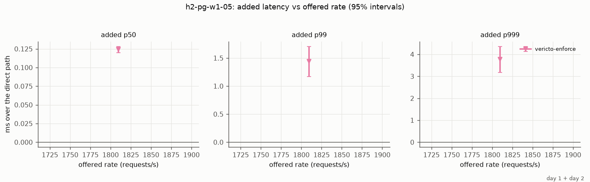
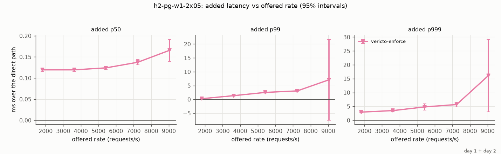
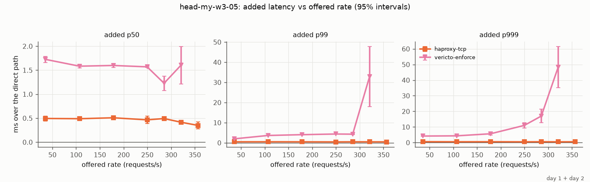
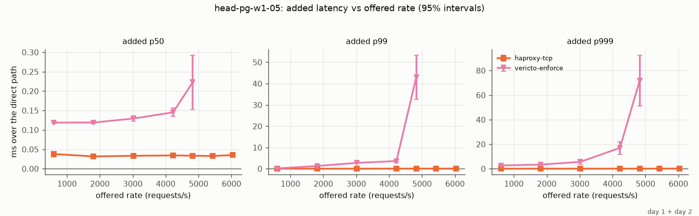
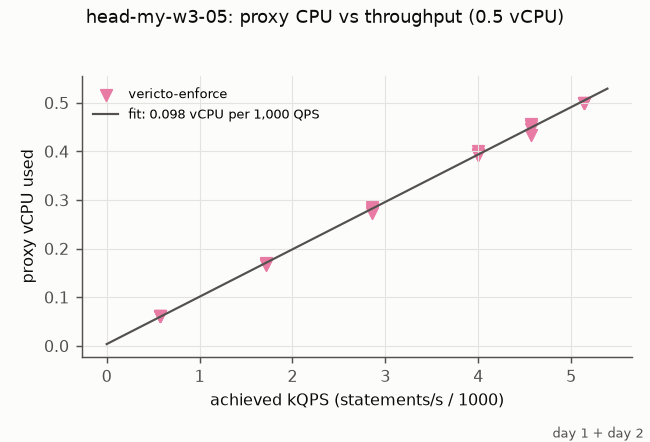
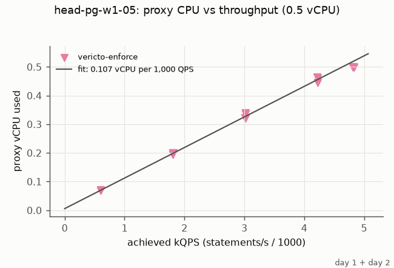
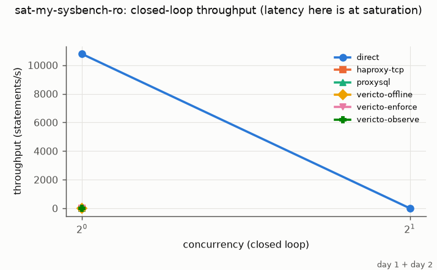
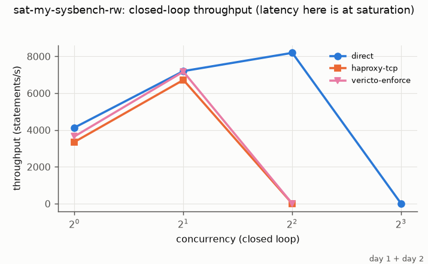
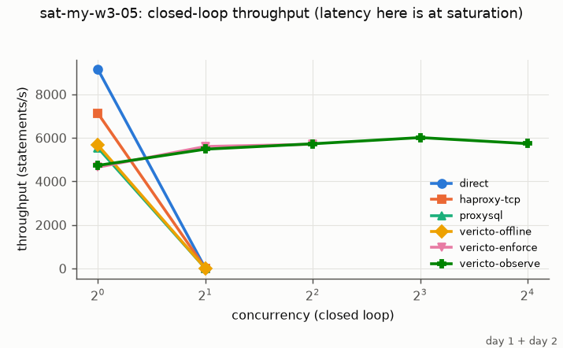
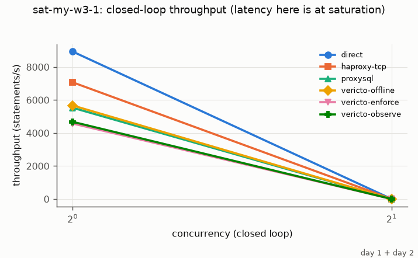
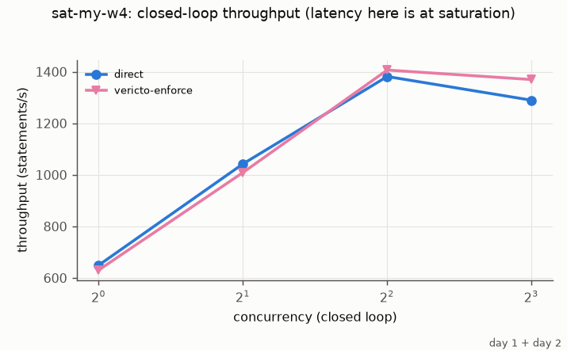
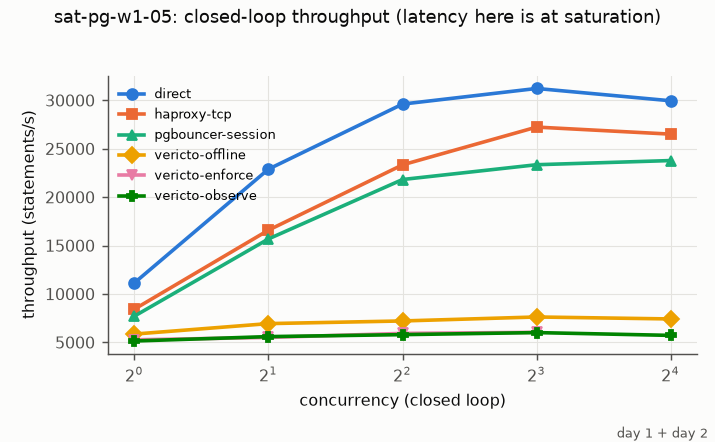
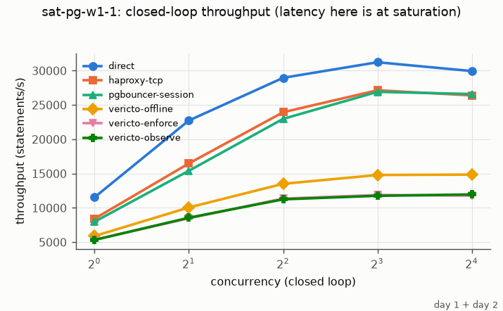
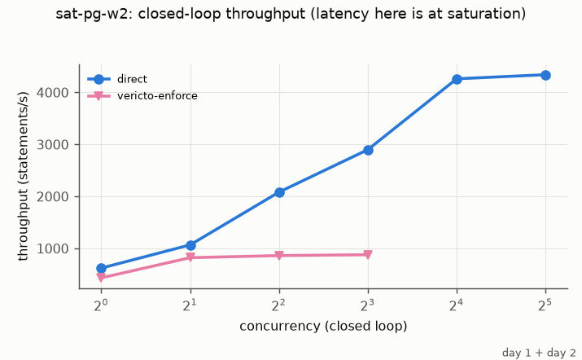
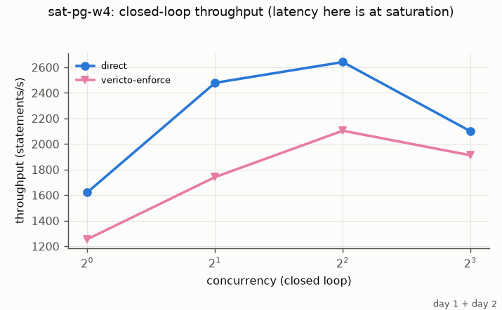
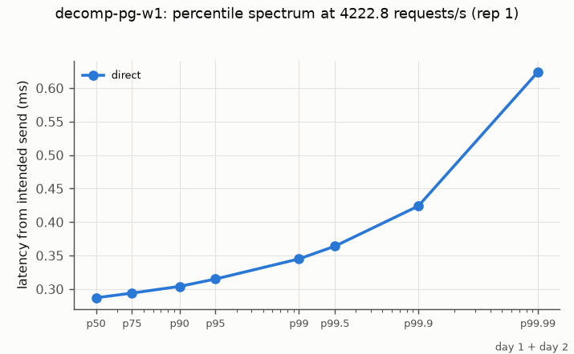
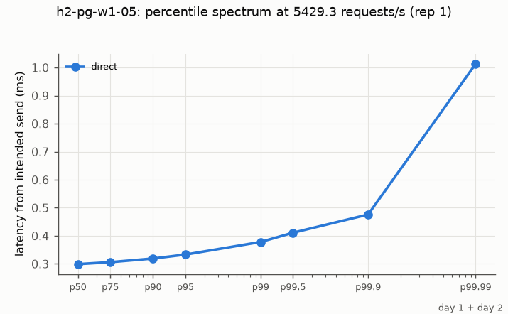
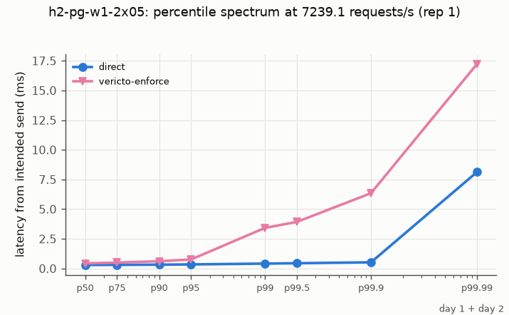
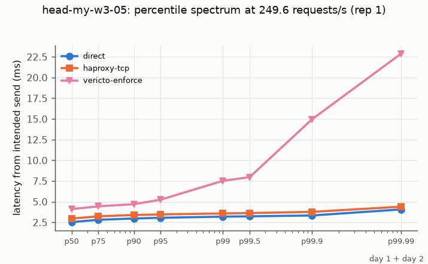
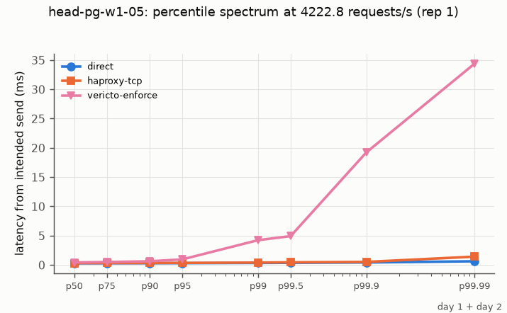
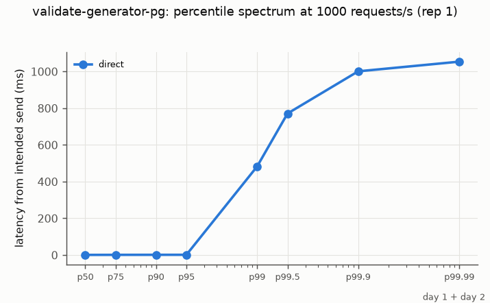
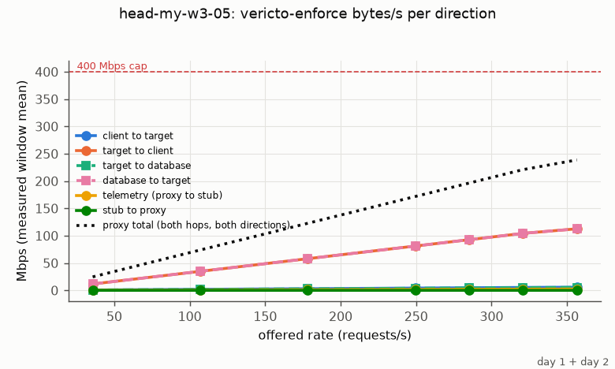
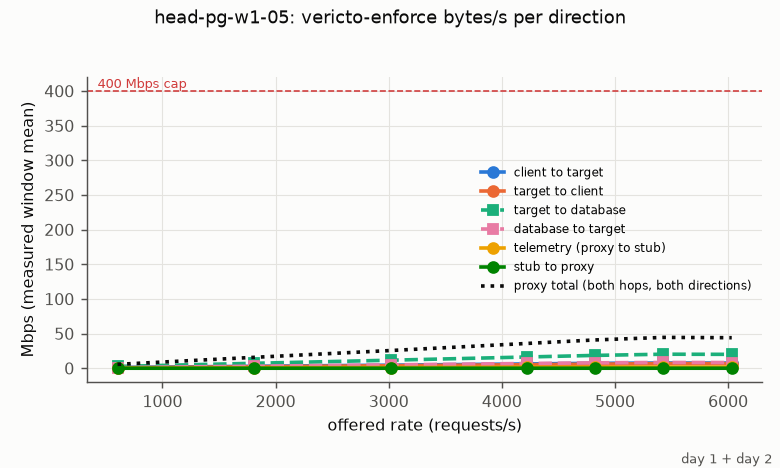
